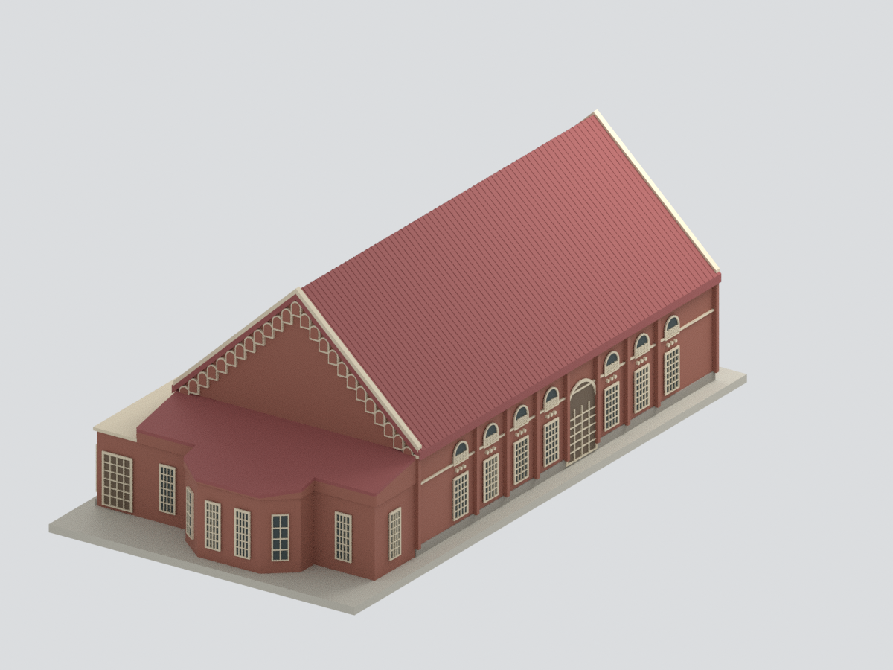
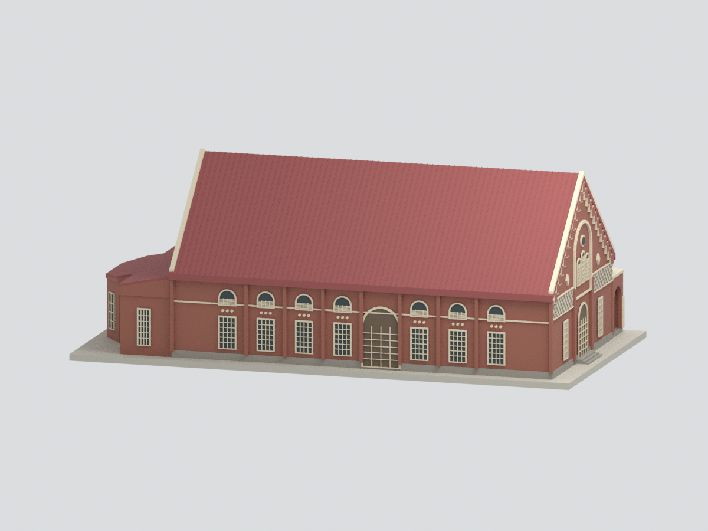
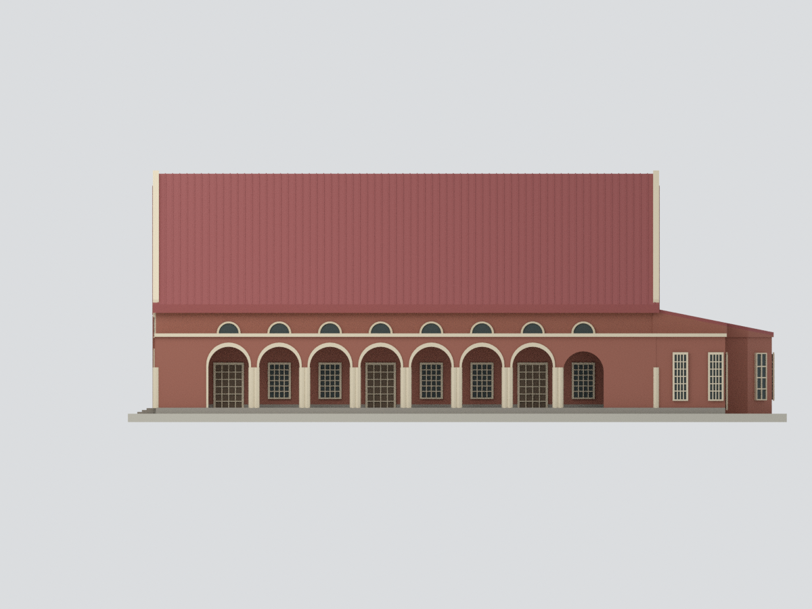
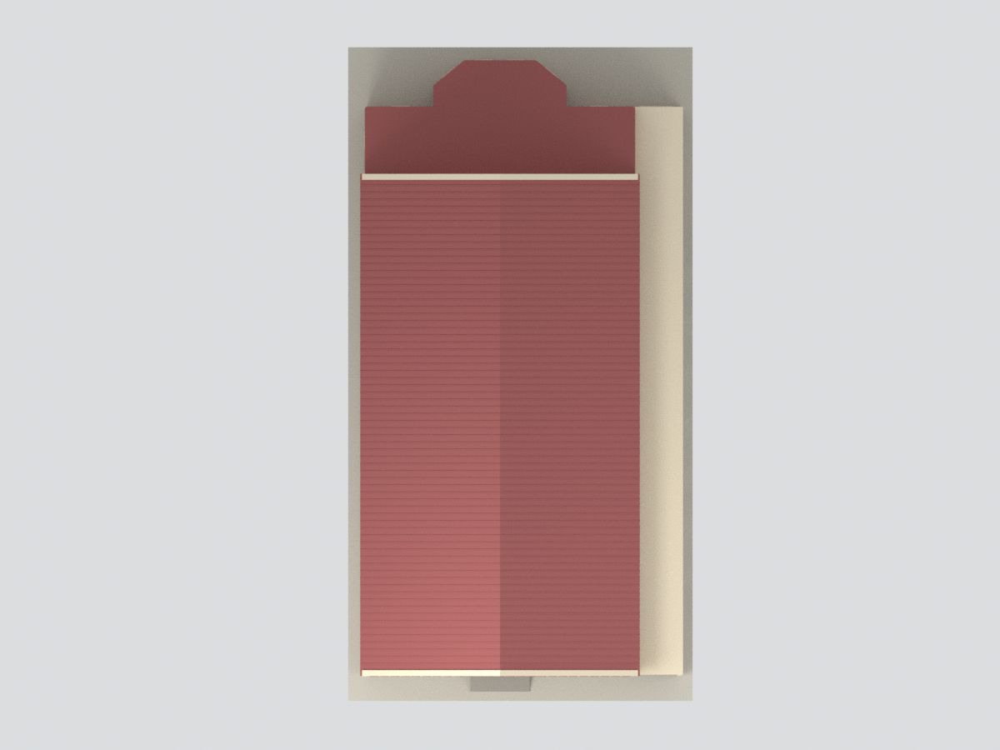
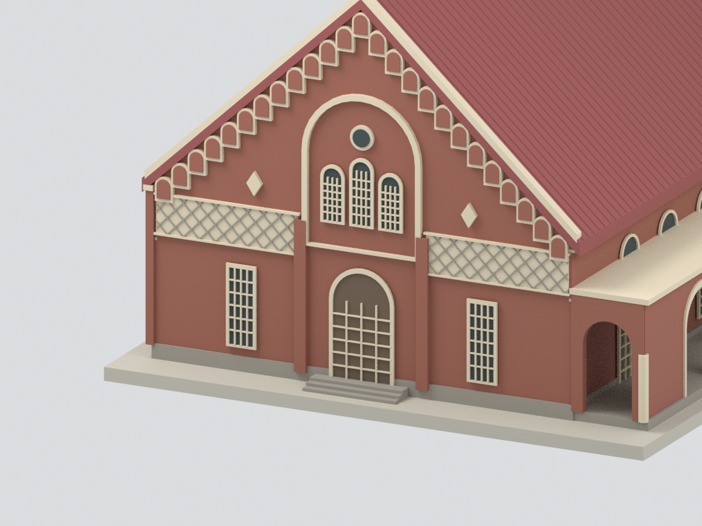

# 國立臺南第一高級中學小禮堂｜2003 調查報告外觀

**歷史外觀模型，不是今日修復現況。** 依 2003 年調查報告製作；其中四向立面沿用 2000 年圖，平面與剖面圖為 2003 年。水平方向以圖面比例估算，來源文字與圖面尺度存在矛盾，詳見下方。

## 下載
- [STL 單色實體](model.stl)
- [3MF 分面色彩實體](model.3mf)
- [Blender 可編輯檔](scene.blend)：成品合併網格及隱藏的製作構件。
- [參數](parameters.json)、[建模腳本](build_model.py)、[來源紀錄](provenance.json)

## 建物與範圍
今國立臺南第一高級中學小禮堂，歷史名稱為原臺南州立臺南第二中學校講堂，**不是今日臺南二中的講堂**。

涵蓋完整主堂、雙坡山牆、南側八拱廊，以及東側多邊形後台與兩準備室。西正面包含主入口、三扇高拱窗與圓窗、兩側面磚交錯斜貼的菱形裝飾帶（不是玻璃窗）；北側為分離的下矩形窗、上拱窗、窗間扶壁及偏置次入口。東面保留實牆山牆與低突出量體，沒有複製西正面。

南拱廊最東一拱較低且為磚拱，其他七拱使用淺色洗石子輪廓；柱形及倫巴底盲拱以簡化浮雕表現，盲拱不是實際穿孔。與其他校舍連接的校園走廊不屬本套小禮堂外殼，未延伸建製。

## 尺度、年代與不確定性
- 名義比例 **1:150**，不是精密測繪或施工模型。A3 西立面可讀垂直標注 420＋160＋700 cm，作為高度錨點。
- **來源內部矛盾保留：**正文 PDF 第 108 頁寫「全棟」約長 23 m、寬 14 m；完整平面／立面的比例則對應更長外框。不能擅稱 23 m 是觀眾席或不含舞台。
- 本模型採圖面比例估算：主高堂約 **26.8 × 14.4 m**，並按完整平面加入東後台與南廊。這些水平數值是建模估算，不是報告直接標注；不能用作工程尺寸。
- 附圖 A3-1 日期為 2000 年 1 月，A2/A4 為 2003 年 8 月；正文構件照片為 2003 年。表示「2003 報告記錄的歷史外觀」，不宣稱所有圖同日實測。
- 未標註的牆厚、突出深度、門窗與小飾件按圖描摹。門窗為不透明封閉浮雕；南拱廊保留真實外部空間，不重建主堂內部、舞台設備或屋架。
- A3 屋頂註記紅色金屬浪板，模型取近似紅色；原始掃描以黑白為主，其餘磚牆、洗石子、木門與屋面實際色相未經測色。浪板肋距、窗格與飾件不是逐一現地計數。
- 平坦底座為模型支撐，不是現地地坪。省略病害斑駁、文字、設備管線、植栽及臨時物；不把調查病害線畫成建物缺口。
- 通過網格／格式檢查不等於實體試印或耐久驗證；目前沒有試印紀錄。

## 多視角
| 西正立面 | 東後側與北面 |
|---|---|
|  |  |

| 北側立體 | 南側拱廊立面 |
|---|---|
|  |  |

| 屋頂 | 西入口細節（局部裁切） |
|---|---|
|  |  |

## 來源
[臺南市文化資產管理處公開調查報告 PDF](https://tmach.tainan.gov.tw/papers/warehouse/636E3BC9-68AA-4E70-AD6D-42A6FD5A15A3/B1f6a117249870778810.pdf)：《原臺南州立臺南第二中學校校舍本館暨講堂、原臺南廳長官邸調查研究及修復計畫》，2003 年 12 月出版。

使用 PDF 第 108–110 頁正文與照片、第 280–281 頁平面／屋頂（A2-01、A2-02）、第 283 頁四立面（A3-1）、第 284–285 頁剖面（A4-01、A4-02）。頁碼為 PDF 順序，不等於書內頁碼。

套件不附原始掃描或照片；預覽皆為本模型實際 Blender 渲染。公開可讀不等於原圖可任意再散布。

## 檢查與重建
`build_model.py` 以 numpy、trimesh、manifold3d 產生同一表面網格供 STL／3MF／Blender 使用；先量化至 STL float32 mm 精度再清理微小接縫，避免雙精度檢查通過卻輸出壞掉的 STL。`render_model.py` 以 Blender Cycles 渲染。

`QA.json`、`BLEND-QA.json`、`REBUILD-QA.json`、`RENDER-BINDING-QA.json`、`SOURCE-VISUAL-QA.json` 分別記錄幾何格式、場景、重建、渲染綁定及來源外觀審核；`SHA256SUMS` 提供雜湊。這些檢查不會消除來源年代與尺寸矛盾。
