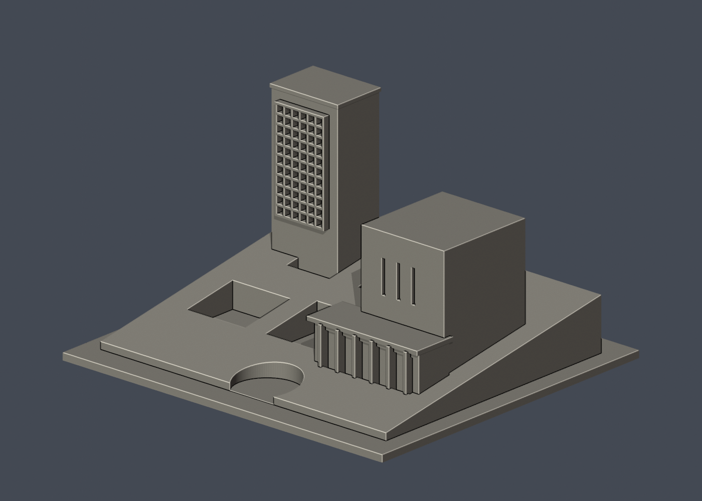
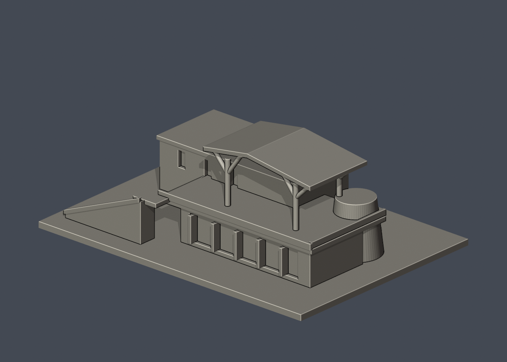
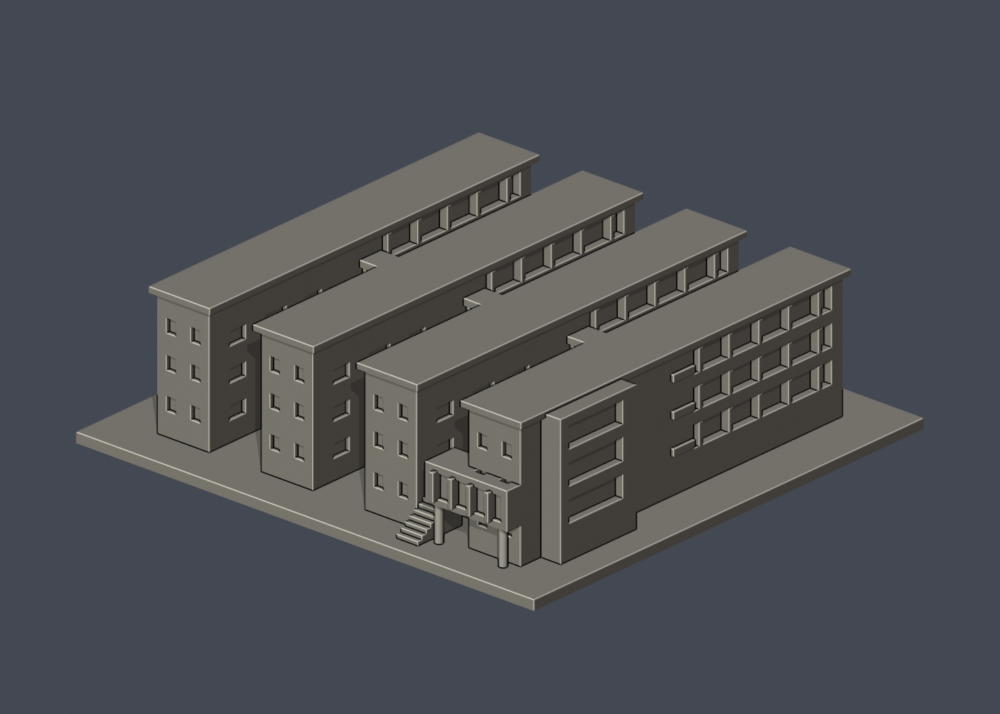
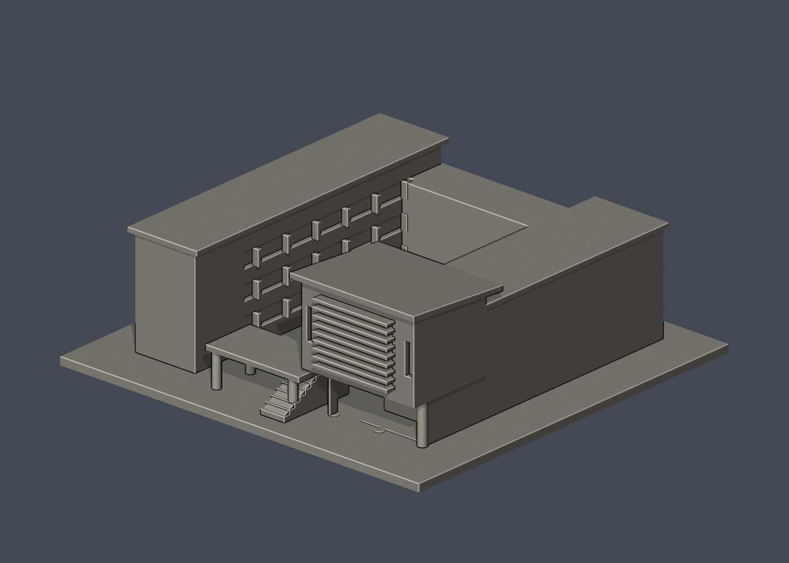
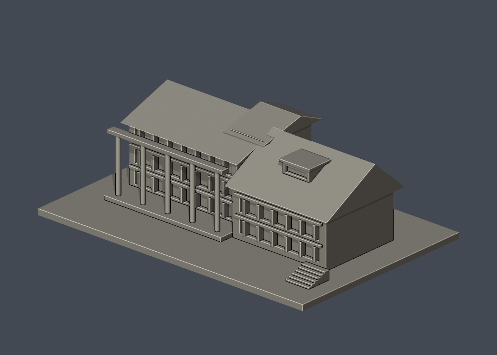
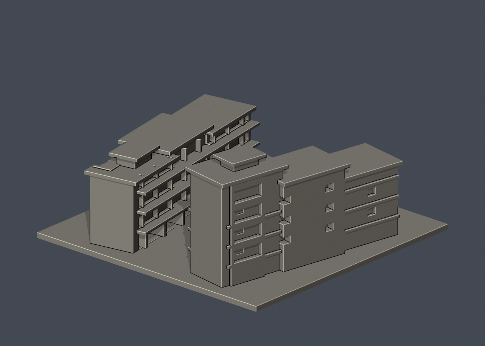
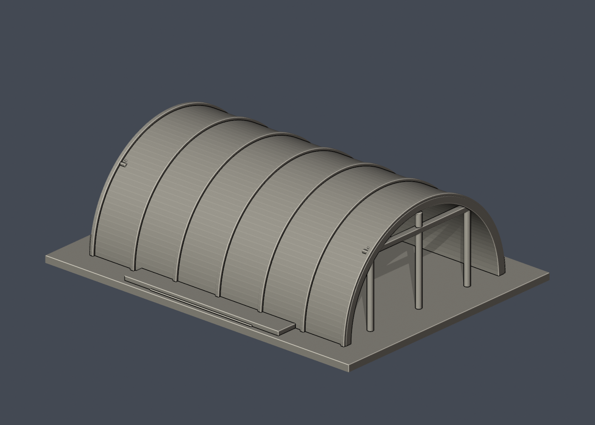
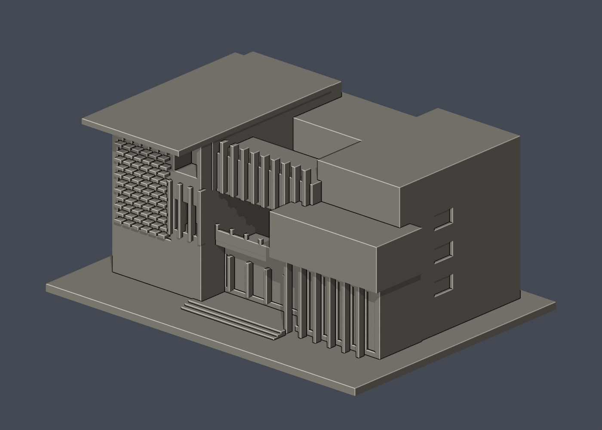
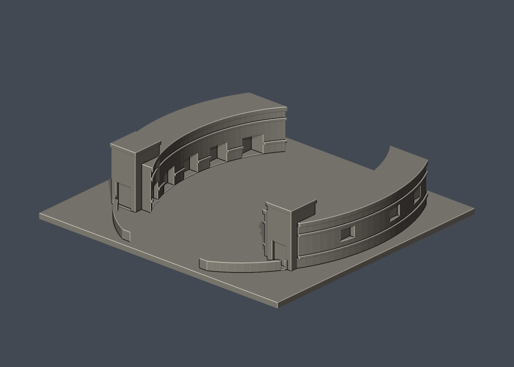

# 國立臺南藝術大學 3D外觀模型圖鑑

本輪核准的外觀近似模型套件；全校尚未完成。套件可能包含相連群組、局部或歷史外觀，件數不等於完整建築棟數。未正式切片、未生成經驗證G-code、未實體試印。各件警示、來源年代、背面簡化及支撐需求請讀詳頁。只公開來源URL，不散布原照片或PDF。

14件中音樂暨宿舍為相连群組、南北畫廊為雙館組群、職務宿舍僅可見局部屋帶；弧頂棚為歷史影像版。

本輪共14套，每件獨立縮放，並非統一比例校園拼圖。

| 建築模型 | 建築模型 | 建築模型 |
| :---: | :---: | :---: |
|  **[國立臺南藝術大學｜古物維護研究大樓](官田校區/buildings/tnnua-antiquities-conservation/README.zh-TW.md)** [資料夾](官田校區/buildings/tnnua-antiquities-conservation) |  **[國立臺南藝術大學｜圖書資訊大樓](官田校區/buildings/tnnua-library-information/README.zh-TW.md)** [資料夾](官田校區/buildings/tnnua-library-information) |  **[國立臺南藝術大學｜音像大樓](官田校區/buildings/tnnua-sound-image/README.zh-TW.md)** [資料夾](官田校區/buildings/tnnua-sound-image) |
|  **[生活機能館](官田校區/buildings/tnnua-campus-life-hall/README.zh-TW.md)** [資料夾](官田校區/buildings/tnnua-campus-life-hall) |  **[音樂系館A–D與第三、四宿舍相連樓群](官田校區/buildings/tnnua-music-complex/README.zh-TW.md)** [資料夾](官田校區/buildings/tnnua-music-complex) |  **[國樂系館](官田校區/buildings/tnnua-chinese-music/README.zh-TW.md)** [資料夾](官田校區/buildings/tnnua-chinese-music) |
|  **[漢寶德紀念館](官田校區/buildings/tnnua-han-pao-teh-museum/README.zh-TW.md)** [資料夾](官田校區/buildings/tnnua-han-pao-teh-museum) |  **[南湖餐廳](官田校區/buildings/tnnua-south-lake-restaurant/README.zh-TW.md)** [資料夾](官田校區/buildings/tnnua-south-lake-restaurant) |  **[建築藝術研究所（加藤教學大樓）](官田校區/buildings/tnnua-architecture-institute/README.zh-TW.md)** [資料夾](官田校區/buildings/tnnua-architecture-institute) |
|  **[第五學生宿舍（北校區宿舍群）](官田校區/buildings/tnnua-fifth-student-dormitory/README.zh-TW.md)** [資料夾](官田校區/buildings/tnnua-fifth-student-dormitory) |  **[建築繁殖場弧頂工作棚（校方影像版本）](官田校區/buildings/tnnua-interbreeding-arched-shed/README.zh-TW.md)** [資料夾](官田校區/buildings/tnnua-interbreeding-arched-shed) |  **[藝術史與文化資產學系館](官田校區/buildings/tnnua-art-history-cultural-heritage/README.zh-TW.md)** [資料夾](官田校區/buildings/tnnua-art-history-cultural-heritage) |
|  **[職務宿舍沿溪屋帶局部簡化模型](官田校區/buildings/tnnua-faculty-housing-visible-row/README.zh-TW.md)** [資料夾](官田校區/buildings/tnnua-faculty-housing-visible-row) |  **[南北畫廊（曲率修正版）](官田校區/buildings/tnnua-north-south-galleries-curved/README.zh-TW.md)** [資料夾](官田校區/buildings/tnnua-north-south-galleries-curved) |  |

## 覆蓋與缺口
- [campus-audit](audits/campus-audit)

漢寶德紀念館已更新[立面配置修訂 v2](官田校區/buildings/tnnua-han-pao-teh-museum/facade-layout-v2/README.md)：外梯及門洞轉至左側並修正升向，雙陽臺及門洞移到右鄰面，七材質及四圖同步。新 STL 重新檢測仍有 11 層薄特徵警示；原 QA 保留，未 FFF／實印驗證。仍為原 14 包，不增加校數或包數。
