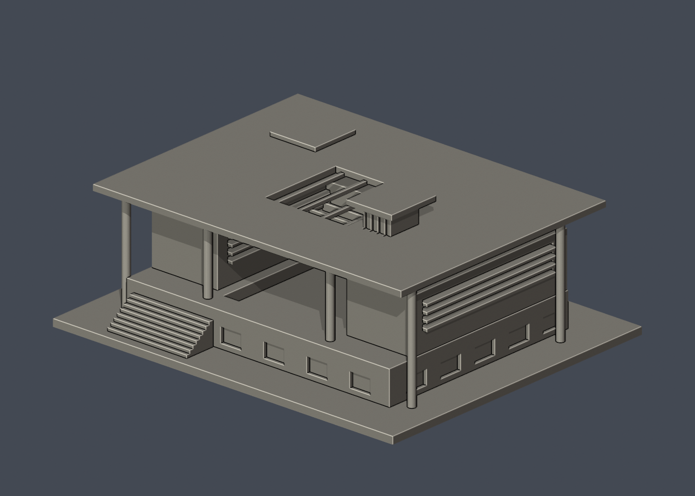
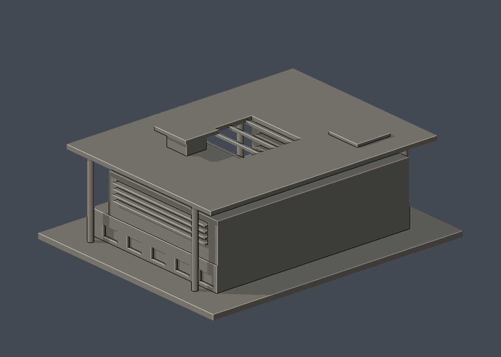

# 國立臺南藝術大學｜建築藝術研究所（加藤教學大樓）

公開外觀影像推估的獨立縮尺建築模型，含底座最長150 mm。不是測繪、竣工圖或同比例全校模型；無可信實際尺寸，故不標示1:N。

## 辨識量體與證據
雙翼與低前臺座、通高柱撐大屋頂、中央採光開口、上層百葉、空橋、階梯和屋頂矩形凸量體。校方編號4、加藤義夫作品書摘全景與外廊、校方建築繁殖場專文內同一外觀照片互相核對。攝影師將此放在繁殖場主題中，本文以校方導覽與建築師書摘確認教學大樓，與半弧形工作棚分開。

## 交付
- model.stl：毫米單件列印網格
- scene.blend：可編輯的實際STL網格、攝影機與材質
- build_model.py：可攜獨立Python建模程式，旁邊requirements.txt列出已用依賴
- previews/front.png、rear.png、elevation.png：實際STL渲染
- sources.json：公開來源與查閱日期
- validation.json：原檔法線、水密、邊及頂點流形、單表面、體積、尺寸、獨立重建hash及Blender一致性
- layer-check.json：每0.2 mm截面封閉與0.8 mm XY薄特徵幾何篩查

## 使用與限制
執行 python build_model.py；再以 blender -b -t 2 -P render_preview.py 產生場景與預覽。python validate_model.py --output validation.json 重驗；python check_layers.py 做幾何篩查。程式不依賴本機其他工作目錄或參考照片。

底座平面朝下；可先以0.4 mm噴嘴、0.2 mm層高在真正切片軟體檢查。懸挑、窗簷、柱廊、入口頂部與裝飾可能需要支撐，不能保證免支撐。最小肋板約1 mm，細節經加厚；仍應依自己的材料及切片參數檢查。薄特徵篩查只檢測水平切面的局部0.8 mm XY開運算損失，不是完整三維壁厚或真正切片器驗證。

未使用第三方原3D資產，不含室內、設備或安全細節。原始照片未收入此公開套件。未知屋頂與背面只作明示近似，不能作工程或安全用途。尚未實機試印，亦未執行正式切片器/G-code驗證。

## 本件實際檢查摘要
原STL與Blender幾何一致，獨立重建hash相同；原網格驗證全部通過。0.2mm截面共297層均封閉；0.8mm XY薄特徵篩查有28層警示（最高局部面積损失0.4 mm²）。細薄警示可能是裝飾尖端、斜板相交或凹口邊緣，不能當作試印成功。

## 本件支撐特別警示
大型頂棚底面、空橋與採光口梁需在真正切片器設定支撐並檢查拆除路徑；約3.2mm直徑細柱在150mm模型中可能折斷，建議低速列印並避免側向受力。本模型未做G-code或實際試印。

## 實際STL正背並排

| 模型預覽 | 模型預覽 | 模型預覽 |
| :---: | :---: | :---: |
| 正面  | 背面（未見部分按詳頁明示簡化）  |  |
