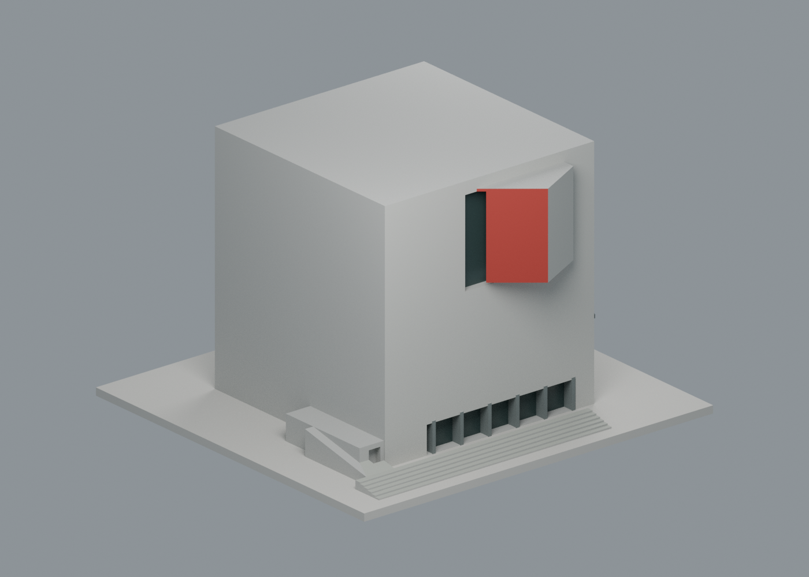
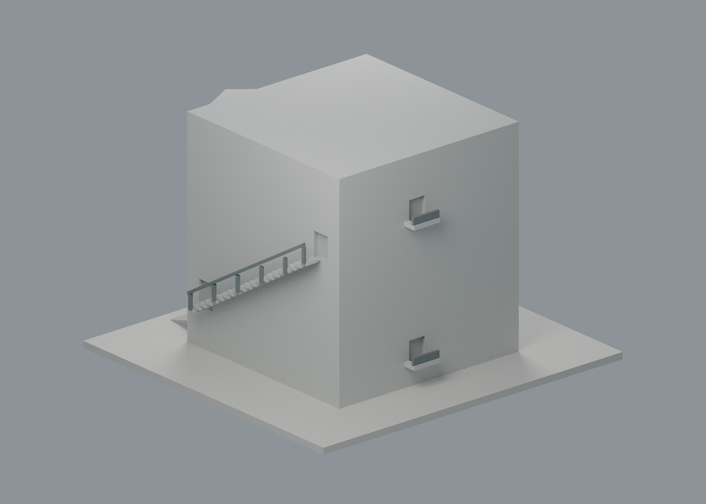
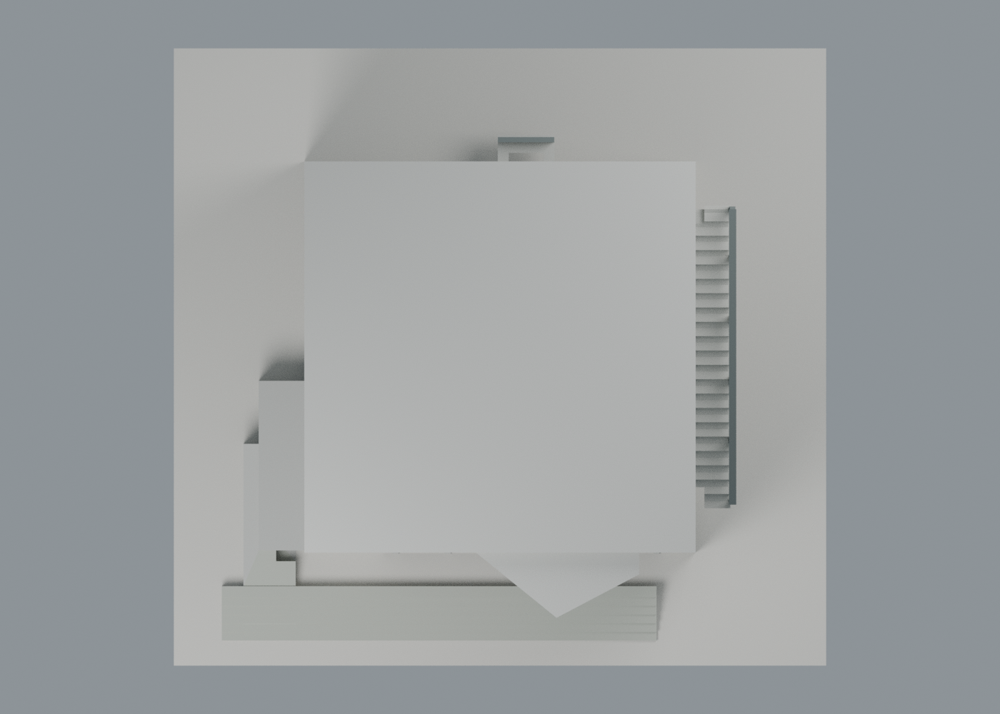
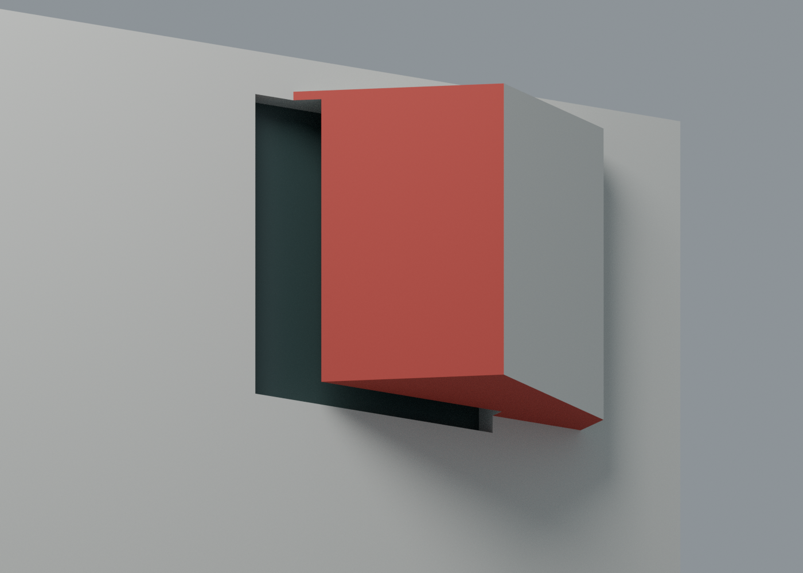

# 漢寶德紀念館：七材質外觀交換版

將原本整體暖米色的模型，依實照可辨表面補上混凝土灰、外伸盒紅側／紅底、深色玻璃及金屬框欄。**756 頂點、1532 三角面全部沿用原 STL，幾何與面序不變；七個可編輯材質身份，不限制四色。** 南藝仍為既有 14 包，本件不增加包數或校數。

| 正面，外伸盒可見紅側與玻璃 | 懸梯側與反側小陽臺，未確認面中性 |
|---|---|
|  |  |

| 原簡化平屋頂，未補採光縫 | 外伸盒局部，紅色只在對應側面及底面 |
|---|---|
|  |  |

## 下載與編輯

- [通用表面色 3MF](han-appearance.3mf)：單一原網格、毫米單位，原 STL float32 座標和三角面順序逐面一致。
- [可編輯 Blender scene](scene.blend)、[七材質調色表](palette.json)、[逐面材質與角色](face-materials.json)。
- [原 STL](../model.stl) SHA256：e4f25a2d8c02e58a57a263ee7ac93289e8818c456be86c251a1a26f9e0337e8e。

這是表面材質交換，沒有將色區分割為封閉實體、沒有噴頭映射、機器設定或 G-code。不同軟體未必能將顯示色直接轉為多材料列印；GUI 匯入未驗證。玻璃採不透明深灰綠代理，不表示測得色值或真實透射率。

## 來源與可支持配色

[建築師官網](https://krisyaoartech.com/zh-cn/projects/cultural/han-pao-teh-memorial-museum)與[建築師供稿專案文](https://www.gooood.cn/han-pao-teh-memorial-museum-by-kris-yao-artech.htm)支持建築身份及清水混凝土外牆；專案文發布於 2023-06-21，記完工 2022-11，均不能當成每張照片的拍攝日期或 2026 年現況證明。[校方四頁平剖面 PDF](https://hptmm.tnnua.edu.tw/var/file/74/1074/img/100203200.pdf)用於區分外伸盒、牆面懸梯、跨池入口梯與室內懸浮展廳，不由此增加本次幾何。

- 既存實照 0／2／3／4：主正面、懸梯側、反側小陽臺及底層退縮玻璃；可見混凝土近似灰、玻璃偏暗。不同日照、反射和白平衡不被當作不同塗料。
- 實照 5／6：外伸盒斜側與外露底面明確紅色，大外面仍是混凝土。紅色只賦予原網格對應斜面及底面；不把整個凸盒塗紅，不套用室內紅盒的範圍。
- 窗框與牆面外梯／小陽臺欄杆採保守灰金屬近似，沿用原加厚細節；沒有新細桿、模板縫或螺栓貼圖。
- 未確認側面、屋頂飾面與其他未辨識面保留中性。底座是展示色，不代表廣場、草地或池水。

本次實看 13 張完整實景照（0、2–13）、1 張模型照（14）、3 張圖面（16–18）及校方四頁圖。1／15／19 僅有聯絡表縮圖，未宣稱看過其完整單張。室內照只用來辨別範圍，未作外牆配色或新增室內的依據。原照片／PDF 不隨包公開，公開連結、雜湊、逐項用途與署名見[來源覆核](qa/source-appearance-review.json)。主要外觀照為 Shephotoerd Co.；凸盒側面近照為 Jeffrey Cheng；其餘來源依原頁逐張署名。

## 必須保留的幾何邊界

- 航拍與圖面可見屋面女兒牆／採光狹縫；**原模型屋面為實心平面，本次仍保留此簡化，沒有用深色線偽裝成已建孔縫。** 頂視圖展示原簡化屋面，不是完整現況屋頂。
- 原模型刻意不建室內懸浮展廳與內部動線，並非本次待補缺陷。外伸盒也是原簡化實體，沒有轉成可透視室內模型。
- 未新增水池、跨池入口梯、景觀或鄰棟。外牆懸梯與兩個小陽臺保留原有加厚、斜樑／實心欄板等列印簡化。
- 原尺寸仍是照片推估的獨立縮尺，含底座 150 × 142 × 98 mm；未利用配色改成工程尺度或精確 1:N。

## 製造限制與檢查

[原模型說明](../README.zh-TW.md)、[原網格驗證](../validation.json)、[原截層篩查](../layer-check.json)保留。原 490 個 0.2 mm 截層及 **11 層薄特徵警示（最大局部面積損失 2.7367 mm²）** 不被本次外觀 QA 消除或重判。斜盒、懸梯、欄杆、玻璃框與懸挑仍可能需支撐；未進行新的 FFF 切片、支撐拆除或實體試印。

[交換驗證](qa/exchange-validation.json)、[scene 重開驗證](qa/scene-validation.json)、[四圖紀錄](qa/render-manifest.json)。lib3mf 2.5.0 嚴格讀取零警告；單一材質改色往返保留其餘色與指派。SDK 六位小數測試寫出最大量化差 0.00000190735 mm、零退化面，測試改色檔不交付；交付檔座標與原 STL 完全一致。

標準 Python 執行 source/build_appearance.py，由原 STL 與 palette.json 重建 3MF／逐面清單；Blender 4.3.2 執行 source/render_appearance.py 生成四圖／scene，再執行 source/verify_scene.py。source/verify_exchange.py 使用 numpy/lib3mf 檢查座標、材質編輯與兩個輸出逐位元重建一致。沒有重跑原 CSG 或歷史製造證據。
