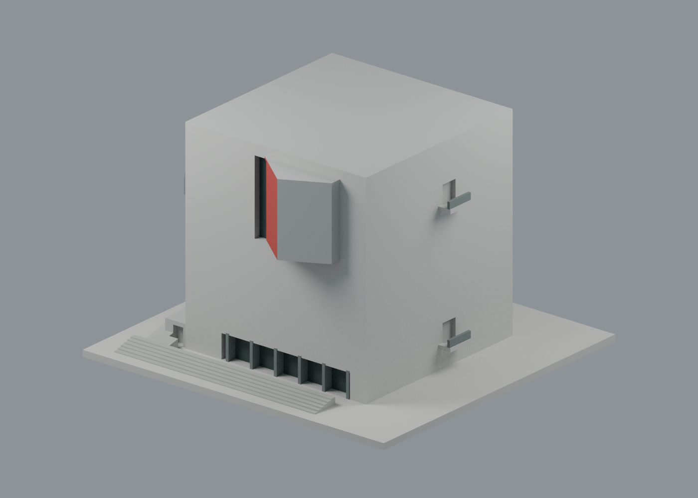
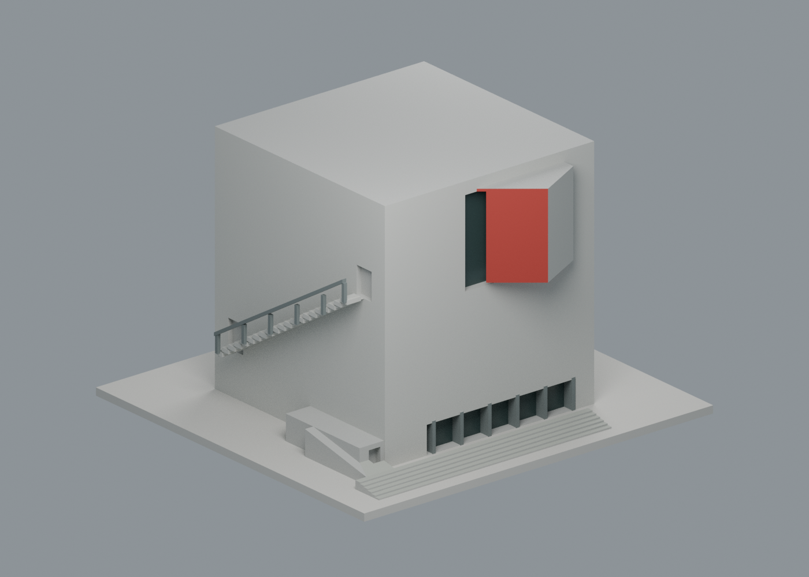
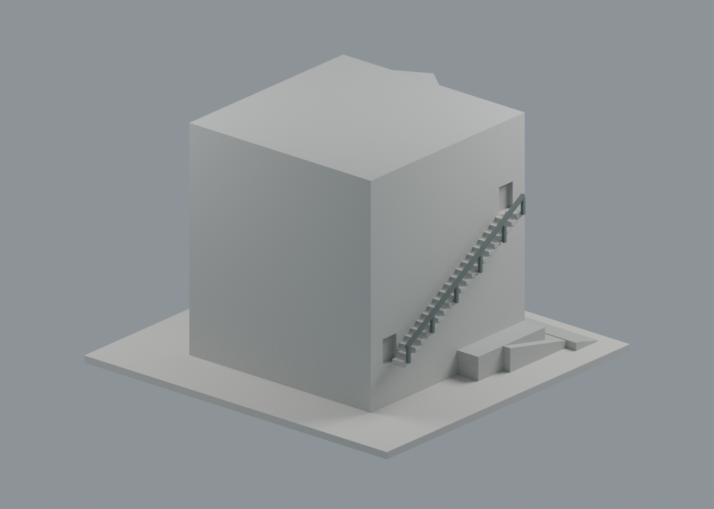
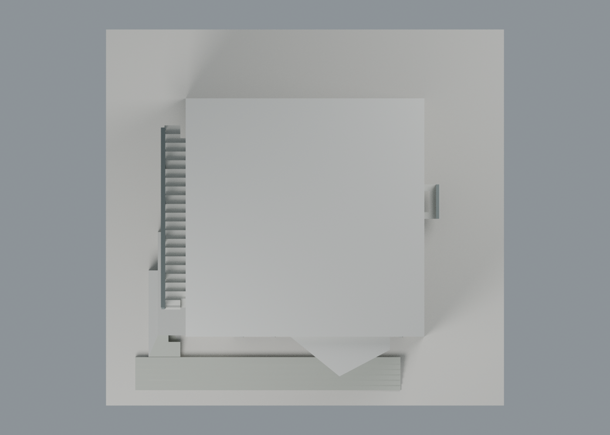

# 漢寶德紀念館：立面配置修訂 v2

這次修正實際 STL 的外梯／雙陽臺相對立面與外梯升向，並重建七材質 3MF、scene 和四圖。**這是原模型的幾何修訂，不新增校數或包數；屋面仍保留明示簡化。**

## 最新下載

- [修訂 STL](model-v2.stl)、[七材質通用 3MF](model.3mf)、[可編輯 Blender 場景](scene.blend)
- [建模源碼](source/build_model.py)、[調色表](palette.json)、[逐面材質](face-materials.json)、[SHA256](SHA256SUMS)
- 含底座仍為 **150 × 142 × 98 mm**，752 頂點、1524 三角面，單件封閉網格。不是測繪模型，未宣稱精確 1:N。

| 模型預覽 | 模型預覽 | 模型預覽 |
| :---: | :---: | :---: |
| y− 正面凸盒與 x+ 右側雙陽臺  | x− 外梯側，向 y− 正面上升  |  |

| 模型預覽 | 模型預覽 | 模型預覽 |
| :---: | :---: | :---: |
| y+ 後面保持中性簡化  | 俯視：x− 左、x+ 右、y− 下  |  |

## 來源如何對應座標

**x／y 是模型座標，不是地理東西南北。** 以外伸盒所在立面定為正面 y−；從正面面向模型時，x− 在左、x+ 在右。俯視圖 x+ 向右、y+ 向上，外伸盒在圖下方。

[校方 3／4F 平面與剖面](https://hptmm.tnnua.edu.tw/var/file/74/1074/img/100203200.pdf)、[建築師供稿專案實照](https://www.gooood.cn/han-pao-teh-memorial-museum-by-kris-yao-artech.htm)交叉核對；[建築師官網](https://krisyaoartech.com/zh-cn/projects/cultural/han-pao-teh-memorial-museum)供身份對照。照片與圖面原檔不隨包公開，來源連結／雜湊／用途見[來源定位紀錄](qa/source-layout-review.json)。

| 特徵與證據 | 舊網格問題 | 修訂實網格 |
|---|---|---|
| 航拍 0、正面照 2、官方 3／4F：外伸盒在正面 | 正面基準已可用 | 保持 y=-45 及原盒幾何 |
| 航拍 0、陽臺照 4、官方平面：兩陽臺在正面右鄰面 | 原放 y=+45，與凸盒相反 | 兩塊平台、欄板和兩個門洞一起移到 x=+45 |
| 外梯照 3、官方平面：外梯在左側，往正面上升 | 原放 x=+45，且升向反了 | 外梯、21 個加厚踏階、斜樑、欄杆／柱和兩端門洞整組繞 z 軸轉 180°，到 x=-45 |

新外梯低門洞模型基準 (-45,+34,20)，高門洞 (-45,-34,61) mm；因此由 y+ 後方往 y− 正面上升。雙陽臺平台基準 (47,6,12) 與 (47,6,70) mm。這些**高度、跨度、+6 mm 沿牆偏移與細部尺寸沿用舊估計**，本次證據支持面別、相鄰關係及升向，不能宣稱所有比例都已校準。舊位置的踏階／陽臺和門洞都已移除／補平，不留下重複零件或洞口。

## 明確保留的範圍

- 外伸盒、正面玻璃／框、入口平台、底座與整體尺寸不改；七材質近似灰混凝土、外伸盒紅斜側／紅底、深玻璃及框欄，沒有四色限制。
- 屋面依舊是原實心平頂。航拍可見的抬高邊界／狹帶尚不足完整定位，本次不加通用女兒牆或偽造狹縫；頂視不代表完整實況屋頂。
- 後面 y+ 缺直接外觀約束，保持無新細節的中性面；不新增室內懸浮展廳、水池、景觀、排水或設備。
- 原加厚踏階、扶手和實心陽臺欄板仍是製造簡化。照片拍攝年未知，來源發布／完工年不能當作拍攝日期或當年現況保證。

## 新版獨立檢查

[網格／重建驗證](qa/geometry-validation.json)：交付 STL 法線、零退化面、水密、每邊兩面、頂點連結單環、單一表面、正體積、毫米尺寸、底座 z=0、獨立重建 hash 與 Blender 幾何一致。

[立面差分驗證](qa/layout-validation.json)：直接拿舊／新 STL 做布林比較，驗證整組梯與門洞的 180° 變換、兩陽臺及門洞的鄰面映射、原位置恢復平面。宣告變動區之外差集體積為 0；凸盒、屋面與底座均不變。這不是只移動渲染物件。

[新版截層檢查](qa/layer-check.json)從新 STL 重新跑 **490 個 0.2 mm 幾何截面，皆封閉；0.8 mm XY 薄特徵篩查仍有 11 層警示，最大局部損失 2.7367 mm²**。這是本版重新計算的結果，沒有把歷史 11 層當成本版驗證。此篩查不是完整 3D 壁厚保證，懸挑、梯、欄杆與開口仍須實際切片檢查支撐。

[3MF 交換驗證](qa/exchange-validation.json)、[scene 重開](qa/scene-validation.json)、[四圖紀錄](qa/render-manifest.json)：3MF 與新 STL float32 座標／面序逐面一致，lib3mf 嚴格零警告，單材質改色往返保留其他色及指派。SDK 測試改寫最大座標量化差 0.00000190735 mm、零退化面，測試檔不交付。

**未進行正式 FFF 切片、支撐拆除或實體試印。** 3MF 是表面材質，未切成封閉色體、沒有噴頭／機器映射、G-code 或 GUI 匯入驗證。深色玻璃為不透明代理，非測得材質或透射率。

## 重建與歷史版本

先以已具 numpy／trimesh／manifold3d 的 Python 執行 source/build_model.py；再以標準 Python 執行 source/build_appearance.py。Blender 4.3.2 執行 source/render_appearance.py，再執行 source/verify_scene.py；source/verify_exchange.py 使用 numpy／lib3mf。source/validate_geometry.py 會在暫存目錄獨立重建並比對 scene；source/verify_layout.py 與保留的 ../model.stl 作幾何差分；source/check_layers.py 使用 numpy／trimesh／shapely／scipy 重算截層。全部使用相對路徑，不需原照片。

保留的 [原 STL](../model.stl)、[原建模源碼](../build_model.py)、[原網格 QA](../validation.json)、[原截層 QA](../layer-check.json)、[原 scene](../scene.blend)及[七材質舊幾何版](../appearance/README.md)供歷史比較，**不應把舊 geometry 當成這次已修訂版本**。基準 commit 為 794cf7db91f422e88ac9eec6c5bb06f4e2a7c79c，[基準清單](baseline-manifest.json)保存各檔雜湊。原製造證據沒有被覆寫。
