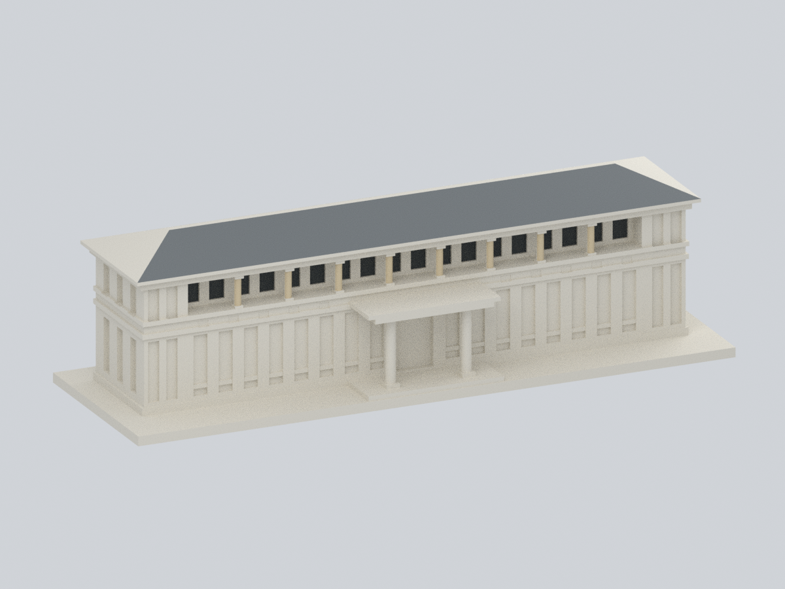

# 臺南校區｜國立臺南護理專科學校

本批 1 棟；尚未宣稱校區建物全數完成。信心樓範圍為完整雙層長條主體、四坡屋面與中央凸出門廊，排除文心樓及兩池院。

| 建築模型 | 建築模型 | 建築模型 |
| :---: | :---: | :---: |
|  **[信心樓｜2014–2015整修後外觀近似](buildings/ntin-xinxin-building/README.md)** |  |  |

[學校入口](../README.md)。後側無同期完整近照，採素面簡化；模型不是最新測繪資料。原幾何、舊預覽與既有QA保留；完整多視角見模型頁。

[局部材質外觀與可編修檔](buildings/ntin-xinxin-building/appearance/README.md)：僅198個原三角面加入來源支持的代表色，其餘2,916面維持中性；不加幾何、不推定未見材料，也不是2026現況。原薄件、支撐與64筆角損警示不因配色取消，尚未實體試印。
