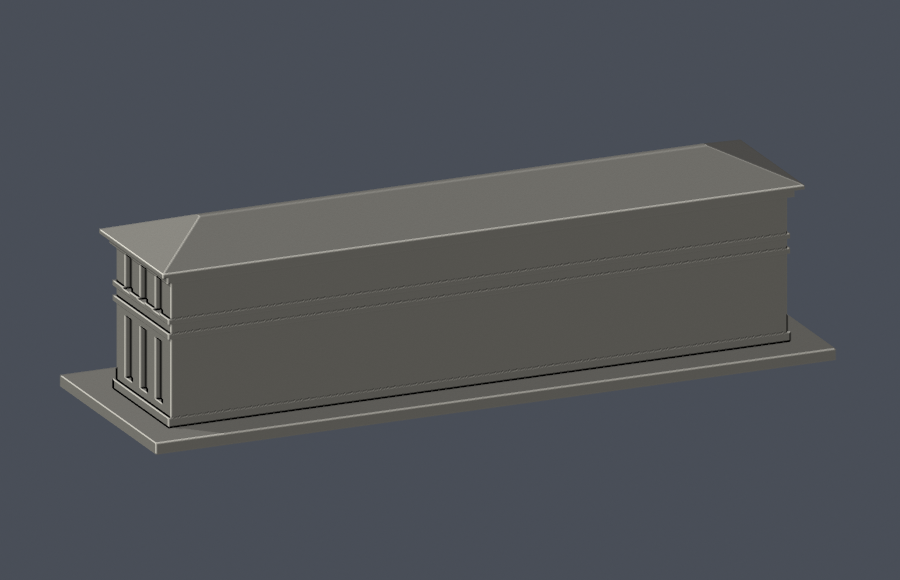

# 信心樓｜2014–2015 整修後外觀近似

國立臺南護理專科學校，臺南校區。這是依官方公開照片、校園底圖自行建立的完整主體辨識性模型，並非測繪、施工 BIM，亦不代表 2026 年實測現況。尺寸均為影像比例估計。

| 建物 | 實際 STL 正面 | 實際 STL 背面 |
|---|---|---|
| 信心樓 |  |  |

[正立面](previews/elevation.png) · [短側](previews/side.png) · [頂視](previews/top.png)

## 下載與重建

- [列印 STL](model.stl)，毫米，含底座 150 × 48 × 41.700001 mm
- [可編修 Blender 網格](scene.blend)，由同一實際 STL 匯入，沒有額外裝飾模型
- [原創參數腳本](build_model.py)、[模型參數](model-parameters.json)、[Python 依賴](requirements.txt)
- [公開來源清冊](sources.json)、[原網格與射線 QA](validation.json)、[保存 Blend 與五張 PNG 一致性](asset-consistency-check.json)
- [0.2 mm 逐層逐構件檢查](layer-component-check.json)、[canonical v3 薄特徵篩檢](thin-feature-check.json)、[QA 總表](qa-summary.json)、[逐檔 SHA256](SHA256SUMS)

Python 3.12 安裝 requirements.txt 後執行 build_model.py；用 Blender 執行 render_preview.py，再以 Python 執行 strip_preview_metadata.py。驗證依次執行 validate_model.py、check_thin_features.py、check_layer_components.py、check_assets.py、check_package.py。所有腳本失敗均以非零碼退出；不使用網格修補或 invalid Polygon 修補來掩蓋問題。正式凍結版請複製到新目錄重建，勿覆寫凍結檔。

## 建物範圍與證據

保留兩層完整長條主體、完整四坡瓦屋頂的輪廓與內縮長屋脊、上層退縮廊道、9 個主要廊跨／8 支中間主柱、前方中央雙柱平頂凸出門廊與緊鄰台階。主體範圍依 S1 校園無障礙配置圖核對；不包括後方獨立文心樓、兩棟之間的兩池院、外接校園走道、銅像、喬木與廣場。

S2 為 2015 官方建築檔案展所收錄的整修後完整正面；S3 高角度實景可核對端部斜坡與內縮屋脊，支持四坡屋型。快門日期不明，因此僅標 2014–2015 外觀版，沒有把網頁更新日當攝影日期。S4 的 1954 年使用許可證及校史支持原始二層量體。S5 的 1950 年代照片只補充歷史量體／門廊及短邊關係，不能充當 2014 年窗格精確記錄。

## 重要簡化與不確定性

- 缺少帶尺寸竣工圖，長寬高、屋坡及門窗比例不是實测尺寸。
- 沒有同期完整後立面近照，後側刻意採素面與樓層橫帶；不能把它解讀成真實背面沒有窗。短邊窗凹槽是保守抽象，非 2014 窗位測繪。
- 瓦片、雨水管、字牌、細窗格、欄杆鏤空與機電省略或以有背襯凹槽表達。屋脊保留 1.6 mm 寬平頂，避免刀刃尖端；不另加未見高塔、翼樓或假內院。
- 正面高樓背景屬其他建物，不併入本件。本校目前僅本棟已製作，不能稱全校完成。

## 真實開口與薄件警示

射線直接量測交付 STL：上廊由前立面基準至背牆淨深 5.0 mm，欄杆上緣至頂下淨高約 7.900002 mm。中央門廊前簷至入口凹壁深 12.6 mm（至主牆面基準 11.2 mm），頂下淨高約 16.949999 mm，柱間淨寬 16.5 mm。上廊及門廊均為實際退空，沒有封平為貼圖。

上廊主柱直徑 1.8 mm，門廊柱直徑 2.5 mm；柱腳與柱頭實際與欄杆／基座、頂梁相連。門廊簷板主體厚 2.2 mm，主屋簷平板厚 0.85 mm且上接屋坡；其薄邊與挑出部位仍需實際切片審視。前窗低橫檔高 1.0 mm、與後壁搭接，不是浮空細件。屋脊頂寬 1.6 mm。這些尺寸不是全面最小壁厚保證。

底座朝下。門廊頂下、上廊頂下與屋簷可能需要支撐；支撐不是用來豁免不合格的幾何薄件。數位 QA 不是 Cura／PrusaSlicer 工具路徑或實體試印，不承諾免支撐或保證可印。

## QA 與版本

原始 STL 為單一連通封閉表面、每邊恰有兩面、每頂點 link 單一環、原始法向與面繞序相符、正體積；未作 repair。獨立程序重建 STL 的 SHA256 相同。保存 Blend 重新載入後有向三角面與 STL 完全相同，五視圖重新渲染後逐像素及 PNG SHA256 均相同；PNG 無附帶私人 metadata。

canonical v3 驗證器保持已核 SHA256 原樣。另以同源增強程式每 0.2 mm 截面、z 偏移 0.071 mm，驗證 degree 2 閉合及個別／合成 Polygon 合法；209 層共 691 個原始 Polygon 在 0.8 mm 參考寬度 erosion/opening 下零消失、零分裂。整層合計面積的最大 opening 損失比例為 0.0008601105915247672（0.08601105915247672%）；這不是逐原 Polygon 的最大值。

### 逐構件角損警示（文件補註 v1）

691 筆原 Polygon 截面樣本中，有 64 筆的 0.8 mm opening 面積損失超過 1%。這是逐層截面樣本數，不是 64 支實體柱子。逐構件最大比例為 0.0292385974785899（2.92385974785899%），不能以較小的整層比例掩蓋。

最大值出現在 z = 25.471 mm 的上廊柱腳矩形截面：2.099998 × 2.25 mm、原面積 4.724995499999999 mm²；形態 opening 篩檢的面積差為 0.13815224151264857 mm²，保留比例 0.9707614025214101（97.07614025214101%）。64 筆較高損失截面的差異全部位於原頂點 0.41 mm 鄰域內，鄰域外差異面積為 0；屬柱腳／柱頭等截面角落圓化篩檢效應。這不表示交付 STL 實際被磨除該面積。

這些原 Polygon 在 erosion 與 opening 後全部保留單一連通 Polygon，零消失、零分裂；較高損失樣本的旋轉包絡短邊至少 2.099998 mm。實體柱腳／柱頭與柱幹、基座或頂梁有幾何連接，原 STL 單殼與頂點 link 檢查亦通過。本次僅核准保留這 64 筆具實厚且局限於頂點鄰域的角損警示；沒有放寬零消失／零分裂條件，也沒有以「需支撐」替代幾何合格。

以上是取樣截面的局部尺寸與形態篩檢結果，不能推論全模型、任意方向的最小壁厚。門廊頂下、上廊頂下與屋簷的支撐警示，以及非實際切片／非實體試印限制繼續適用。精確數值另見 [整層與逐構件 opening 警示](opening-loss-warning.json)。

本版外觀已覆核、作者 QA 已完成；凍結後仍須獨立幾何審核，通過才可納入發布包。修訂一律另版，保留本版原檔。第三方來源原圖只供內部核圖，不在公開包重新散布。
