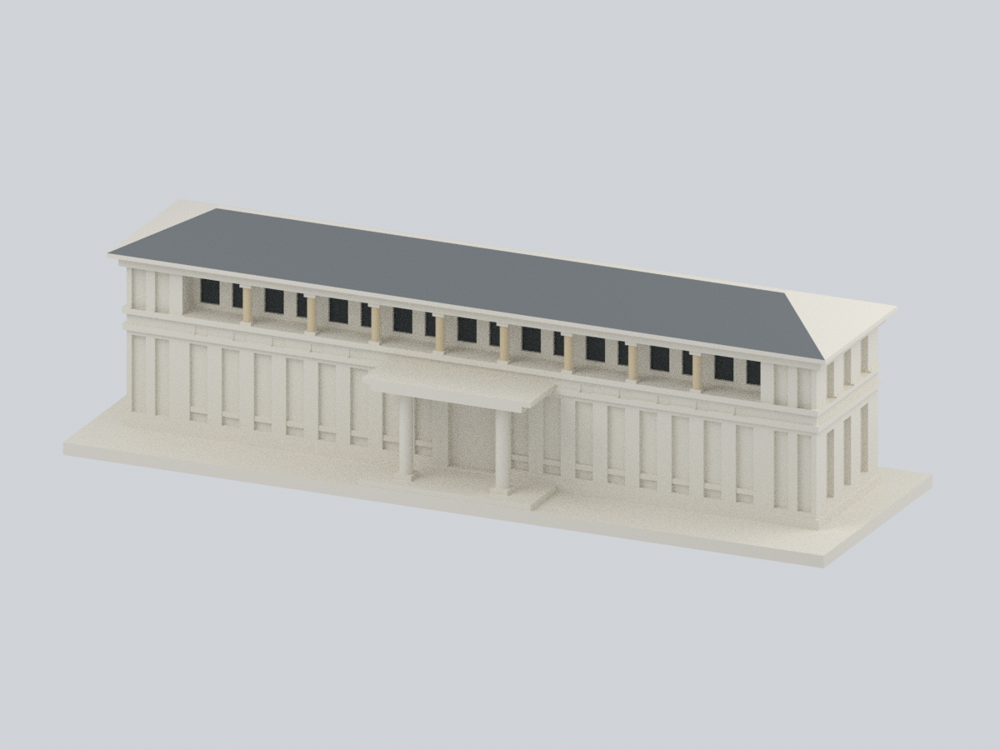
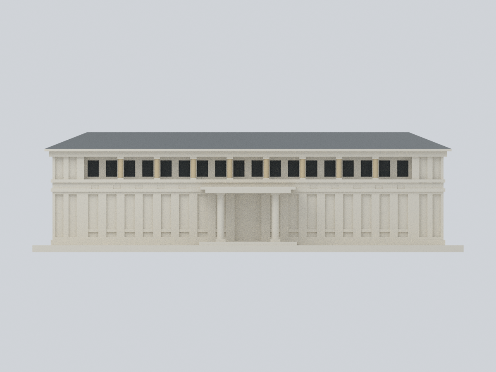
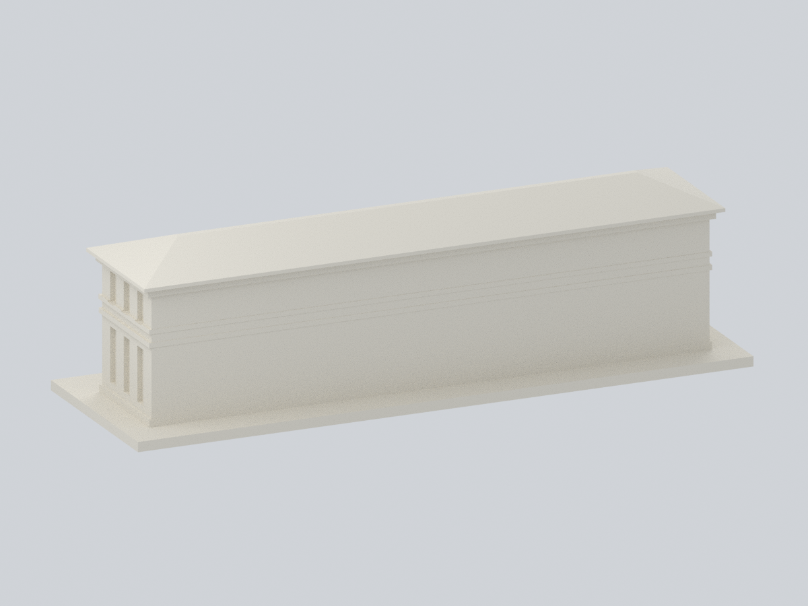
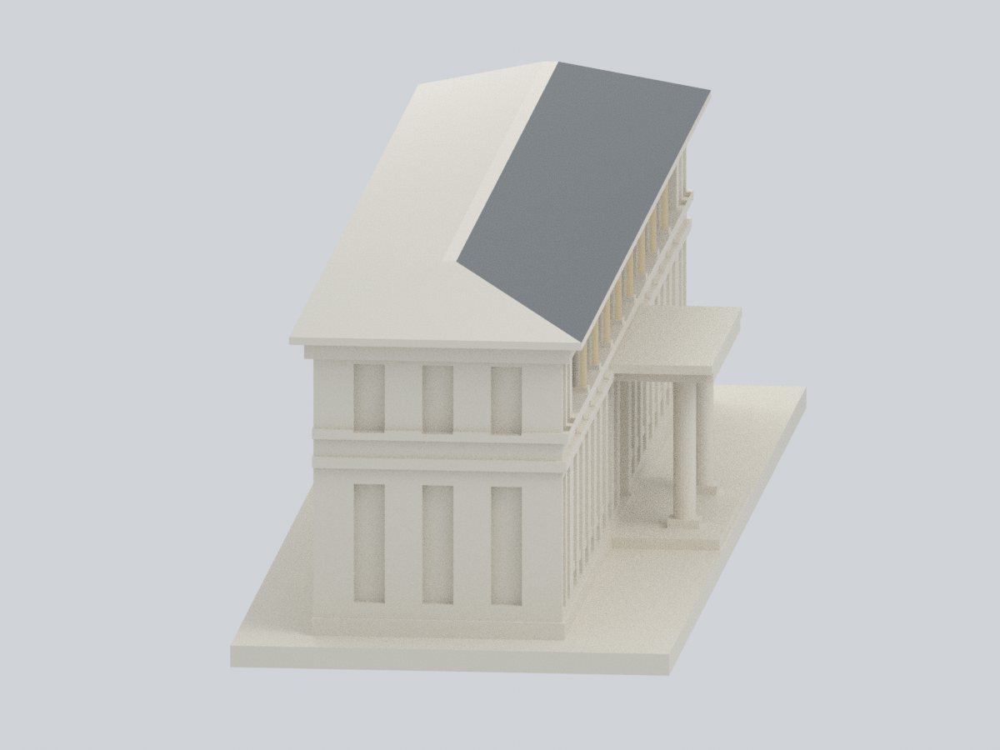
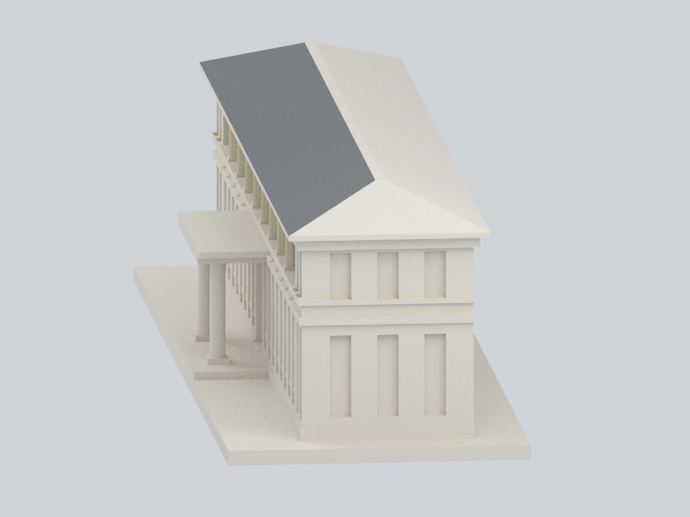
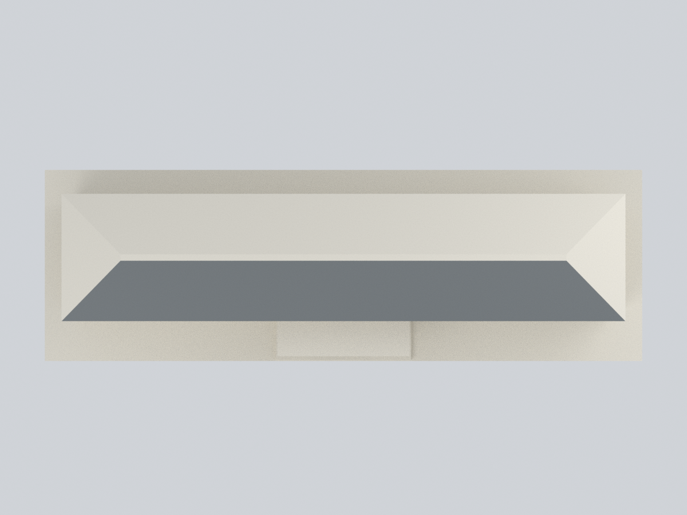
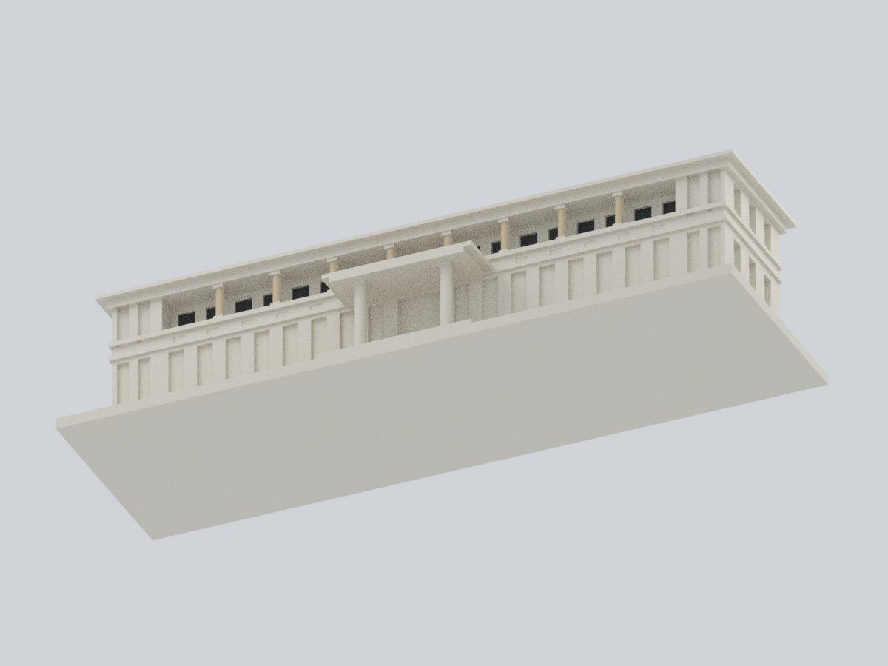
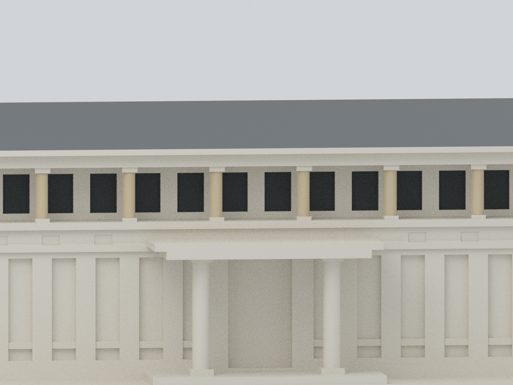

# 信心樓｜原網格局部材質外觀

國立臺南護理專科學校・臺南校區。**只替原始 3,114 個三角面中的 198 面指定來源支持的色彩家族，其他 2,916 面保留原中性色。** 這不是完整著色、測繪、現況重建，也不是新增建物。原始 STL、幾何、三角面順序、舊版預覽與既有 QA 均不修改。

## 九張實際模型預覽

以下均由同一可編修網格與實際面材質渲染，沒有照片貼圖、生成式背景或額外裝飾模型。正面為模型 −Y，並非地理方位；近景僅改變相機。

| 左前斜視 | 右前斜視 | 正立面 |
| :---: | :---: | :---: |
|  |  |  |

| 背面（保留中性） | 左側 | 右側 |
| :---: | :---: | :---: |
|  |  |  |

| 頂視（僅前坡灰色） | 底視 | 上廊材質近景 |
| :---: | :---: | :---: |
|  |  |  |

## 檔案與可編修性

- [原始列印 STL](../model.stl)：155,784 bytes；SHA-256 `d9b3a2a55439f8d7a8650942128def62f7f7d9ca505aa71c31b3ff2c4e22b161`。不複製／另造一個變形 STL。
- [逐面材質 3MF](ntin-xinxin-appearance.3mf)：毫米；單一網格、四個 base materials，198 個著色面有逐面材質指定，2,916 面繼承中性預設材質；不是僅給整個物件一種顏色。
- [可編修 Blender](ntin-xinxin-appearance.blend)：原面索引屬性 `original_stl_triangle_index`；可編修頂點與材質、無修飾器、無外部影像。
- [完整面索引表](face-materials.csv)・[數值範圍與准用面 IDs](parameters.json)・[色盤](palette.json)・[來源清冊](sources.json)・[檔案雜湊](SHA256SUMS)。

## 嚴格限定的材質範圍

| 材質 | 原三角面數 | 範圍與限制 |
|---|---:|---|
| N00 原中性 | **2,916** | 保留原 Blender 線性色值 `(0.76, 0.72, 0.63, 1)`；不是對未觀察表面之實際塗裝宣稱。3MF 用對應 8-bit sRGB 近似 `#E2DDD0`。 |
| C01 灰瓦家族 | 2 | 僅正面長屋坡；排除背坡、左右斜脊面、頂部窄平台、簷板和底面。 |
| C02 深色窗單元代理 | 36 | 18 個上廊窗凹槽的**背面**，各 2 面；不將窗洞側壁塗黑，亦不聲稱整片黑玻璃、陰影或真實漆色。 |
| C03 暖奶油色柱幹 | 160 | 8 支上廊柱各 20 面，僅 −165° 至 −15° 前弧、Z=25.85–32.45 mm；不延伸至背周、柱頭、柱腳或門廊柱。 |

每一納入面均以**三個原始頂點**、平面、法向、凸元素邊界及逐窗／逐柱分組驗證，而非只驗中心點。完整面不能跨越模型材質接縫；沒有切面、細分、補洞或向隱藏區域推延色彩。這是簡化建築元素與照片的視覺對應，不是經校正之逐像素攝影測量。

牆面、水平帶、底座、台階、地面層、入口、門廊、屋頂其他面、側面與後面均保持中性。照片雖顯示更多淺色與灰色，仍不足以支持將原始混合／未知面擴大著色。

## 來源、年代與權利

- **S01**：[官方「第一棟樓」](https://shiny.ntin.edu.tw/spark/first-building)，支持建物識別與整修脈絡。未標出版日期的回顧頁；敘事中的 2014-12-30 事件不等於攝影或出版時間。
- **S02**：[官方 2015 建築檔案展](https://shiny.ntin.edu.tw/divsion/genoffice/gen2/104/100.html) 的[正面實景照片](https://shiny.ntin.edu.tw/divsion/genoffice/gen2/104/images/100-27.jpg)，支持前瓦坡、上層窗單元與柱幹色彩家族。EXIF 自述 **2014-12-30 16:09:00 本地相機時間**，無 UTC 偏移，亦未獨立驗證相機時鐘；2015 是展覽脈絡，不是快門日期。
- **S03**：[官方「小而美」](https://shiny.ntin.edu.tw/spark/tiny-but-shiny) 連結的[高角度實景](https://ap-northeast-1.graphassets.com/Abyzo3AtgRxmpoyqZ7yEqz/cm9s735dc6wk70h0y5dgo3ygp)，只輔助同棟識別、前坡與分離後棟判讀，**拍攝日期不明**；未據此擴大著色。

本版仍是 **2014–2015 整修後外觀近似**，不是 2026 現況。2026-10-24 為本次查閱日，不能拿來當拍攝日期。光線、曝光、陰影與玻璃反射會改變觀感，色盤為未校色的代表值，而非油漆／顏料測定。這項新增 EXIF 說明補充舊來源文件，未回寫歷史檔案。

來源照片／網頁權利屬校方等原權利人，未發現允許再散布的授權；公開包僅提供連結、原創數值對應和模型預覽，不包含來源圖片、網頁、照片衍生貼圖或私人備份內容。

## 公開重建（不需要來源照片或私人備份）

只需要原公開 `../model.stl`、本目錄 `parameters.json`、`palette.json` 及 `source/*.py`。先備妥 [工具依賴](source/requirements-model.txt)，不會自動安裝套件，也不會下載網路資料。以全新輸出目錄執行：

```bash
python source/rebuild.py --stl ../model.stl --out ../appearance-rebuild \
  --geometry-python python --three-mf-python python3 --blender blender
```

若工具分屬不同 Python 環境，兩個 interpreter 參數分別指定。驗證用 Blender 4.3.2，Cycles CPU、32 samples、seed 0；不同渲染版本不保證逐像素相同。腳本先驗原 STL 位元組雜湊與每個原面範圍，再輸出 3MF／Blend／九圖；不重新執行幾何生成器。凍結包不可覆寫。

## 已驗證項目與列印限制

[原面範圍](qa/face-containment.json)、[原網格全量比較](qa/geometry-validation.json)、[3MF 嚴格重讀／編修測試](qa/3mf-validation.json)、[Blend 真實編修重開](qa/blend-validation.json)、[完整 SDNA 路徑緩衝區](qa/path-buffer-audit.json)、[乾淨目錄公開輸入重建](qa/rebuild-validation.json)、[圖像與檔案檢查](qa/package-verification.json)。作者視覺記錄見 [visual-review.json](qa/visual-review.json)；作者 QA 不取代獨立審核。

所有 3,114 面的頂點、繞序、次序與原 STL 精確一致，無新增幾何；原有單殼、邊雙用及頂點 link 檢查再次通過。3MF 文字座標存在小量序列化誤差，實測最大值詳列 QA，驗收上限 0.00001 mm；不將此聲稱為位元組完全相同的 STL。

仍適用[原模型 QA 與薄件／支撐警示](../README.md)：上廊柱 1.8 mm、門廊柱 2.5 mm、主屋簷平板 0.85 mm、屋脊頂寬 1.6 mm；這不是全面最小壁厚保證。門廊／上廊頂下與屋簷可能需支撐。原 0.8 mm opening 篩檢的 64 筆角損警示、最大 2.9239% 不能因換色而取消。材質不增加實厚或補強。沒有實際切片、工具路徑或實體試印；多色 3MF 的讀入／列印能力取決於軟體與設備，可能忽略或重映材質，沒有保證直接多色可印。
