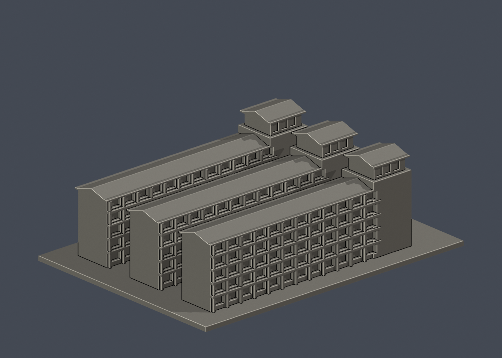

# 國立臺東大學 3D外觀模型圖鑑

本輪核准的外觀近似模型套件；全校尚未完成。套件可能包含相連群組、局部或歷史外觀，件數不等於完整建築棟數。未正式切片、未生成經驗證G-code、未實體試印。各件警示、來源年代、背面簡化及支撐需求請讀詳頁。只公開來源URL，不散布原照片或PDF。

11件包含學院、宿舍與鏡心書院局部棟群；鏡心D不在本包。45項盤點為候選與缺口，不是45棟完整建築。

本輪共11套，每件獨立縮放，並非統一比例校園拼圖。

| 建築／模型 | 建築／模型 | 建築／模型 |
|---|---|---|
| [圖書資訊館](知本校區/buildings/zhiben-library-information/README.md)  [資料夾](知本校區/buildings/zhiben-library-information) | [理工學院主要教學棟](知本校區/buildings/zhiben-science-engineering/README.md)  [資料夾](知本校區/buildings/zhiben-science-engineering) | [師範學院主要教學棟](知本校區/buildings/zhiben-teachers-college/README.md)  [資料夾](知本校區/buildings/zhiben-teachers-college) |
| [行政服務大樓](知本校區/buildings/zhiben-administration/README.md)  [資料夾](知本校區/buildings/zhiben-administration) | [人文學院廣場側棟群暨演藝廳](知本校區/buildings/zhiben-humanities-plaza-complex/README.md)  [資料夾](知本校區/buildings/zhiben-humanities-plaza-complex) | [鏡心書院主要教學棟](知本校區/buildings/zhiben-jinsin-academy-main/README.md)  [資料夾](知本校區/buildings/zhiben-jinsin-academy-main) |
| [學生活動中心暨綜合體育館](知本校區/buildings/zhiben-student-union-sports/README.md)  [資料夾](知本校區/buildings/zhiben-student-union-sports) | [食品生技實習工廠（原中正堂）](臺東校區/buildings/taitung-food-biotech-factory/README.md)  [資料夾](臺東校區/buildings/taitung-food-biotech-factory) | [第一學生宿舍主要棟群](知本校區/buildings/zhiben-first-dormitory/README.md)  [資料夾](知本校區/buildings/zhiben-first-dormitory) |
| [第二學生宿舍主要棟群](知本校區/buildings/zhiben-second-dormitory/README.md)  [資料夾](知本校區/buildings/zhiben-second-dormitory) | [第二宿舍旁餐飲中心](知本校區/buildings/zhiben-dining-centre/README.md)  [資料夾](知本校區/buildings/zhiben-dining-centre) |  |

## 覆蓋與缺口
- [nttu-inventory](audits/nttu-inventory)
