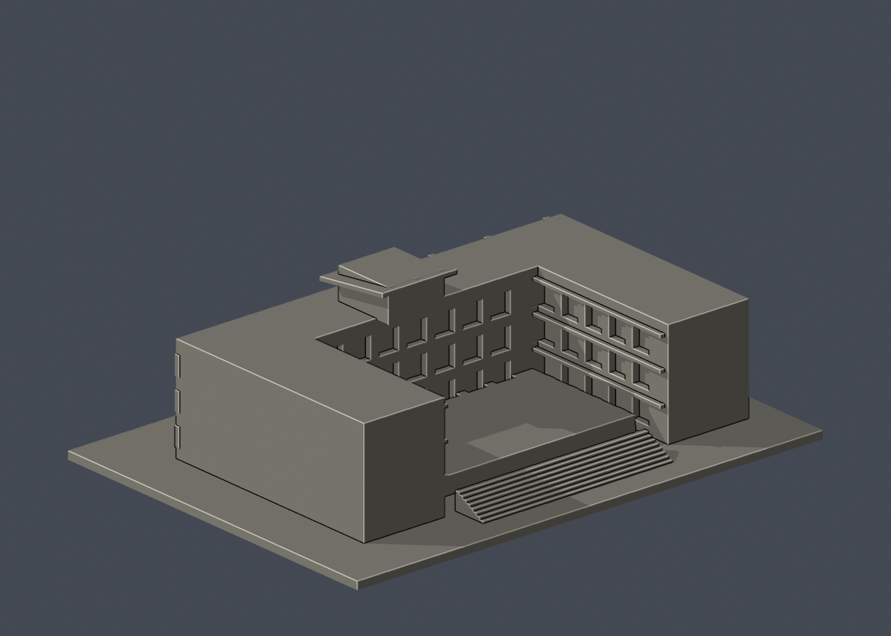

# 國立臺東大學知本校區：行政服務大樓

## 模型預覽

| 模型預覽 | 模型預覽 | 模型預覽 |
| :---: | :---: | :---: |
|  |  |  |

公開實景確認的主要外牆和開放中庭組合；不是測量級的全棟竣工模型。

## 定位與比例
公開外觀照片詮釋模型，非校方官方或測量模型。模型含底座最長邊 **150 mm**；尺寸 150.00 × 110.00 × 44.20 mm。每件獨立縮尺，不能直接拼成等比例校園。正面為 -Y，不代表地理北向。舊照片不保證完全反映 2026 現況。

## 檔案與重建
- `model.stl`：毫米制、單一閉合連通表面的列印模型。
- `scene.blend`：Blender 4.3.2 可編輯網格，內嵌原始程式。
- `build_model.py`、`requirements.txt`：可攜 CSG 程式及依賴，不需照片、網路或其他模型目錄。
- `previews/front.png`、`rear.png`、`elevation.png`：直接從交付 STL 渲染。
- `validate_model.py`、`validation.json`：原始 STL、乾淨重建及 Blender 幾何驗證。
- `section_check.py`、`section_validation.json`：每 0.2 mm 的數學截面檢查。
- `sources.json`：來源角色、已看像素、身份與近似說明。

```sh
python -m pip install -r requirements.txt
python build_model.py
blender -b -t 2 -P render_preview.py
python validate_model.py
python section_check.py
```

修改程式後需完整重跑，勿沿用舊 Blender／圖片／驗證。

## 來源核對
- [來源頁](https://enews.nttu.edu.tw/p/406-1045-36360,c4248-1.php)／[外觀圖](https://enews.nttu.edu.tw/var/file/45/1045/img/669/250173803.jpg)：校方行政服務大樓標題下的正面照片；左側細密遮陽花格、右側帶狀窗及頂部斜帽。
- [來源頁](https://nshcm.nttu.edu.tw/p/412-1059-8230.php?Lang=zh-tw)／[外觀圖](https://nshcm.nttu.edu.tw/var/file/59/1059/img/1432/127857408.jpg)：同角度的高解析校方照片，細查屏風與梁柱比例；不算另一個拍攝角度。
- [來源頁](https://www.ekuo.com.tw/jiao-yu-ji-gou-1/%E5%8F%B0%E6%9D%B1%E5%A4%A7%E5%AD%B8-%E8%A1%8C%E6%94%BF%E5%A4%A7%E6%A8%93)／[外觀圖](https://static.wixstatic.com/media/a0c8e0_ff2a888fd755498799f4bce95f90afac~mv2.jpg)：建築師提供的建成實景，顯示中庭側多層露台、寬階及挑出上層。
- [來源頁](https://www.ekuo.com.tw/jiao-yu-ji-gou-1/%E5%8F%B0%E6%9D%B1%E5%A4%A7%E5%AD%B8-%E8%A1%8C%E6%94%BF%E5%A4%A7%E6%A8%93)／[外觀圖](https://static.wixstatic.com/media/a0c8e0_ac952dedf8bc44578774a6610d293347~mv2.png)：建築師概念實體模型，僅輔助理解中庭外部配置，不冒充建成實景。
- [來源頁](https://www.ekuo.com.tw/jiao-yu-ji-gou-1/%E5%8F%B0%E6%9D%B1%E5%A4%A7%E5%AD%B8-%E8%A1%8C%E6%94%BF%E5%A4%A7%E6%A8%93)／[外觀圖](https://static.wixstatic.com/media/a0c8e0_ede38276ff4d47299672466f8590b9e6~mv2.png)：建築師另一概念模型，僅輔助 U 形配置；與現況可能有差異。

每張來源圖都已實際檢視像素。照片權利屬原提供者，公開套件不含原圖或參照拼圖。建物身份先核對標題再建模，不靠圖片搜尋的自動圖說。

## 近似、缺口與省略
左側花格孔數大幅合併成約 1.05 mm 方形凹孔；保留實心背板，並非每一真實穿孔。右側帶狀窗、中央牆段與斜帽有校方實景支持。中庭側另有建成實景；整體翼棟位置同時參考建築師概念模型，因此平面深度、後側開口、台階及屋頂仍屬近似，不能把概念模型視為竣工圖。未建置室內。

僅公開外觀，不包含室內、設備、安全或維生系統。底座是列印附加物，非真實基地邊界。

## 支撐與列印
平底向下；中庭樓板邊、斜帽及格柵窗框需檢查局部支撐。花格孔約 1.05 mm，宜使用 0.25–0.4 mm 噴嘴，先在切片器確認孔是否保留。外階下方填實。

底座厚 2.4 mm。STL 是實心外界面，填充率由切片器設定。未作實體試印或切片器驗證。建議先檢查微小特徵、懸挑、支撐、床面與第一層；模型通過數位檢查不保證每部列印機可直接成功。

## 驗證摘要
- 原始 STL 法線為單位向量且匹配繞序、面不退化、封閉性、邊流形、頂點單環、單一連通表面、正體積皆通過。
- 無獨立內部空腔殼。底面 z=0，最長邊 150 mm。
- 空目錄乾淨重建的 STL SHA-256 一致；Blender 儲存網格與 STL 幾何雜湊一致。
- 5808 三角面、1 表面殼；體積 225116.9 mm³。
- 每 0.2 mm、偏移 0.1 mm，共 221 層數學截面均非空、有限且正面積。這是幾何截面，不是切片器、刀路、橋接或支撐測試；多個頂部截面輪廓可能是正常柱／屋頂，不能等同漂浮零件。
- 未宣稱獨立窮舉自相交檢查。
- STL SHA-256：`854e49c793350ad42e6188bfabb2f733c4707c956fdfca31bb88d92fe9c441c4`。


## 實際STL正背並排

| 模型預覽 | 模型預覽 | 模型預覽 |
| :---: | :---: | :---: |
| 正面<br> | 背面（未見部分按詳頁明示簡化）<br> |  |
