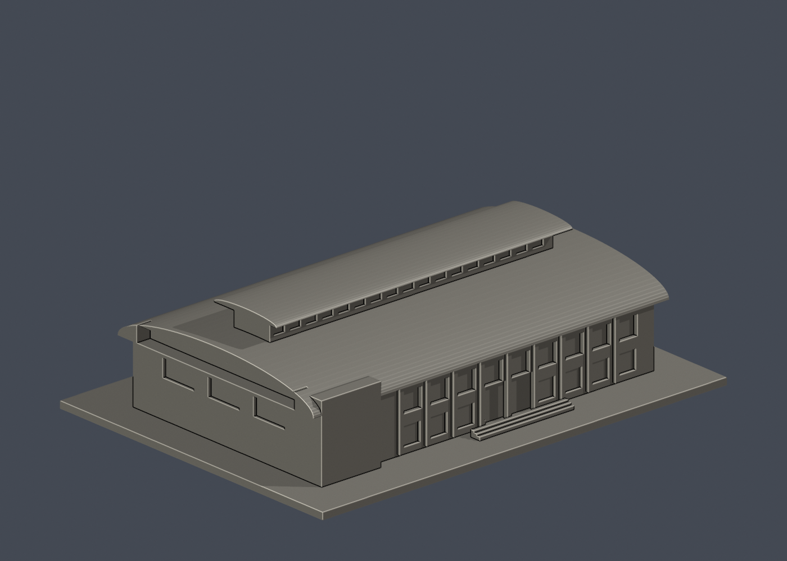
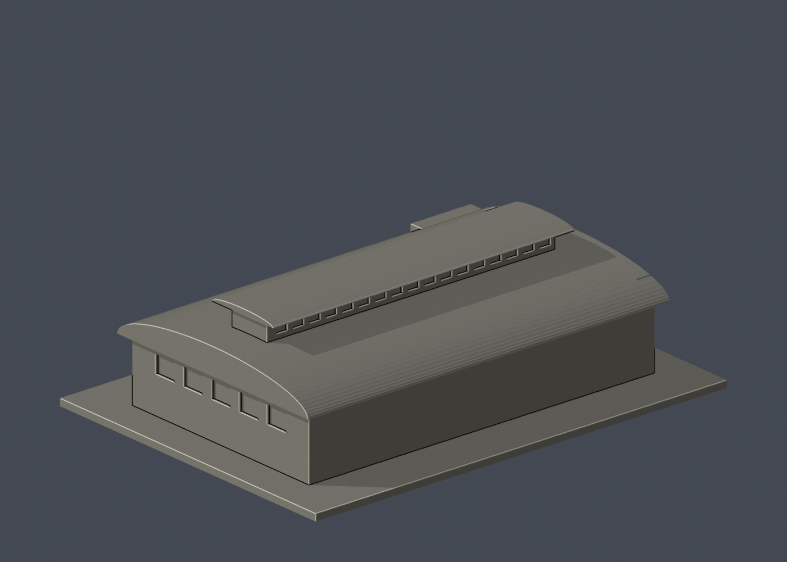

# 國立臺東大學知本校區：第二宿舍旁餐飲中心

獨立餐飲中心公開外觀，與第三批第二宿舍不同棟。模型尺寸150 × 110 × 41.50 mm，含底座最長邊150 mm，各模型独立縮尺；-Y為展示正面。非測量模型，舊照片不保證完全反映現況。

## 外觀證據與簡化
校方環境照可讀到餐飲中心標示，官方空拍核對位置及長方弧頂；來源詳見sources.json。保留大弧頂、中央抬高採光頂帶、低層窗帶和前左標示牆。頂帶曲率、長深比、窗數與樓層比例近似。樹木遮蔽下層只做少量簡化門窗，背面素牆；無室內或設備。照片不納入公開套件。

## 檔案與重建
提供model.stl、可編輯scene.blend、build_model.py、requirements.txt，以及從交付STL直接渲染的previews/front.png、rear.png、elevation.png。Blender4.3.2，原始程式內嵌Blend；Python不需照片或其他模型目錄。

```sh
python -m pip install -r requirements.txt
python build_model.py
blender -b -t 2 -P render_preview.py
python validate_model.py
python section_check.py
```

## 支撐與驗證
平底向下，弧頂與細長頂帶挑簷需局部支撐檢查；頂帶窗間牆約2 mm，主立面柱約1.5 mm。建議0.12–0.16 mm層高，自行切片確認橋接與支撐可拆除。

validation.json全項通過：原始STL法線、面繞序、無退化、封閉、邊/頂點流形、單一連通表面、無分離內腔殼、正體積、150 mm最長邊、乾淨重建雜湊、Blender幾何一致。1656三角面、體積335775.46 mm³。

section_validation.json通過207個0.2 mm逐層數學截面。這不是切片器或實體試印；不計算刀路、支撐、黏著或窮盡自交情形。


## 實際STL正背並排

| 正面 | 背面（未見部分按詳頁明示簡化） |
|---|---|
|  |  |
