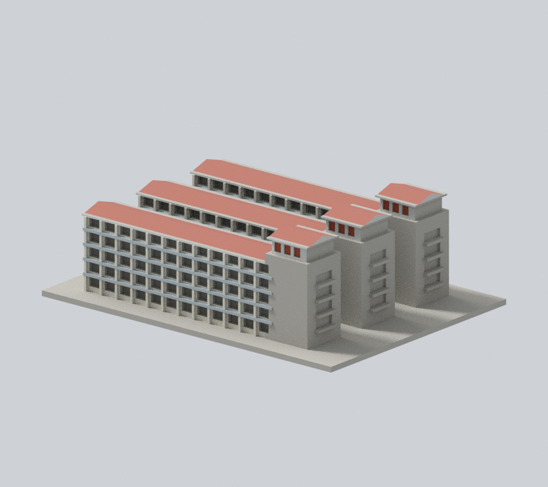
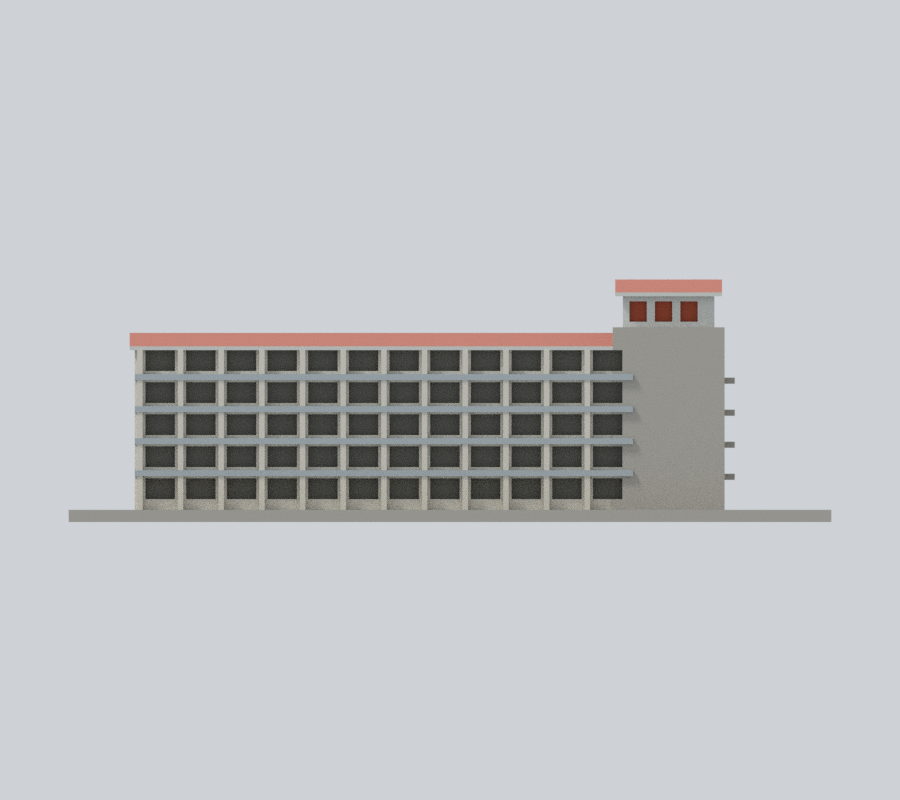
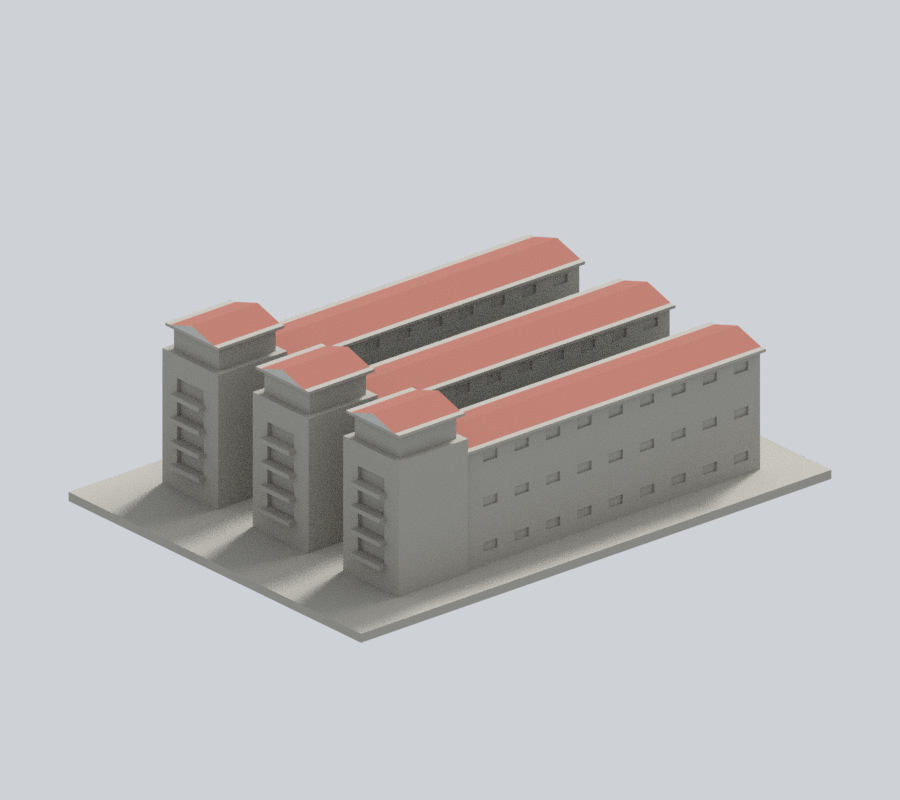
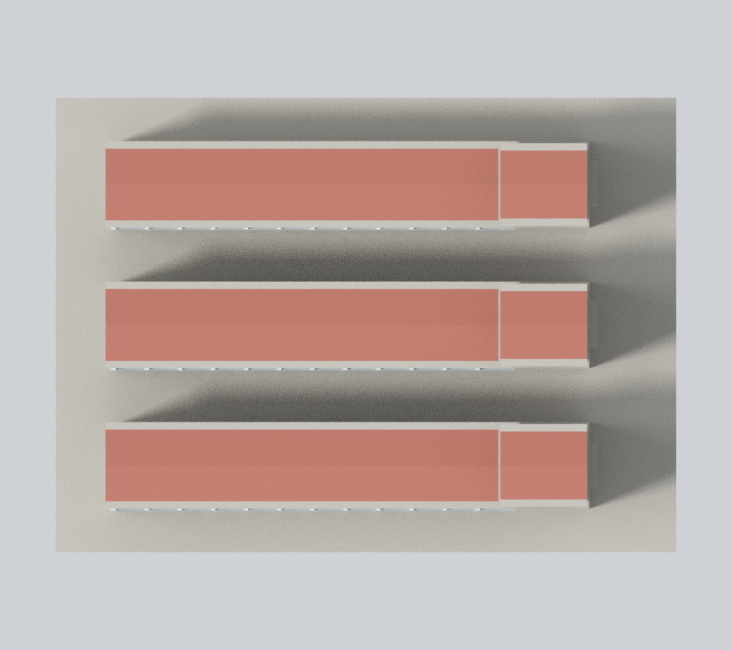

# 國立臺東大學知本校區：第一學生宿舍主要棟群

## 模型預覽

| 新彩色正斜視 | 新彩色來源角度 | 新彩色立面 |
| :---: | :---: | :---: |
|  |  |  |
| 新彩色背向 | 新彩色上視 | 彩色下載 |
|  |  | [彩色3MF](appearance.3mf) · [Blender](appearance.blend) |


三列平行五層住宿棟及屋頂小塔；不含所有連接廊、附屬車棚。

公開外觀詮釋模型，非測量或校方官方模型。含底座尺寸：150.00 × 110.00 × 47.70 mm；最長邊150 mm，各件獨立縮尺。-Y為展示正面，不代表地理北向。舊照片不能證明2026年每個細節未變。

### 新增有限官方實照配色（原三圖保留）

三列宿舍有證前側灰米牆／淡藍灰樓帶、暗凹廊表觀、紅褐坡面與塔頂磚紅凹板；塔頂紅板不是玻璃。未知後側、塔身拼貼及底座保持中性，不新增面界或細節。樹遮低層同構件材料延續只作推估，並非逐面實照可見。


[材料來源與限制](APPEARANCE.md)。原幾何、STL、scene、三張鎖定預覽及歷史QA保留；本輪不重跑原列印QA，沒有實體試印。

## 證據與近似
三列五層外廊、端部陽台、小塔與雙坡帽有照片支持。棟間距、深度、屋頂坡度與窗數為近似；遠側與連接廊資料不足而簡化，不重建室內或設備。

來源詳見sources.json。已檢視所列照片像素並交叉核對標題和校區，不以圖片檔名單獨判定身份。原始照片未納入套件。

## 重建與檔案
model.stl為毫米制；scene.blend為可編輯單一網格，含原始程式文字。previews內正、背與立面圖直接從交付STL生成。

```sh
python -m pip install -r requirements.txt
python build_model.py
blender -b -t 2 -P render_preview.py
python validate_model.py
python section_check.py
```

程式可獨立離線重建，無須原照片、其他模型或網路。Blender 4.3.2；其餘依賴版本見requirements.txt。

## 列印建議
主要外廊凹處、陽台及塔頂簷需局部支撐；柱最細約1.1 mm。

建议0.12–0.16 mm層高。請自行於切片器檢查支撐、橋接、細節與首層；沒有實體試印或切片器驗證。

## 驗證
validation.json記錄原始二進位STL法線單位長及繞序一致、無退化面、封閉、邊與頂點流形、單一連通表面且無分離內腔殼、正體積、150 mm最大尺寸、乾淨目錄重建SHA256及Blender/STL幾何一致。

本件8688三角面，體積271768.43 mm³。section_validation.json另檢查239個0.2 mm等距幾何截面；這不是切片器、刀路或支撐驗證，也不宣稱窮盡所有可能自交問題。


