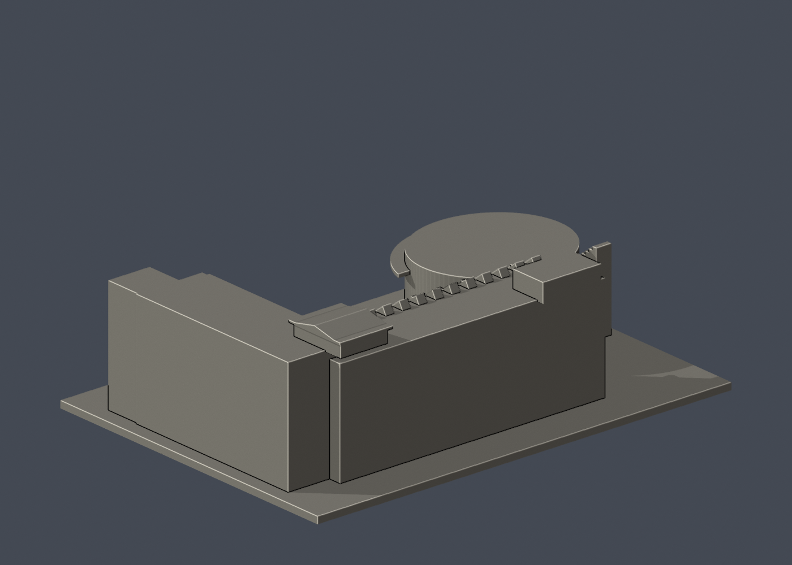

# 國立臺東大學知本校區：人文學院廣場側棟群暨演藝廳

只涵蓋公開正面廣角照片可見的廣場側主立面、右翼及橢圓演藝廳，未完成全學院後側翼棟。

## 定位與比例
公開外觀照片詮釋模型，非校方官方或測量模型。模型含底座最長邊 **150 mm**；尺寸 150.00 × 110.00 × 47.90 mm。每件獨立縮尺，不能直接拼成等比例校園。正面為 -Y，不代表地理北向。舊照片不保證完全反映 2026 現況。

## 檔案與重建
- `model.stl`：毫米制、單一閉合連通表面的列印模型。
- `scene.blend`：Blender 4.3.2 可編輯網格，內嵌原始程式。
- `build_model.py`、`requirements.txt`：可攜 CSG 程式及依賴，不需照片、網路或其他模型目錄。
- `previews/front.png`、`rear.png`、`elevation.png`：直接從交付 STL 渲染。
- `validate_model.py`、`validation.json`：原始 STL、乾淨重建及 Blender 幾何驗證。
- `section_check.py`、`section_validation.json`：每 0.2 mm 的數學截面檢查。
- `sources.json`：來源角色、已看像素、身份與近似說明。

```sh
python -m pip install -r requirements.txt
python build_model.py
blender -b -t 2 -P render_preview.py
python validate_model.py
python section_check.py
```

修改程式後需完整重跑，勿沿用舊 Blender／圖片／驗證。

## 來源核對
- [來源頁](https://enews.nttu.edu.tw/p/406-1045-36360,c4248-1.php)／[外觀圖](https://enews.nttu.edu.tw/var/file/45/1045/img/669/182800008.jpg)：校方人文學院大樓標題下廣場照片；橢圓廳、凹廊教學棟、右側樓梯塔。
- [來源頁](https://nshcm.nttu.edu.tw/p/412-1059-8230.php?Lang=zh-tw)／[外觀圖](https://nshcm.nttu.edu.tw/var/file/59/1059/img/1432/162212488.jpg)：4126×2751 的同一視角高解析照片，用於放大確認窗間柱、樓層板、屋頂鋸齒遮陽及演藝廳前簷；非獨立角度。

每張來源圖都已實際檢視像素。照片權利屬原提供者，公開套件不含原圖或參照拼圖。建物身份先核對標題再建模，不靠圖片搜尋的自動圖說。

## 近似、缺口與省略
可辨識的橢圓演藝廳、前伸弧形雨棚、左側外階、廣場後方深凹立面及右端樓梯塔已建成實體幾何。背面、屋頂全貌及更後方棟群照片不足，所以只做廣場側片段；後面簡化為素牆，不擅自延伸完整學院。演藝廳平面以橢圓近似，階梯與梁柱加粗，窗數合併。

僅公開外觀，不包含室內、設備、安全或維生系統。底座是列印附加物，非真實基地邊界。

## 支撐與列印
平底向下。弧形雨棚、樓梯塔平台及樓廊板需局部支撐；屋頂鋸齒細件已改成厚實三角稜柱。演藝廳外階下方填實。

底座厚 2.4 mm。STL 是實心外界面，填充率由切片器設定。未作實體試印或切片器驗證。建議先檢查微小特徵、懸挑、支撐、床面與第一層；模型通過數位檢查不保證每部列印機可直接成功。

## 驗證摘要
- 原始 STL 法線為單位向量且匹配繞序、面不退化、封閉性、邊流形、頂點單環、單一連通表面、正體積皆通過。
- 無獨立內部空腔殼。底面 z=0，最長邊 150 mm。
- 空目錄乾淨重建的 STL SHA-256 一致；Blender 儲存網格與 STL 幾何雜湊一致。
- 4742 三角面、1 表面殼；體積 235204.1 mm³。
- 每 0.2 mm、偏移 0.1 mm，共 240 層數學截面均非空、有限且正面積。這是幾何截面，不是切片器、刀路、橋接或支撐測試；多個頂部截面輪廓可能是正常柱／屋頂，不能等同漂浮零件。
- 未宣稱獨立窮舉自相交檢查。
- STL SHA-256：`a2766d109052b10610b3bbcfa20b27d854ac8b18bbc5521a27bfc857ec8c80e2`。

| 模型預覽 | 模型預覽 | 模型預覽 |
| :---: | :---: | :---: |
|  |  |  |


## 實際STL正背並排

| 模型預覽 | 模型預覽 | 模型預覽 |
| :---: | :---: | :---: |
| 正面<br> | 背面（未見部分按詳頁明示簡化）<br> |  |
