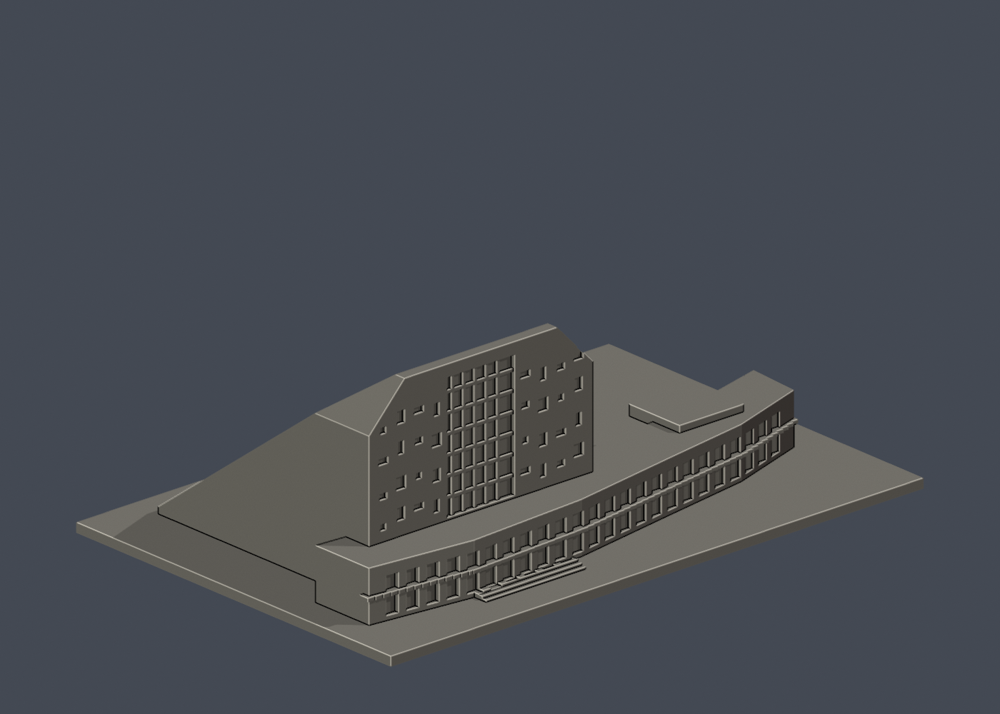
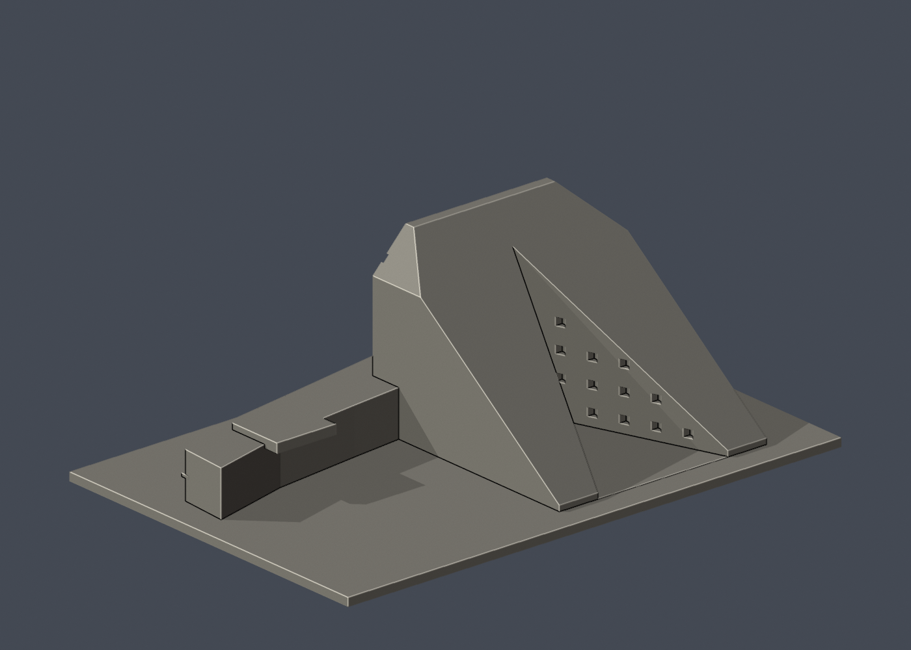

# 國立臺東大學知本校區：圖書資訊館

## 模型預覽

| 模型預覽 | 模型預覽 | 模型預覽 |
| :---: | :---: | :---: |
|  |  |  |

山形圖書主棟＋低層資訊翼之外觀簡化模型，不含完整地景湖岸。

這是公開照片外觀詮釋模型，非校方官方模型、非測繪成果，也不表示全校已完成。來源照片拍攝年代較早，不能保證與 2026 年現況完全一致。

## 檔案
- `model.stl`：毫米制單件實心外形，可供切片；最長邊 **150 mm（含底座）**，各模型比例獨立。
- `scene.blend`：Blender 4.3.2 可編輯三角網格；場景只有一個列印網格及攝影機，原始程式亦嵌入文字資料塊。
- `build_model.py`：可攜參數化 CSG 原始程式，不需要照片或網路。
- `render_preview.py`：直接載入實際 STL 製作正面、背面與正立面 PNG。
- `validate_model.py`、`validation.json`：原始 STL、乾淨重建及 Blender 一致性驗證。
- `sources.json`：來源、照片像素觀察、範圍與近似說明。

## 已實際檢視的來源
- [館方正面山坡照片](https://enews.nttu.edu.tw/p/405-1045-80455,c4006.php?Lang=zh-tw)：[照片](https://enews.nttu.edu.tw/var/file/45/1045/img/669/A15_9397.jpg)。實際檢視 3008×2008 像素；可見大斜屋頂、開書般折面與不規則窗孔。
- [館方湖面立面照片](https://enews.nttu.edu.tw/p/405-1045-80455,c4006.php?Lang=zh-tw)：[照片](https://enews.nttu.edu.tw/var/file/45/1045/img/669/243700461.jpg)。實際檢視 3872×2592 像素；可見中央高玻璃面、兩側混凝土量體及低層水平資訊翼。

- [校方知本校區配置圖](https://ndga.nttu.edu.tw/p/412-1008-9291.php?Lang=zh-tw)：實際檢視校圖像素，確認建物名稱及相對位置。

原始參考照片不包含在此套件；照片權利屬原提供者。本套件未取得校方背書或第三方照片再散布授權。

## 近似與缺口
大斜面與中央湖向玻璃網格有照片依據。斜坡用直線平面、資訊翼用折線曲面近似；兩端頂部倒角、深度、屋頂缺口及入口寬度是照片估計。後方開書切面經大幅簡化，非真實平面切口測繪；窗孔位置與尺寸僅保留錯落語彙。草坡、石紋、欄杆、植物、湖面及完整外階均未重現。

只製作公開外觀，不建置室內、設備或安全配置。底座是模型附加構件，非真實基地邊界。正面固定 -Y，並非地理正北。

## 列印建議及限制
平底向下。主斜面無向下懸挑；窗孔、玻璃格柵及低翼屋簷可能需要局部支撐或橋接設定。玻璃格柵 0.8 mm，宜 0.25–0.4 mm 噴嘴並先確認切片是否保留。

建議先以 PLA、0.12–0.16 mm 層高檢查預覽；這只是起始建議。底座 2.4 mm 厚。STL 是閉合實心邊界，實際填充率由切片器決定。未進行實體試印或切片驗證，也不保證免支撐、所有機種可直接成功列印。正式列印前應檢查懸挑、細柱、第一層及床面黏著。

## 重建
使用 Python 3.12，在此資料夾執行：

```sh
python -m pip install -r requirements.txt
python build_model.py
blender -b -t 2 -P render_preview.py
python validate_model.py
```

驗證腳本在臨時空目錄重建 STL，逐 byte 比對 SHA-256，並讀取已儲存 Blender 真實頂點／三角面作幾何雜湊比對。不能只重建 STL 後沿用舊 Blender，修改模型後必須重新渲染、存場景及驗證。

## 本次驗證
- 尺寸：150.00 × 100.00 × 51.00 mm；三角面：3662；表面連通殼：1。
- 原始 STL 法線與繞序一致、法線為單位向量、非退化面、封閉性、邊流形、頂點單一環、單一表面殼、正體積皆通過。
- 無獨立內部空腔殼；乾淨重建 STL 雜湊一致；Blender 幾何雜湊一致。
- 未宣稱完成全域自相交的獨立窮舉檢查；數位幾何驗證不等於試印。
- STL SHA-256：`2b79321536cdecd979ecae1d67a6b656992089400802ab55cc502cd19eec9aa3`。


## 第二版外觀 QA 修正
第二版將中央頂端平台深度由 9 mm 縮至 3 mm，保留照片所見的短平頂與兩側肩部斜線。原狹槽改為向外張開的 V 形入口切面，兩個三角牆面加入可見窗孔。中央玻璃格柵退回立面內，低層資訊翼增設兩層水平樓板。V 形夾角、窗孔位置與曲線翼仍為照片近似。

外廊、窗框、樓層平台有實際凹凸深度，局部水平突出需在切片器檢查支撐；沒有試印。


## 實際STL正背並排

| 模型預覽 | 模型預覽 | 模型預覽 |
| :---: | :---: | :---: |
| 正面<br> | 背面（未見部分按詳頁明示簡化）<br> |  |
