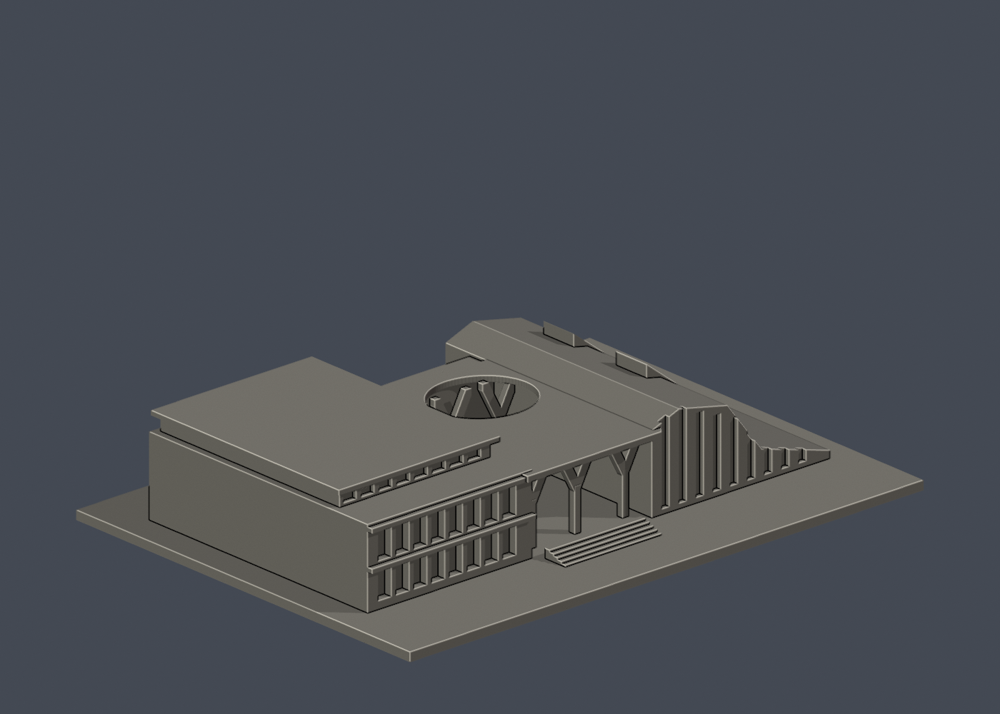
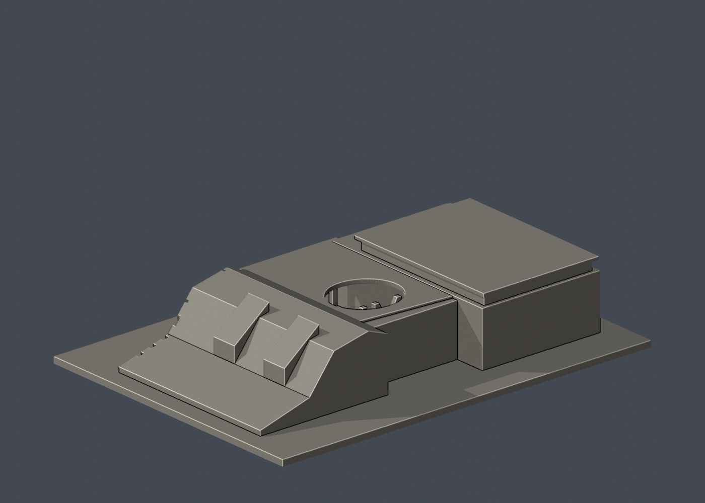

# 國立臺東大學知本校區：學生活動中心暨綜合體育館

## 模型預覽

| 模型預覽 | 模型預覽 | 模型預覽 |
| :---: | :---: | :---: |
|  |  |  |

公開外觀的低矮體育館、露天入口庭院及地景斜屋頂組合；未建立任何室內場館。

## 定位與比例
公開外觀照片詮釋模型，非校方官方或測量模型。模型含底座最長邊 **150 mm**；尺寸 150.00 × 110.00 × 28.20 mm。每件獨立縮尺，不能直接拼成等比例校園。正面為 -Y，不代表地理北向。舊照片不保證完全反映 2026 現況。

## 檔案與重建
- `model.stl`：毫米制、單一閉合連通表面的列印模型。
- `scene.blend`：Blender 4.3.2 可編輯網格，內嵌原始程式。
- `build_model.py`、`requirements.txt`：可攜 CSG 程式及依賴，不需照片、網路或其他模型目錄。
- `previews/front.png`、`rear.png`、`elevation.png`：直接從交付 STL 渲染。
- `validate_model.py`、`validation.json`：原始 STL、乾淨重建及 Blender 幾何驗證。
- `section_check.py`、`section_validation.json`：每 0.2 mm 的數學截面檢查。
- `sources.json`：來源角色、已看像素、身份與近似說明。

```sh
python -m pip install -r requirements.txt
python build_model.py
blender -b -t 2 -P render_preview.py
python validate_model.py
python section_check.py
```

修改程式後需完整重跑，勿沿用舊 Blender／圖片／驗證。

## 來源核對
- [來源頁](https://enews.nttu.edu.tw/p/406-1045-36360,c4248-1.php)／[外觀圖](https://enews.nttu.edu.tw/var/file/45/1045/img/669/523845579.jpg)：校方學生活動中心暨綜合體育館標題下實景；左側低館、中央 Y 形柱入口、右方斜屋頂。
- [來源頁](https://www.twarchitect.org.tw/works/%E8%87%BA%E6%9D%B1%E5%A4%A7%E5%AD%B8%E5%AD%B8%E7%94%9F%E6%B4%BB%E5%8B%95%E4%B8%AD%E5%BF%83%E6%9A%A8%E9%AB%94%E8%82%B2%E9%A4%A8/)／[外觀圖](https://www.twarchitect.org.tw/web2015/wp-content/uploads/2016/05/201606a3-1.jpg)：建築師雜誌鳥瞰實景，確認低館屋頂、上緣採光帶與斜屋頂前後深度。
- [來源頁](https://www.twarchitect.org.tw/works/%E8%87%BA%E6%9D%B1%E5%A4%A7%E5%AD%B8%E5%AD%B8%E7%94%9F%E6%B4%BB%E5%8B%95%E4%B8%AD%E5%BF%83%E6%9A%A8%E9%AB%94%E8%82%B2%E9%A4%A8/)／[外觀圖](https://www.twarchitect.org.tw/web2015/wp-content/uploads/2016/05/201606a3-2.jpg)：建築師雜誌側面實景，確認斜屋頂上升折線、直立窗格、側向採光帶。
- [來源頁](https://www.twarchitect.org.tw/works/%E8%87%BA%E6%9D%B1%E5%A4%A7%E5%AD%B8%E5%AD%B8%E7%94%9F%E6%B4%BB%E5%8B%95%E4%B8%AD%E5%BF%83%E6%9A%A8%E9%AB%94%E8%82%B2%E9%A4%A8/)／[外觀圖](https://www.twarchitect.org.tw/web2015/wp-content/uploads/2016/05/201606a3-3.jpg)：公開露天入口庭院的仰視照片，僅參考露天孔洞及外部 Y 形柱，不製作設備或室內。

每張來源圖都已實際檢視像素。照片權利屬原提供者，公開套件不含原圖或參照拼圖。建物身份先核對標題再建模，不靠圖片搜尋的自動圖說。

## 近似、缺口與省略
保留低矮階層屋頂、上層採光帶、中央開孔及 Y 形外柱、斜屋頂及兩道折面。屋頂曲面以折線稜柱近似；草坡、細欄杆、金屬細桿及植栽省略。模型 Y 形柱大幅加粗；背面窗位缺乏完整證據所以不補猜窗洞。總深度與各分棟比例是照片估計，並非精確場館平面。

僅公開外觀，不包含室內、設備、安全或維生系統。底座是列印附加物，非真實基地邊界。

## 支撐與列印
需支撐：中央大跨入口頂板、Y 形枝柱、屋簷與開孔邊。Y 形枝柱約 1.7 mm；不要將通過網格或截面檢查當成免支撐。建議 0.12–0.16 mm 層高，切片確認支撐可拆除。

底座厚 2.4 mm。STL 是實心外界面，填充率由切片器設定。未作實體試印或切片器驗證。建議先檢查微小特徵、懸挑、支撐、床面與第一層；模型通過數位檢查不保證每部列印機可直接成功。

## 驗證摘要
- 原始 STL 法線為單位向量且匹配繞序、面不退化、封閉性、邊流形、頂點單環、單一連通表面、正體積皆通過。
- 無獨立內部空腔殼。底面 z=0，最長邊 150 mm。
- 空目錄乾淨重建的 STL SHA-256 一致；Blender 儲存網格與 STL 幾何雜湊一致。
- 1694 三角面、1 表面殼；體積 182258.4 mm³。
- 每 0.2 mm、偏移 0.1 mm，共 141 層數學截面均非空、有限且正面積。這是幾何截面，不是切片器、刀路、橋接或支撐測試；多個頂部截面輪廓可能是正常柱／屋頂，不能等同漂浮零件。
- 未宣稱獨立窮舉自相交檢查。
- STL SHA-256：`0afbbd065257870eddfee328bb13a17af62567428583b7b1cc389cede2857476`。


## 實際STL正背並排

| 模型預覽 | 模型預覽 | 模型預覽 |
| :---: | :---: | :---: |
| 正面<br> | 背面（未見部分按詳頁明示簡化）<br> |  |
