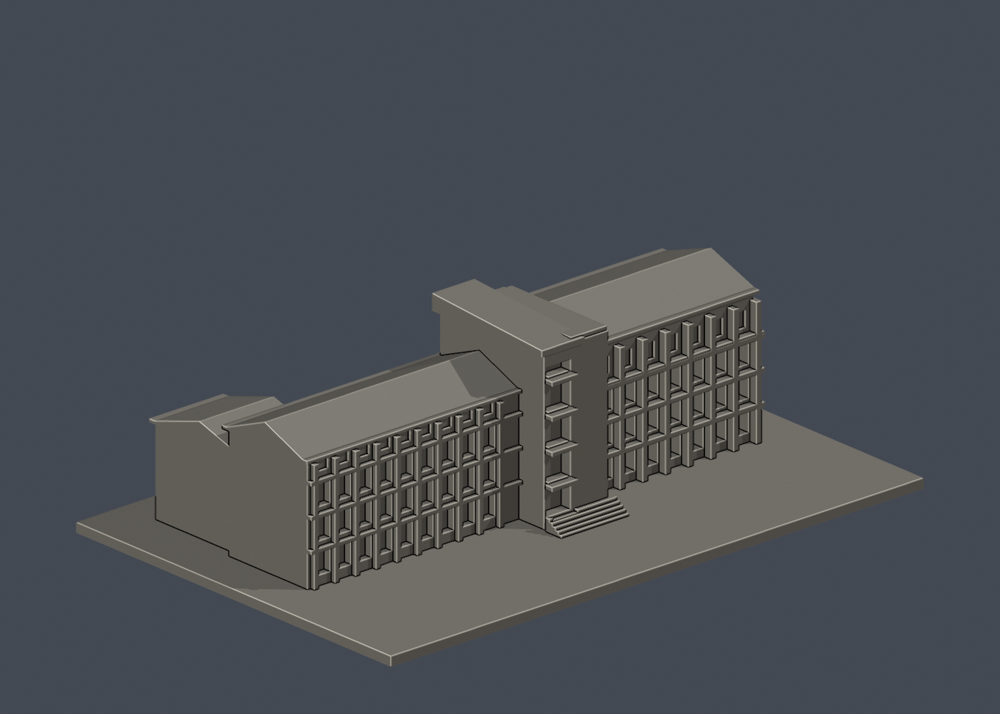
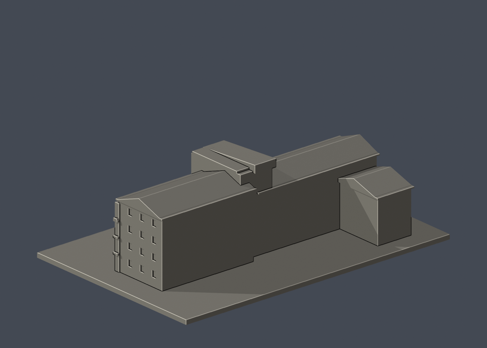

# 國立臺東大學知本校區：師範學院主要教學棟

## 模型預覽

| 模型預覽 | 模型預覽 | 模型預覽 |
| :---: | :---: | :---: |
|  |  |  |

官方照片中的四層主要外觀棟群；不是師範學院全部院落或全部翼棟。

這是公開照片外觀詮釋模型，非校方官方模型、非測繪成果，也不表示全校已完成。來源照片拍攝年代較早，不能保證與 2026 年現況完全一致。

## 檔案
- `model.stl`：毫米制單件實心外形，可供切片；最長邊 **150 mm（含底座）**，各模型比例獨立。
- `scene.blend`：Blender 4.3.2 可編輯三角網格；場景只有一個列印網格及攝影機，原始程式亦嵌入文字資料塊。
- `build_model.py`：可攜參數化 CSG 原始程式，不需要照片或網路。
- `render_preview.py`：直接載入實際 STL 製作正面、背面與正立面 PNG。
- `validate_model.py`、`validation.json`：原始 STL、乾淨重建及 Blender 一致性驗證。
- `sources.json`：來源、照片像素觀察、範圍與近似說明。

## 已實際檢視的來源
- [校方師範學院外觀](https://enews.nttu.edu.tw/p/406-1045-36360,c4248-1.php)：[照片](https://enews.nttu.edu.tw/var/file/45/1045/img/669/144043877.jpg)。實際檢視 800×536 像素；可見四層白牆、左低右高長翼、中央直立樓梯塔與斜屋頂。
- [綠建築協會師範／理工學院照片](https://www.taiwangbc.org.tw/tw/modules/news/article.php?storyid=359)：[照片](https://www.taiwangbc.org.tw/tw/uploads/news/1000/2/3ddc8e51ea6bf02b.png)。實際檢視組圖；下圖有師範學院題字、中央塔與多重斜屋頂。

- [校方知本校區配置圖](https://ndga.nttu.edu.tw/p/412-1008-9291.php?Lang=zh-tw)：實際檢視校圖像素，確認建物名稱及相對位置。

原始參考照片不包含在此套件；照片權利屬原提供者。本套件未取得校方背書或第三方照片再散布授權。

## 近似與缺口
保留主立面樓層節奏、中央塔及左右不同高度斜頂。照片透視未校正；長寬深度、屋頂斜度、窗距為近似。背面缺乏完整近照，所以後立面留白；後側低翼僅作校圖／斜照所見量體概括，未完整重建三軸兩院配置。

只製作公開外觀，不建置室內、設備或安全配置。底座是模型附加構件，非真實基地邊界。正面固定 -Y，並非地理正北。

## 列印建議及限制
平底向下。斜頂有 0.75 mm 厚化屋簷；小懸挑、遮陽板與窗框可能需局部支撐。塔前玻璃橫格約 0.8 mm，入口階梯約 0.65 mm 高。

建議先以 PLA、0.12–0.16 mm 層高檢查預覽；這只是起始建議。底座 2.4 mm 厚。STL 是閉合實心邊界，實際填充率由切片器決定。未進行實體試印或切片驗證，也不保證免支撐、所有機種可直接成功列印。正式列印前應檢查懸挑、細柱、第一層及床面黏著。

## 重建
使用 Python 3.12，在此資料夾執行：

```sh
python -m pip install -r requirements.txt
python build_model.py
blender -b -t 2 -P render_preview.py
python validate_model.py
```

驗證腳本在臨時空目錄重建 STL，逐 byte 比對 SHA-256，並讀取已儲存 Blender 真實頂點／三角面作幾何雜湊比對。不能只重建 STL 後沿用舊 Blender，修改模型後必須重新渲染、存場景及驗證。

## 本次驗證
- 尺寸：150.00 × 100.00 × 46.00 mm；三角面：3626；表面連通殼：1。
- 原始 STL 法線與繞序一致、法線為單位向量、非退化面、封閉性、邊流形、頂點單一環、單一表面殼、正體積皆通過。
- 無獨立內部空腔殼；乾淨重建 STL 雜湊一致；Blender 幾何雜湊一致。
- 未宣稱完成全域自相交的獨立窮舉檢查；數位幾何驗證不等於試印。
- STL SHA-256：`6bd3e91f0d0feb8401baeea03181e6f1efcef14bdc295f1253e5f7c41a5c3217`。


## 第二版外觀 QA 修正
第二版依正確師範學院照片深化左右兩翼外廊，新增連續直柱與水平樓板，中央樓梯塔改成深凹開口及樓層平台。校方紅磚 news4 照片屬鏡心書院，不是師範學院，沒有將兩建物混用。

外廊、窗框、樓層平台有實際凹凸深度，局部水平突出需在切片器檢查支撐；沒有試印。


## 實際STL正背並排

| 模型預覽 | 模型預覽 | 模型預覽 |
| :---: | :---: | :---: |
| 正面<br> | 背面（未見部分按詳頁明示簡化）<br> |  |
