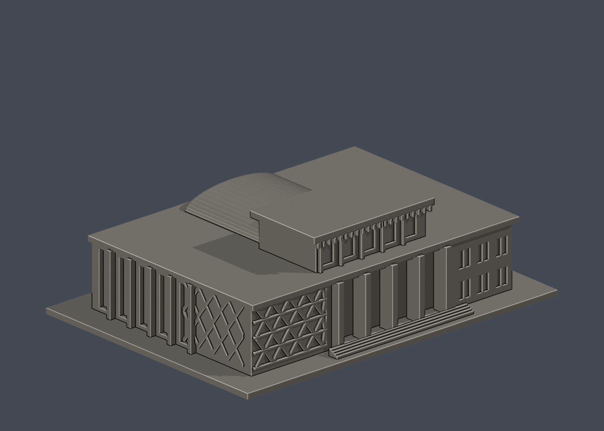

# 國立臺東大學 臺東校區

本輪核准的外觀近似模型套件；全校尚未完成。套件可能包含相連群組、局部或歷史外觀，件數不等於完整建築棟數。未正式切片、未生成經驗證G-code、未實體試印。各件警示、來源年代、背面簡化及支撐需求請讀詳頁。只公開來源URL，不散布原照片或PDF。

| 建築／模型 | 建築／模型 | 建築／模型 |
|---|---|---|
| [食品生技實習工廠（原中正堂）](buildings/taitung-food-biotech-factory/README.md)  [資料夾](buildings/taitung-food-biotech-factory) |  |  |
