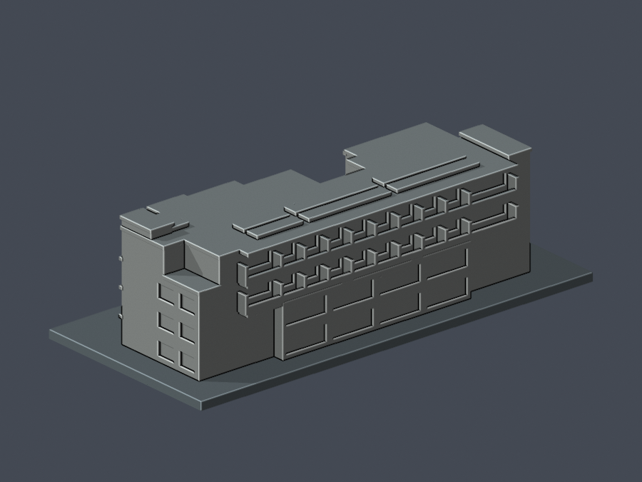

# 國立臺東專科學校｜誠樸校區

本批僅有C03學生綜合樓1件完整主體近似模型（凍結v1）；不代表全校或全校區完成。

| 模型預覽 | 模型預覽 | 模型預覽 |
| :---: | :---: | :---: |
| C03學生綜合樓（同棟正、背並列）   [模型、來源、年代限制與驗證](buildings/ntc-student-complex/README.md) |  |  |

範圍：2016–2017竣工主體，NLSC 2023標記正射核屋面；不是2026精確現況。2025示意5F與四層原始資料的差異未擅自解讀。C03以外其他棟仍未完成，沒有以研究候選項目充當已完成模型。
