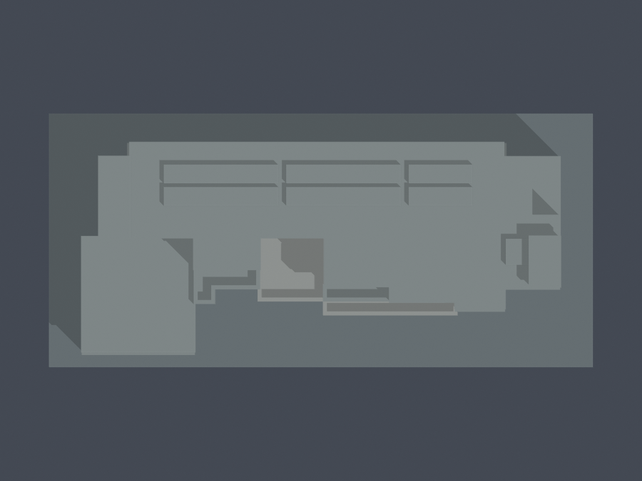
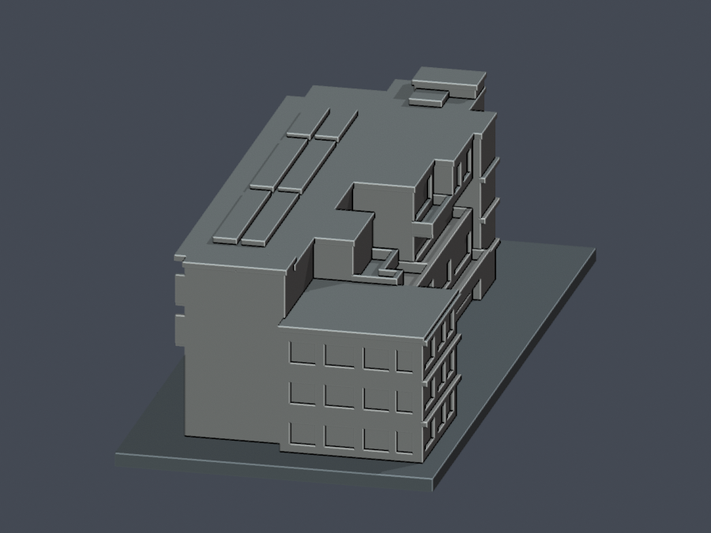
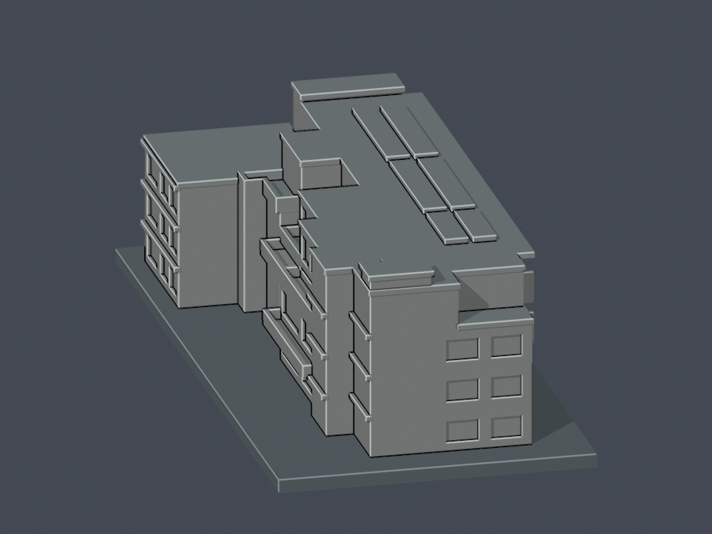
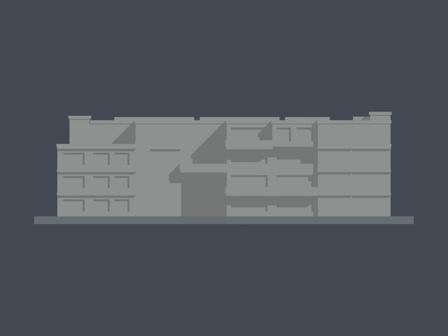

# C03 學生綜合樓（竣工主體近似）

國立臺東專科學校｜誠樸校區｜完整主體、簡化細部。

**狀態：凍結v1，外觀覆核與獨立數位QA通過。** 本件不代表整個校區或全校完成。

| 模型預覽 | 模型預覽 | 模型預覽 |
| :---: | :---: | :---: |
| 正面：南側  | 背面：北側  |  |

[頂視](previews/top.png) · [西側](previews/west.png) · [東側](previews/east.png) · [南側正立面](previews/south-elevation.png) · [北側正立面](previews/north-elevation.png)

| 模型預覽 | 模型預覽 | 模型預覽 |
| :---: | :---: | :---: |
| 頂視  | 西側  | 東側  |
| 南側正立面  | 北側正立面  |  |

## 範圍與證據年代

模型依校方C03全1–4F空間編碼圖、2016落成四層說明、2017校方海報實景及浮水印「NLSC 2023」的正射屋面建立。不是2026精確現況、竣工測量或法定樓層認定。2026網頁更新日不等於建築測量日期；2017是海報年代，正射也沒有精確攝影日。

保留四層北側長條主體、三層西南凸翼、東北上層退縮、南側中央凹入、3F大平台、4F中央梯間旁L形小陽台、梯間屋突與主屋面。南北側分層陽台、主要水平簷帶與窗帶以可列印尺度簡化。北側1–2F玻璃牆依圖突出至柱網外約1.8公尺；南側2F陽台較深、3F退縮，4F東半房間再前伸，沒有把四層壓成同一足跡。

重要限制：
- 校圖原標5848×2380，換成58.48×23.80公尺是依常見cm單位的推定，非圖面明示單位；層高4.1公尺、屋突高度與細部開口尺寸也屬近似。
- 3F大平台及4F退空有直接平面證據；其下作入口挑空與淨高是圖面推讀，沒有剖面獨立核實。這不是已證實的封閉中庭。
- 2025安全示意標至5F，與原1–4F图及2016四層說明不同。本件不補造整個第五層，也不聲稱5F已證明只指屋突。
- 2017實景只有約120×80像素。照片確有圓窗高塔，但無法唯一對位為中央或端部；本件省略圓窗，不任意定位。屋突仅依樓層圖和正射可以互證的部位建立。
- 光電板以連接屋面的粗略板組表示，不能當作2016設備原貌；細窗格、管線、冷氣、百葉和室內不還原。

來源網址、物理頁／圖次、支持特徵與限制見 [sources.json](sources.json)。原照片及原PDF不隨公開包散布。

## 檔案與重建

- [model.stl](model.stl)：唯一列印網格，毫米；底座朝下，最大外廓150×70×44.28975 mm
- [scene.blend](scene.blend)：由實際交付STL匯入的可編修網格，不是照片代理物件
- [build_model.py](build_model.py)：獨立原創參數化幾何來源；[requirements.txt](requirements.txt)
- [render_preview.py](render_preview.py)：從實際STL產生全部900×675 PNG與Blend；[render-manifest.json](render-manifest.json)綁定輸入STL及每張PNG SHA
- [independent-validation.json](independent-validation.json)：獨立審核；[source-reference-index.json](source-reference-index.json)：來源下載網址與原檔校驗（不含影像）。
- [run_all_checks.py](run_all_checks.py)：完整數位驗證；[validation.json](validation.json)、[qa-summary.json](qa-summary.json)、[SHA256SUMS](SHA256SUMS)

以Python 3.12安裝requirements後執行：

    python build_model.py
    blender -b -t 3 -P render_preview.py
    python run_all_checks.py

預覽的屋面與底座對比色僅輔助看圖，STL本身不含材質。

北為+Y、東為+X、上為+Z；底座z=0至3 mm。每公尺對應2.25 mm，名義約1:444.44，因實體尺寸單位推定而不是精密比例保證。模型建構使用0.00225 mm重疊避免共面布林碎片，不透過修補輸入STL掩蓋缺陷。

## 列印與薄件警示

底座平面朝下。中央3F平台下方、北側陽台底面、外挑簷及階梯屋頂可能需要支撐或逐處評估橋接；不能以幾何通過代替切片器的支撐設定。

設計細件尺寸與根部連接：
- 陽台板／主簷帶厚約1.13 mm；陽台欄板及分隔板寬約1.13 mm，與牆、平台或相鄰欄板實體相連
- 北側陽台外挑約3.94 mm、南側最多約4.28 mm，從後牆、側板與樓板相接，底面仍有懸挑
- 中央大平台有約18 mm寬的下方挑空，平台後緣與兩侧主體相接；3D列印支撐另行判斷
- 低屋面壓頂約1.17 mm厚；主屋面約1.2645 mm厚，其北緣另有最多4.275 mm懸挑；屋突蓋約1.13 mm厚，皆連到下方主體，仍須局部支撐評估
- 簷口突出牆面約1.01 mm，以整段根部連接；光電板組厚約1.42 mm，根部嵌入主屋面
- 窗為淺凹，不用薄玻璃片、孤立窗框或尖細欄杆。圓窗因定位未知未建模

[thin-feature-review.json](thin-feature-review.json)列全部類別、尺寸与檢查限制。0.8 mm參考形態檢查會損失少量銳角，不等同每個方向的最小壁厚量測；没有用面積閾值忽略分裂或消失的小構件，也沒有薄件豁免。

## 數位驗證邊界

原始STL以完全相同座標去重後檢查，沒有修補或重算法向：水密、每邊兩面、vertex link單一環、單一連通表面、原始法向／繞序一致、正體積與150 mm上限。另核獨立重建STL SHA、Blend三角幾何，以及獨立重建／渲染7張PNG的逐byte一致。

0.2 mm逐層（固定z起點0.071 mm）檢查degree2閉合、每個Polygon及合成輪廓有效；每個原Polygon做0.4 mm erosion及opening須零消失、零分裂。使用既核canonical v3，沒有buffer(0)或make_valid修補fallback。入口與陽台通空以原STL射線另核。

這不是Cura／Prusa實際工具路徑、全面自交證明或實體試印。原創幾何可修改；公開来源影像版权属各來源。凍結記錄見 [freeze-record.json](freeze-record.json)；往後修改須另開新版，不能覆寫本版。
