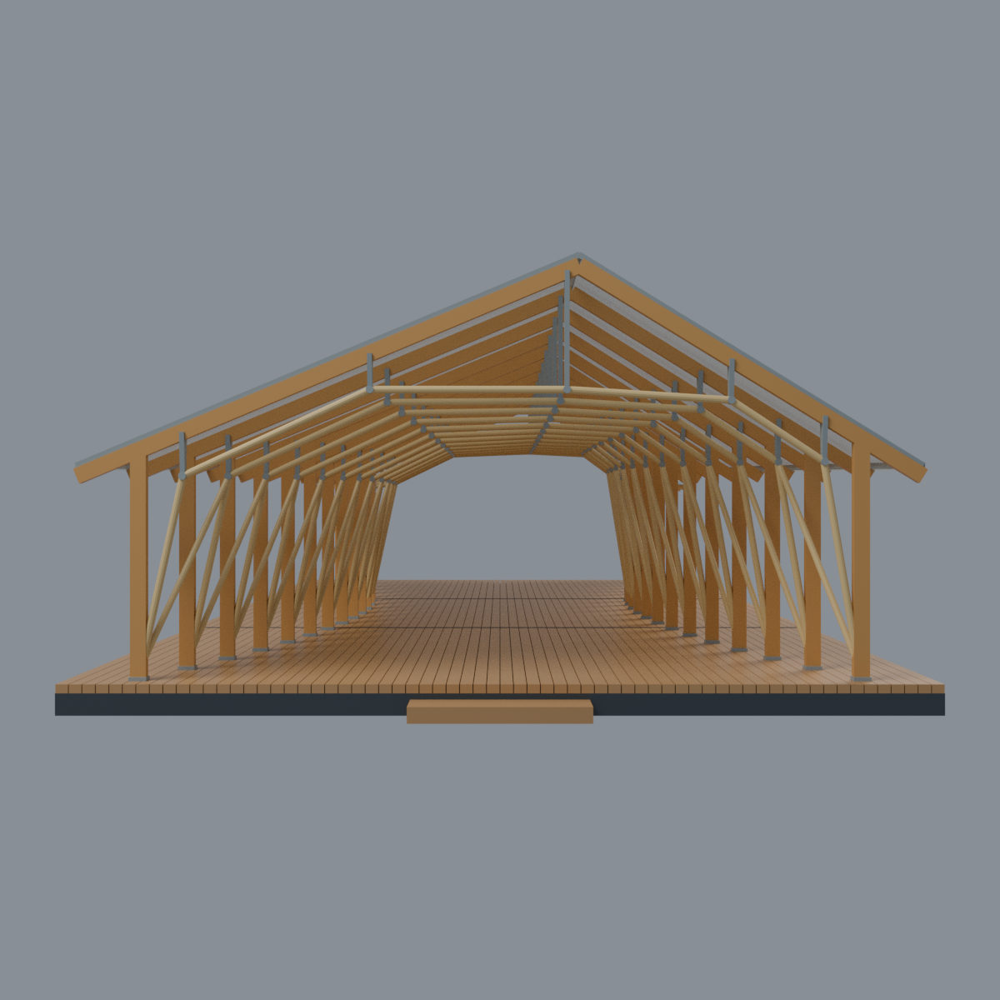

# 國立臺灣大學：公開外觀3D列印模型

本校 **48 套**，其中校總區 **43 套**；套件數不等於整棟建築數，非全校完成。

目前收錄48件有明示範圍的外觀近似模型，分布於校總區、竹北校區、雲林校區、城中校區（含臺大醫院場域）；另收校外溪頭實驗林樹之歌2019單棟；城中竹木隧道與溪頭木屋均非校總區，非2026現況調查。不是全校完成，也不是48棟完整測繪模型；前部、歷史狀態或局部入口段的範圍以各詳頁為準。地質標本小屋與地質館前棟是不同實體，但不等於兩個官方索引項目。

既有43件含STL、OBJ、Blender場景、可攜式參數化來源、原STL正背預覽及繁體中文來源說明。既有件獨立最長150mm；新增校門段為154mm展示寬，不能當同一比例校園拼接；來源照片未重新散布。

## 下載前
- 已驗證原STL法向、流形邊/頂點、單一連通封閉表面、正體積、獨立重建與Blender幾何一致性。
- 前34件另作[新增截面有效性與薄篩補查](qa/printability-20261013/README.zh-TW.md)，第11至13批9件在各模型內有同類結果。
- 工科海洋入口段只提供修訂v2：消除舊版窗框相切折返。舊版STL不在此整合包中，建物件數不變。
- 尚未用真正列印切片器生成工具路徑或實體試印。屋簷、門廊、跨距及細節需要支撐/解析度評估。國發所、第一學生活動中心的頂尖及地質前棟拱罩的薄篩警示見附錄，不能以支撐取代細節線寬檢查。

## 校區入口
[校總區](校總區/README.md) · [竹北校區](竹北校區/README.md) · [雲林校區](雲林校區/README.md) · [城中校區](城中校區/README.md) · [溪頭實驗林（校外基地）](溪頭實驗林/README.md)

## 三欄圖鑑
每格為不同模型項目；點圖可開詳頁，內有同一件的正、背面實際STL圖與下載。

| 建築模型 | 建築模型 | 建築模型 |
| :---: | :---: | :---: |
|  [第一行政大樓（歷史前棟）](校總區/buildings/ntu-administration/README.md) |  [農業陳列館](校總區/buildings/ntu-agricultural-exhibition/README.md) |  [文學院歷史館舍](校總區/buildings/ntu-liberal-arts/README.md) |
|  [總圖書館](校總區/buildings/ntu-main-library/README.md) |  [舊總圖書館／校史館（歷史前棟）](校總區/buildings/ntu-old-main-library/README.md) |  [博雅教學館](校總區/buildings/ntu-boya-lecture/README.md) |
|  [第一學生活動中心（歷史前棟）](校總區/buildings/ntu-first-student-center/README.md) |  [新月台](校總區/buildings/ntu-new-moon-pavilion/README.md) |  [普通教學館](校總區/buildings/ntu-putong-lecture/README.md) |
|  [綜合體育館](校總區/buildings/ntu-sports-center/README.md) |  [電機一館（主要前棟）](校總區/buildings/ntu-electrical-engineering-one/README.md) |  [舊體育館](校總區/buildings/ntu-old-gymnasium/README.md) |
|  [新生教學館](校總區/buildings/ntu-xinsheng-lecture/README.md) |  [農藝館](校總區/buildings/ntu-agronomy/README.md) |  [生化科學研究所（歷史前棟）](校總區/buildings/ntu-biochemical-sciences-front/README.md) |
|  [工學博物館（修復保留館體）](校總區/buildings/ntu-engineering-museum-retained/README.md) |  [應用力學研究大樓（主要前棟）](校總區/buildings/ntu-applied-mechanics-front/README.md) |  [圖書資訊學系館](校總區/buildings/ntu-library-information-science/README.md) |
|  [碧禎館](竹北校區/buildings/ntu-bizhen-hall/README.md) |  [工程科學及海洋工程學系館（五波浪入口段）](校總區/buildings/ntu-esoe-wave-entrance/README.md) |  [獸醫一館](校總區/buildings/ntu-veterinary-one/README.md) |
|  [嚴慶齡工業研究中心](校總區/buildings/ntu-yen-tjing-ling-center/README.md) |  [明達館（電機四館）](校總區/buildings/ntu-mingda-hall/README.md) |  [國家發展所大樓](校總區/buildings/ntu-national-development/README.md) |
|  [鋤禾館（雲林分部農業育成推廣中心）](雲林校區/buildings/ntu-chuhe-hall/README.md) |  [電機二館（主立面量體）](校總區/buildings/ntu-electrical-engineering-two/README.md) |  [社會及社工館](校總區/buildings/ntu-sociology-social-work/README.md) |
|  [知武館](校總區/buildings/ntu-tomatake-hall/README.md) |  [醫學人文博物館（中央樓及西翼外部量體）](城中校區/buildings/ntu-medical-humanities-museum/README.md) |  [大氣科學館B館](校總區/buildings/ntu-atmospheric-science-b/README.md) |
|  [地質科學館（三層前棟）](校總區/buildings/ntu-geology-front/README.md) |  [植物標本館（主館）](校總區/buildings/ntu-herbarium-main/README.md) |  [磯永吉紀念室（2026修繕前外觀）](校總區/buildings/ntu-iso-cottage-pre-restoration/README.md) |
|  [氣象館A館](校總區/buildings/ntu-meteorology-a/README.md) |  [食品科技館（原館前部）](校總區/buildings/ntu-food-science-front/README.md) |  [地理館（前部）](校總區/buildings/ntu-geography-front/README.md) |
|  [地質標本館小屋](校總區/buildings/ntu-geological-specimen-cottage/README.md) |  [語文大樓（前部）](校總區/buildings/ntu-language-front/README.md) |  [霖澤館（主棟）](校總區/buildings/ntu-linze-main/README.md) |
|  [萬才館（主棟與前階梯段）](校總區/buildings/ntu-wancai-main/README.md) |  [博理館](校總區/buildings/ntu-bory-hall/README.md) |  [化學工程館正門入口段](校總區/buildings/ntu-chemical-engineering-entry/README.md) |
|  [社會科學院主棟](校總區/buildings/ntu-social-sciences-main/README.md) |  **[國立臺灣大學歷史校門：弧形前牆與內側雙行人門段](校總區/buildings/ntu-historic-gate-front-segment/README.md)** |  **[國立臺灣大學｜傅鐘鐘亭](校總區/buildings/ntu-fu-bell-pavilion/README.md)** |
|  **[國立臺灣大學｜傅園斯年堂](校總區/buildings/ntu-si-nian-memorial-hall/README.md)** |  **[臺大醫院國際會議中心前廣場｜竹木隧道 Bam-Wood Hut（2018）](城中校區/buildings/ntu-hospital-bam-wood-hut-2018/README.md)** |  **[臺灣大學溪頭實驗林｜樹之歌木屋（2019）](溪頭實驗林/buildings/ntu-xitou-tree-song/README.md)** |

## 清冊與版本
[全校待辦與來源缺口](inventory/README.zh-TW.md) · [48件現行索引](model-index.json) · [完整SHA256](SHA256SUMS) · [批次紀錄](batches/)

[下一階段逐項來源與缺口](inventory/CONTINUE.zh-TW.md) · [第12批補查](qa/batch12-20261013/README.zh-TW.md) · [第13批補查](qa/batch13-20261013/README.zh-TW.md)

[臺大地質標本館小屋外觀與來源界線](校總區/buildings/ntu-geological-specimen-cottage/appearance/README.md)

[臺大舊體育館外觀與來源界線](校總區/buildings/ntu-old-gymnasium/appearance/README.md)

[臺大博理館外觀與來源界線](校總區/buildings/ntu-bory-hall/appearance/README.md)

[臺大農藝館外觀與來源界線](校總區/buildings/ntu-agronomy/appearance/README.md)

[臺大電機一館外觀與來源界線](校總區/buildings/ntu-electrical-engineering-one/appearance/README.md)

[臺大地理館前部外觀與來源界線](校總區/buildings/ntu-geography-front/appearance/README.md)

[臺大食品科技館前部外觀與來源界線](校總區/buildings/ntu-food-science-front/appearance/README.md)

[臺大圖書資訊學系館外觀與來源界線](校總區/buildings/ntu-library-information-science/appearance/README.md)

[臺大生化所歷史前棟外觀與來源界線](校總區/buildings/ntu-biochemical-sciences-front/appearance/README.md)

[臺大農業陳列館外觀與來源界線](校總區/buildings/ntu-agricultural-exhibition/appearance/README.md)

[臺大磯永吉紀念室修繕前外觀與來源界線](校總區/buildings/ntu-iso-cottage-pre-restoration/appearance/README.md)

[臺大語文大樓前部外觀與來源界線](校總區/buildings/ntu-language-front/appearance/README.md)

[臺大工科海洋五波浪入口段外觀與來源界線](校總區/buildings/ntu-esoe-wave-entrance/appearance/README.md)

[臺大工學博物館保留館體外觀與來源界線](校總區/buildings/ntu-engineering-museum-retained/appearance/README.md)

[臺大第一學生活動中心歷史前棟外觀與來源界線](校總區/buildings/ntu-first-student-center/appearance/README.md)

[臺大嚴慶齡工業研究中心外觀與來源界線](校總區/buildings/ntu-yen-tjing-ling-center/appearance/README.md)

[雲林鋤禾館木屏與框簷限定配色外觀與來源界線](雲林校區/buildings/ntu-chuhe-hall/appearance/README.md)

[綜合體育館銀灰屋蓋與入口塔限定配色外觀與來源界線](校總區/buildings/ntu-sports-center/appearance/README.md)

[普通教學館中央高拱窗限定配色外觀與來源界線](校總區/buildings/ntu-putong-lecture/appearance/README.md)
