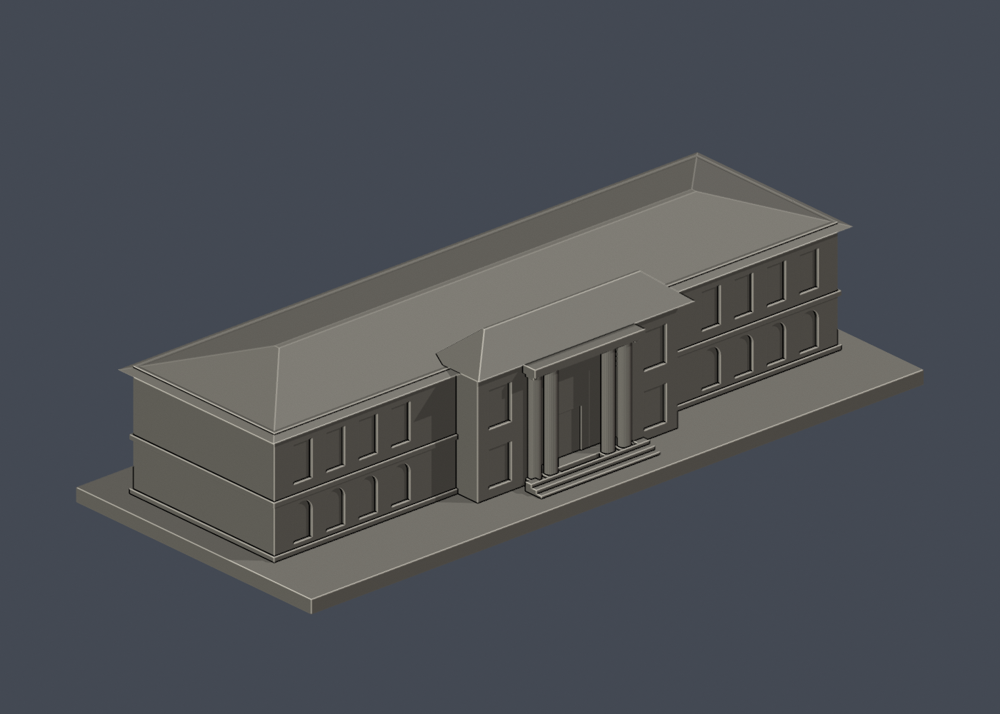
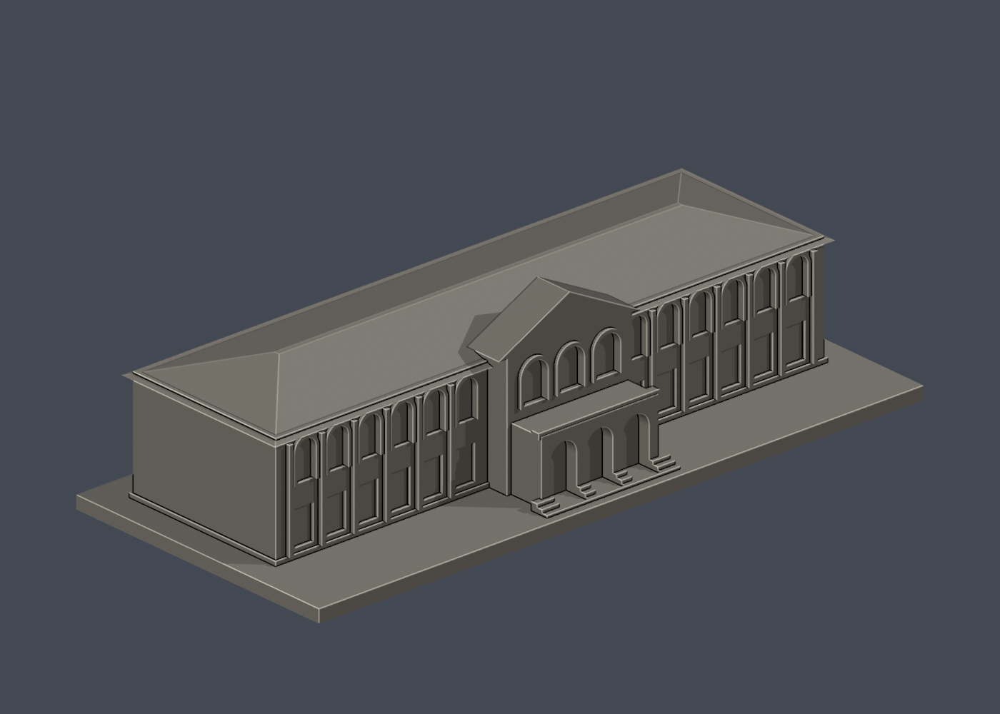
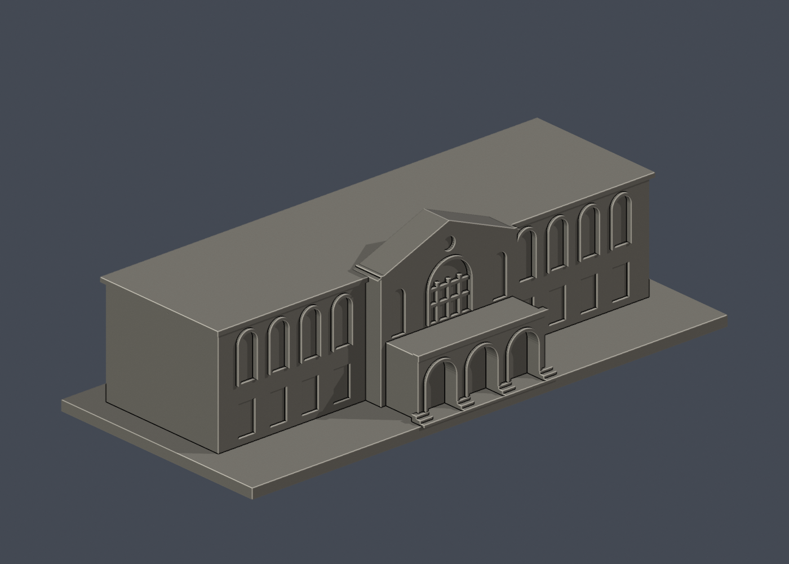

# 國立臺灣大學建築模型

首批 **5 件外觀近似模型**，位於校總區。這不是全校建築完成清單；歷史前棟及學院主要教學棟的範圍限制詳見個別說明。每件獨立展示尺寸，沒有共同校園比例尺。

[本批來源、驗證與尚未涵蓋範圍](校總區/README.zh-TW.md) · [全國院校清冊](../全國大專院校/README.md)

## 三欄模型圖鑑

| 建築模型 | 建築模型 | 建築模型 |
| :---: | :---: | :---: |
|  **[總圖書館](校總區/buildings/ntu-main-library/README.zh-TW.md)** |  **[第一行政大樓（歷史前棟）](校總區/buildings/ntu-administration/README.zh-TW.md)** |  **[文學院歷史館舍](校總區/buildings/ntu-liberal-arts/README.zh-TW.md)** |
|  **[舊總圖書館／校史館（歷史前棟）](校總區/buildings/ntu-old-main-library/README.zh-TW.md)** |  **[農業陳列館](校總區/buildings/ntu-agricultural-exhibition/README.zh-TW.md)** |  |

各件均提供 STL、可重建原始程式、Blender 場景及實際模型預覽。已通過數位網格檢查，尚未完成切片或實體試印；下載後仍須檢查薄壁、懸挑與支撐。預覽材質不包含於 STL。來源照片僅連結，不隨模型再散布。
