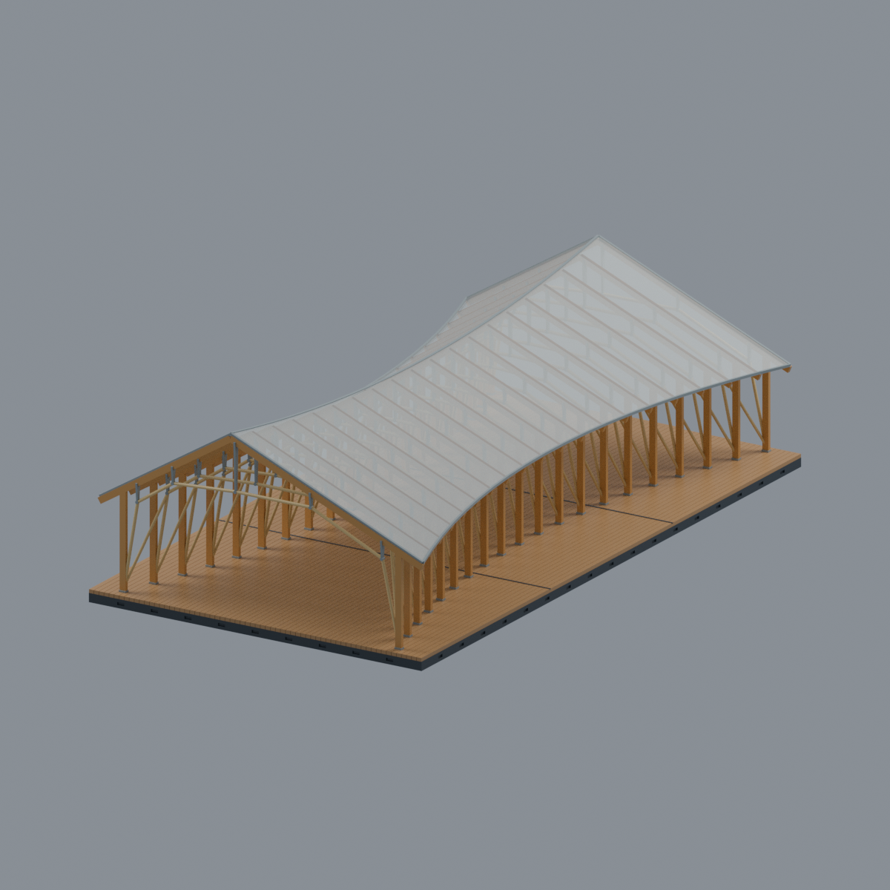
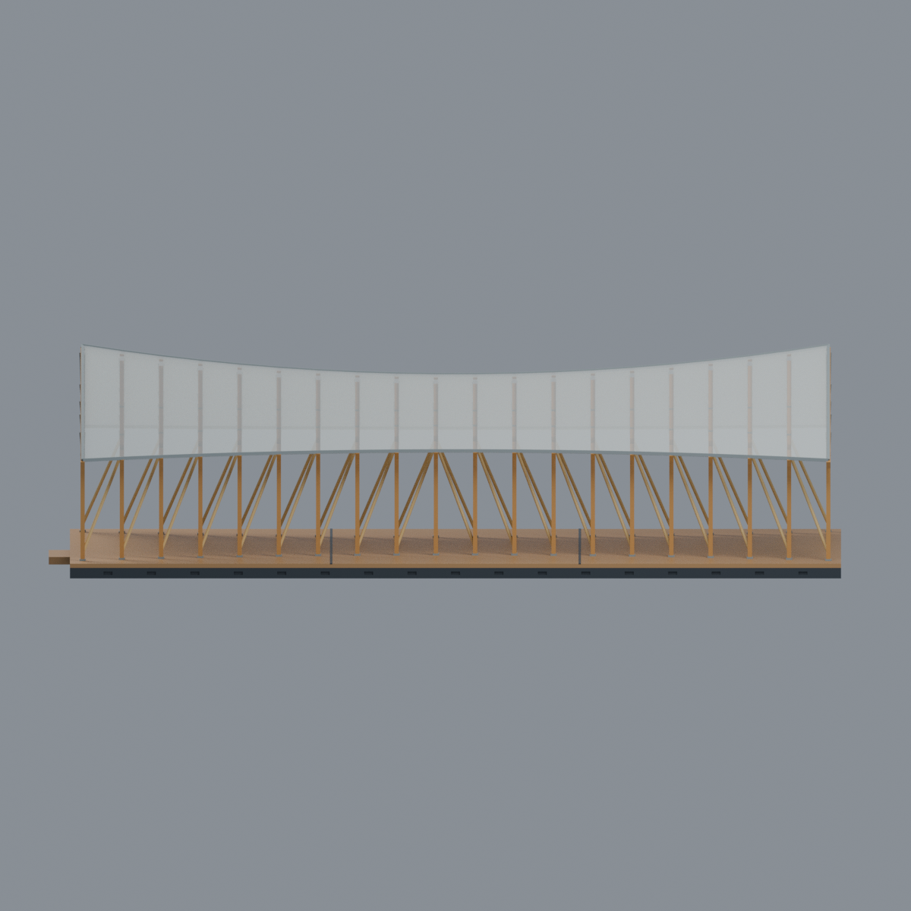
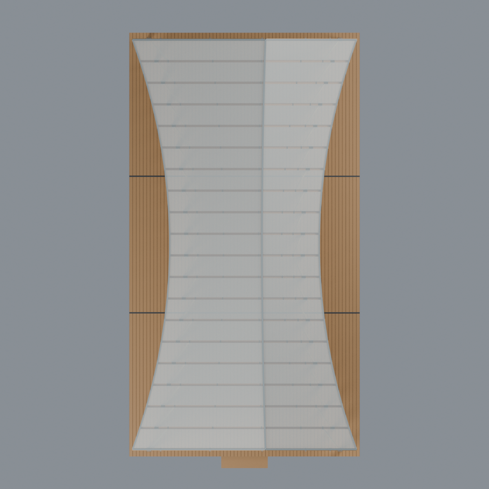
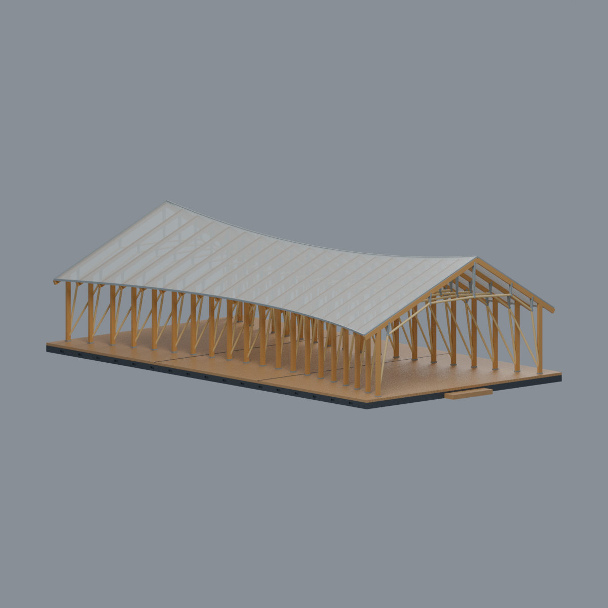

# 臺大醫院國際會議中心前廣場｜竹木隧道 Bam-Wood Hut（2018）

## 模型預覽

| 模型預覽 | 模型預覽 | 模型預覽 |
| :---: | :---: | :---: |
|  |  |  |

**臺大醫院場域／城中校區，不是臺大校總區。** 依王銘顯建築師事務所2018完工照片與典型剖面製作的完整外觀近似。建築位於臺北市徐州路2號會議中心前廣場；此包只含獨立亭體及其原有抬高平台／小階，不含會議中心或醫院大樓。**重建的是2018歷史外觀，不宣稱2026仍存在或狀態未變。**

## 可辨識形體與真空隙
- **20榀木構、19跨、40根立柱**；兩列柱在平面向中央束腰，柱跨度由端部約82mm收至中央約50mm，平台仍為矩形。
- 兩端高、中央低的偏脊線；每榀是兩根直屋梁形成的**非等坡雙坡**，不是等寬重複人字棚或桶形實心隧道。
- 每榀六段淺色竹張力多邊弧（上方近水平鏈段）與獨立灰色鋼支承；竹弧和屋梁之間保留真實空氣間隔。
- 側向採單向斜杆連結，不把透視重疊一律補成每跨雙X。**逐跨連接、前後反手點及小接頭是照片導引的簡化估值，不是施工放樣。**
- 兩端、兩長側及中間通道開放；沒有補實牆或不透明山牆三角。38片頂面近似連成完整屋蓋。
- 暖色木柱／屋梁、淺竹、鍍鋅鋼、白色半透明聚碳酸酯頂、木平台及深色基座。未把圖紙的Prototype II／III未建變體加進實物。

## 材質與列印轉譯

`scene.blend`與`model.3mf`均含**6種可編輯逐面材質**；頂面Alpha為100/255，表示白色半透明聚碳酸酯，不是木屋頂。這是展示材質近似，沒有量測光學透射率。部分切片器會忽略3MF的顯示Alpha。

**STL不保存顏色或透明。** 頂面保留為約0.78mm垂直厚度的實片；使用不透明耗材會印成不透明屋頂，不能把透明預覽當成單色實印結果。若要透明實物，需要另行選擇透明材料／製程，或編輯材質分區設計分件薄片；此包未驗證那類組裝方案。3MF與Blend是一個融合網格，可按材質選取編輯，**不是預先分拆的38片屋頂或可拆裝結構**。

## 尺寸、估值與薄件風險

最終外包約 **99 × 187 × 52.188 mm**，含前方小階；平台99×182mm。來源標示L18.2m／W9.9m／H5.2m，典型剖面另標高4.2–5.0m、文章約5m；模型僅以這些作約1:100外包參考，**不是精確實測比例，也未強行消除來源高度差異**。

原圖木料80×180mm、竹徑60mm、鋼管30×60×2t為設計典型值。模型木料約1.8×1.0mm、竹弧直徑0.86mm、縱斜竹0.76mm、鋼支承0.55×0.65mm、頂片垂直厚0.78mm，均有展示／製作調整。柱列曲線、脊偏移、各榀站位／坡度、頂片板縫、鋼接頭與地板細節是估值。原平台隱蔽底部以實心連通芯簡化，側邊通風網格用淺凹槽表示，**不是完整鋼梁／地下基礎重建**；沒有新增周邊場地大底板。

**未實印，不保證免支撐。** 竹／鋼件、頂邊、斜面尖端及地板細槽存在真實0.8mm切層侵蝕警告；薄件未因整體連通而被宣告合格。屋頂下方、竹弧與鋼支承可能需要支撐，支撐移除也可能折斷細杆。請依實際材料、縮放、設備與擺向重新切片；[QA](QA.md)保留所有警告。

## 內容與重建

| 檔案 | 用途 |
|---|---|
| `scene.blend` | 同一最終網格、6材質、相機與燈光；可編輯，無原照／內嵌腳本 |
| `model.3mf` / `model.stl` | 相同三角座標與順序；3MF帶材質，STL僅幾何 |
| `build_model.py` / `render_model.py` | 原始參數生成與五視圖渲染 |
| `mesh.json` / `palette.json` | 精確幾何與逐面材質對照 |
| `qa_model.py` / `check_features.py` / `verify_*.py` | 原始拓樸、全局切層、局部實體／空氣、格式往返與hash檢核 |
| `rebuild.py` | 全新目錄獨立重建核心4檔及5PNG，逐檔bytes比較 |
| `SOURCES.md` / `sources.json` | 來源連結、日期界線、作者及逐圖用途；沒有原始照片／圖紙 |
| `QA.md` / `qa/` / `qa-*.json` / `SHA256SUMS` | 檢核數值、限制及檔案hash |

[正面](previews/front.png) · [後面](previews/rear.png) · [側立面](previews/elevation.png) · [俯視](previews/top.png) · [斜視](previews/left_oblique.png)

| 模型預覽 | 模型預覽 | 模型預覽 |
| :---: | :---: | :---: |
| 後面<br> | 側立面<br> | 俯視<br> |
| 斜視<br> |  |  |

五圖皆由交付的最終網格渲染，沒有原照合成、示意圖替代或後製補構件。

Python3.12／Blender4.3.2驗證；依`requirements.txt`準備Python依賴，Blender另裝。在本資料夾執行：

```bash
python build_model.py
python qa_model.py
python check_features.py
python verify_exchange.py
blender -b -t 8 --python-exit-code 1 --python render_model.py
blender -b -t 8 --python-exit-code 1 --python verify_scene.py
blender -b -t 8 --python-exit-code 1 --python verify_render.py
python rebuild.py --output ../independent-new --threads 8
python verify_package.py
```

CPU Cycles、seed0、96 samples、不降噪；PNG僅去除文字／日期metadata，不改像素。獨立重建要求全新目錄；不保證跨Blender版本或計算環境bytes相同。修改幾何或材質後須重跑全部QA及來源視覺審查。建築及來源權利不隨原創模型授權轉移，見[LICENSE](LICENSE)。
