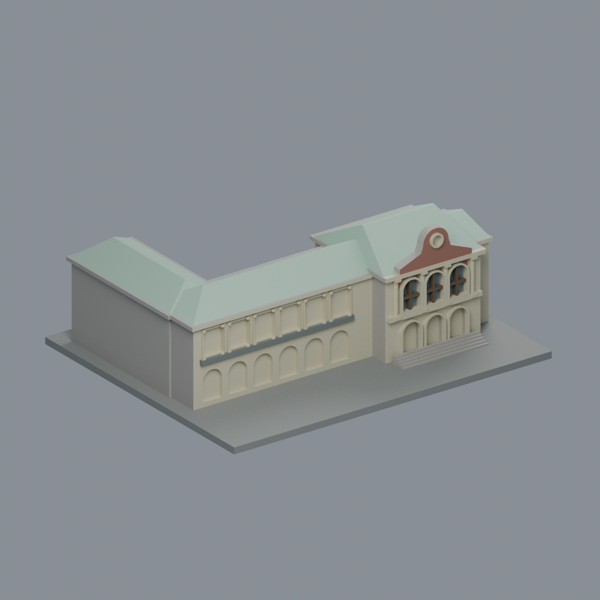
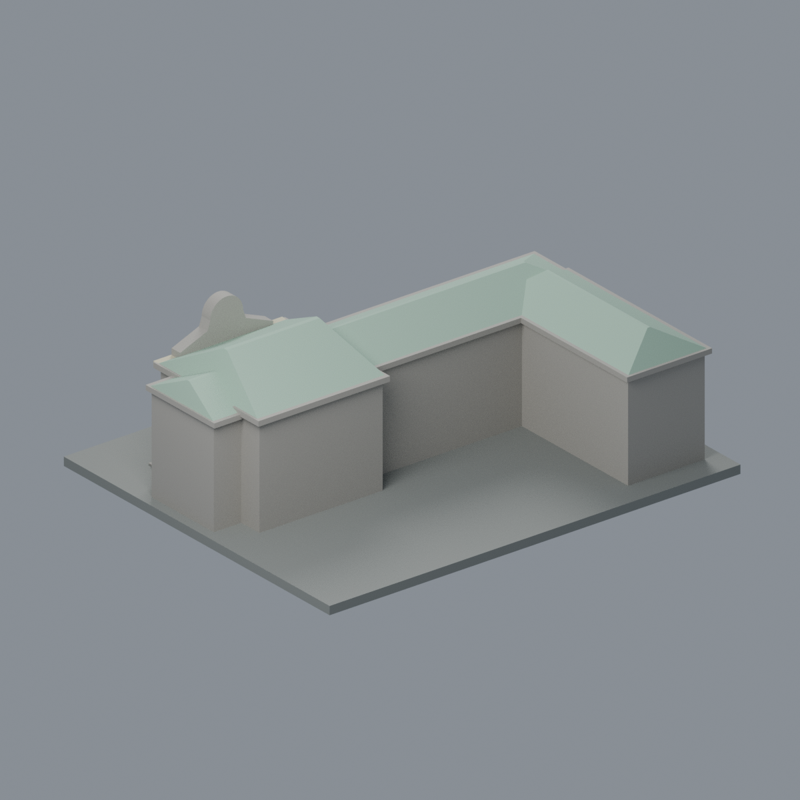
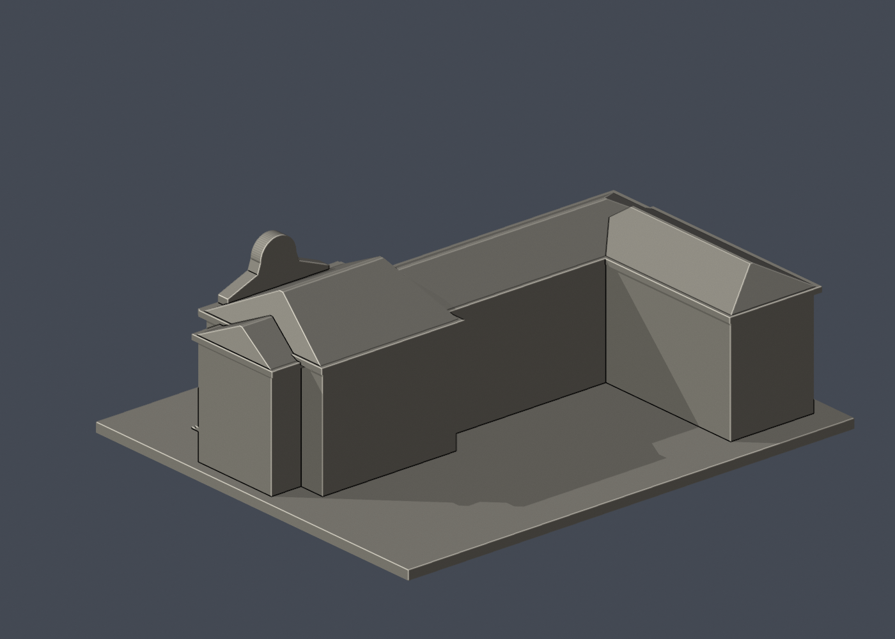

# 國立臺灣大學 醫學人文博物館（中央樓及西翼外部量體）

[返回校區圖鑑](../../README.md) · [返回臺大總圖鑑](../../../README.md)

## 實際 STL 正面與背面

## 最新八材質外觀版（2026-10-20）

| 模型預覽 | 模型預覽 | 模型預覽 |
| :---: | :---: | :---: |
| 正面原幾何配色  | 背面與未見面保持中性  |  |

[來源界線與四視角](appearance/README.md) · [表面色 3MF](appearance/medical-appearance.3mf) · [可編輯場景](appearance/scene.blend)

依官方立面與原攝影者空拍登錄薄荷綠金屬屋面、中央磚山牆、奶白柱與拱圈及原上層窗格。西翼和下層凹格是廊道，不染成玻璃；圓章淺色，未知牆面中性。來源發表年份不等於拍攝日期，不宣稱現況。原STL與歷史QA不變，不是新增幾何。[原單色正面](previews/front.png)／[原單色背面](previews/rear.png)

| 模型預覽 | 模型預覽 | 模型預覽 |
| :---: | :---: | :---: |
| 原單色正面  | 原單色背面  |  |

[下載 STL](model.stl) · [Blender 場景](scene.blend) · [參數化來源](build_model.py) · [驗證結果](validation.json)

[新增34件列印幾何補查與細節警示](../../../qa/printability-20261013/README.zh-TW.md)

官方索引代碼 CZ11。公開外觀近似模型，非測繪或BIM。

## 範圍與比例
依官方中央入口照片與2023公開攝影者外觀、高角度屋頂照片，近似保留中央樓和西翼L形量體。各翼比例、進深與斜屋頂高度為目測；背面、端面與樹遮裝飾留白，未復刻後方舊講堂遺留立面。不包含已拆講堂、1930年前塔樓/老虎窗或旁邊醫院大樓；不是整組醫學院歷史建築復原。

保留辨識特徵：中央兩層三拱、上層柱式、帶圓飾的曲線山牆、左側下拱上柱廊、斜坡屋頂及西翼轉折。柱頭與山牆曲線已加厚簡化，廊道改成保留背牆的淺凹。

尺寸 [150.0, 124.0, 55.0] mm，含底座最長150 mm。各館獨立比例，不是可拼接的共同尺度校園沙盤。尺寸、厚度、窗距均為照片目測和列印簡化，不是原建物實測。

## 列印
- 底座向下，毫米單位。參考起點：0.4 mm噴嘴、0.16–0.2 mm層高、3道外牆、15–20%填充。須依自己的切片器調整。
- 曲線山牆、拱及屋簷有懸垂，須局部支撐；長翼柱廊加粗、有背牆。不含薄玻璃或細金屬欄杆。
- 新增細浮雕名義最小約0.9 mm；這不是全模型最小壁厚的測量結果。零碎設備、文字招牌、樹木、電線及細緻裝飾沒有加入。
- 門窗背牆與實心量體避免隱藏內殼；實際填充由切片器決定。
- 未實際列印；未用PrusaSlicer、Cura等生成工具路徑。不宣稱無支撐或無風險可印。

## 驗證與檔案
- model.stl、model.obj；scene.blend是由實際STL匯入的可編修網格。
- build_model.py為獨立參數來源；Python3.12，依requirements.txt裝依賴後執行python build_model.py。
- Blender4.3.2：blender -b -t 2 -P render_preview.py。previews/front.png、rear.png、elevation.png均直接渲染交付STL。
- python validate_model.py：原始法向、水密、流形邊／頂點、單一連通表面、無分離封閉內殼、正體積、150mm、獨立重建SHA256及已儲存Blender/STL三角幾何一致性。結果validation.json。
- python check_layers.py：每0.2mm水平截面幾何檢查，共 275 層，所抽樣截面全部閉合。首層採z=0.071mm避免重合平面退化，非實際列印首層設定。
- layer-check.json另記向下超45度面積指標與各層輪廓；它不是切片器、最小壁厚測試或實體試印。閉合截面不保證擠出連續、橋接、支撐可拆、床面附著或局部細節可印。
- SHA256SUMS可核對檔案；更改參數後需重建、重繪、重驗證。

## 公開來源
查閱及圖像像素檢視：2026-10-13。來源照片未隨檔重新散布。
- [醫學院官方博物館身份](https://www.mc.ntu.edu.tw/mmh/Index.action)
- [醫學院官方建築歷史頁，確認歷史建築範圍](https://homepage.ntu.edu.tw/~ntummh/)
- [實際檢視官方中央三拱及山牆正面](https://homepage.ntu.edu.tw/~ntummh/images/visit_pic.png)
- [2023原攝影者公開外觀系列，僅使用照片不採其產權敘述](https://justabalcony.blogspot.com/2023/05/just-old_18.html)
- [實際檢視公開高角度屋頂及西翼轉折](https://blogger.googleusercontent.com/img/b/R29vZ2xl/AVvXsEhI3DFaWlDkrIZXy0hr8wlZJ1gbWFGI8x_EAo1v-DLTWR577yjTvZeM3hUToyy-wIECp2lU6F7RyIuN8e1GlYCiE1F8JKNh9I3SGgQLGLsZPypQCA5lZxSbinYEvM0by-EwgSdK-ph_99pq4NRkuG8uz-8bLBmlm0Da9FoKCLGP1GsnhbSeE99HryDU/s16000/cghghlgl.jpg)
- [實際檢視外部雙層拱柱廊一](https://blogger.googleusercontent.com/img/b/R29vZ2xl/AVvXsEgO24duBDWgfghJuKLADBWBkR0eiQUH-4MlGC-oR2Wc9ZBTAbFXB30wduAkut8Ze4eTbl50qoHyAWM40kzY8t92aEpGE2hrGldMAYW0wunYTz0L5O6I22ttR9BIW33t50fju_5_ebl3dSmeLQUSPi-o9i59AohYiRT9IEuKRTD1DZLyHLggzrW-pwk4/s16000/vhjlhjv%3Bhj%3B.jpg)
- [實際檢視外部雙層拱柱廊二](https://blogger.googleusercontent.com/img/b/R29vZ2xl/AVvXsEhXwLIGqosrj2nu675L0HA7gStbhVxCQhdW6CetSGZp8SmcZPLPCKPPeVdgR8xifF9bBcnPCSDjJ3dq3cG8qEPxEFNNuFhtFHEfGVGnkNqY8nED-Qu3rhe8N9LjtFMIljnsvprosh-h26NllT3UQbadU7U37VQerOpMWCe73sIHefMwhNEah3lmCLTf/s16000/xfgkhchgl.jpg)
- [實際檢視西翼端面局部，未當作完整背面](https://blogger.googleusercontent.com/img/b/R29vZ2xl/AVvXsEjkgdrvs06pugEd2YWHT2huoNaKA72rjh7oJXR3LMXKxbJ_rv00yxN6pbmTjmED44xB6IjFGcpm9SIYDhV4RHrl37YJhS1Kx6aHpV7RKwnqSRhonNTBVhho1ypwV9Fil5PkXu0z9ZRaHmbrl50QL1Y_SMab9nqpD2TE5NMPhQfSb6cuqOPq9uFIcvMg/s16000/cghlgljl.jpg)
- [臺大官方建物索引，檢索標題2026-08-17](https://cpo.ntu.edu.tw/map/C_01_list.pdf)

照片版權屬原權利人；沒有轉授原建築設計或照片權利。不同拍攝日期不等於已核實目前全部外觀。
