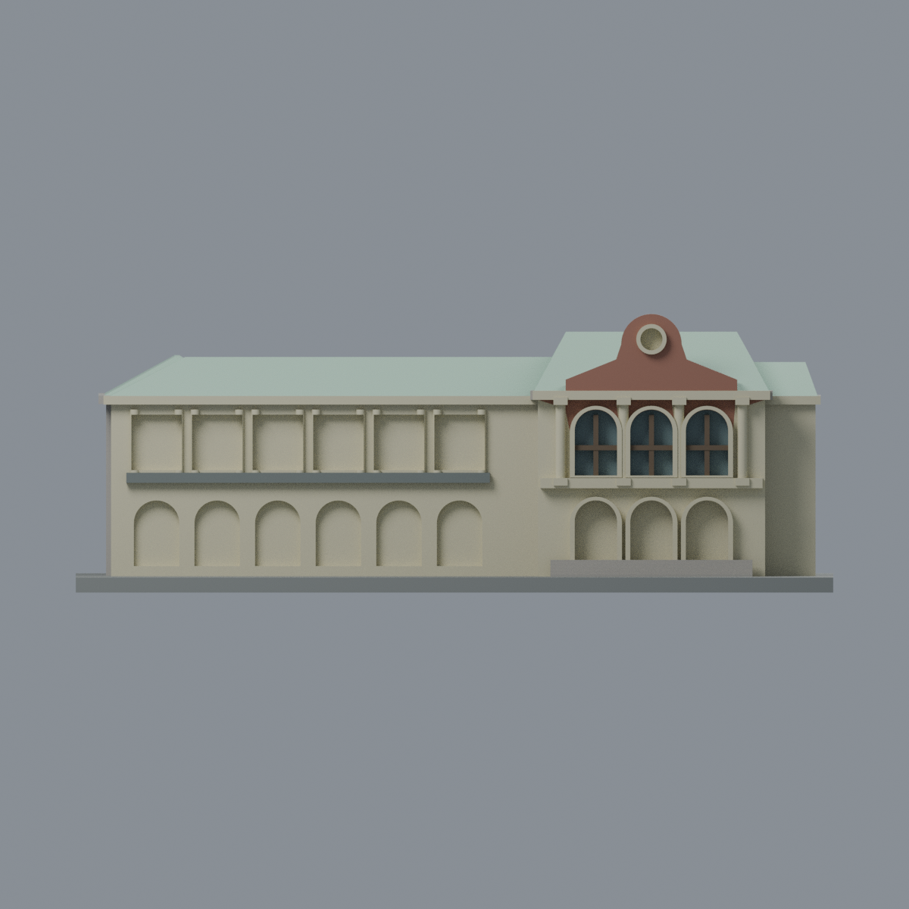
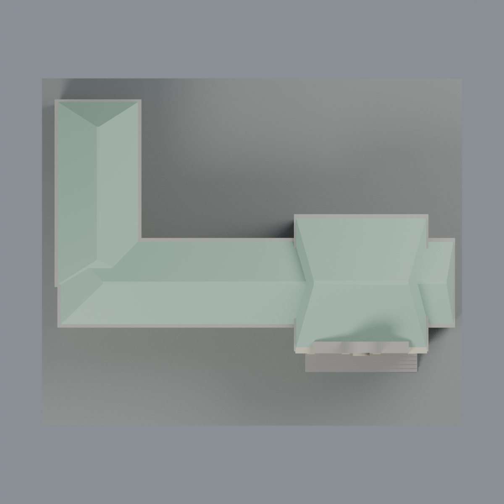

# 臺大醫學人文博物館中央樓與西翼：八材質外觀版

沿用原 **6,292 三角面／3,130 頂點**，不改原 STL 位元、座標、面序或幾何；這是既有模型外觀改版，不增加模型包數。

| 正面 | 背面保持中性 |
|---|---|
|  |  |
|  |  |

[表面色 3MF](medical-appearance.3mf) · [可編輯 Blender](scene.blend) · [材質色表](palette.json) · [逐面指派與依據](face-materials.json) · [原 STL](../model.stl)

## 來源與配色邊界

親自查看 [醫學人文博物館官方介紹](https://homepage.ntu.edu.tw/~ntummh/) 的 [中央立面](https://homepage.ntu.edu.tw/~ntummh/images/visit_pic.png)，以及原攝影者 [Just a Balcony：2023 發表之照片系列](https://justabalcony.blogspot.com/2023/05/just-old_18.html) 的屋頂俯視、西翼與端面照片。**發表年份不是已核實拍攝日期**，不宣稱 2026 現況。各原始影像網址與本地核對雜湊列在來源 QA；第三方照片不隨包散布。

- 原幾何只有保留中央樓、西翼／西向折返與小東段，不是完整歷史校舍。原俯視可登錄的連接屋面為低彩度薄荷綠金屬板代理，**不是灰瓦**；原平頂化屋脊一併同色，但不增添金屬板縫、煙囪或舊塔樓。
- 中央原前山牆磚紅棕色、原圓章邊框及凹背淺色；照片圓章看似實心，原網格凹槽保持原狀，不能改成黑洞，也不新增符號。未分離的山牆外緣不畫假白框，保留原簡化輪廓。
- 中央原上層三拱窗的既有梃條棕色、凹背低彩度玻璃，柱、拱圈與層帶奶白；可分離的上層牆面磚色。實際窄拱周磚／白邊界不完全由原三角面分離，保留未分離面之保守底色，不宣稱逐飾條復原。
- **下層拱廊及西翼凹格是廊道，不是玻璃窗**。它們的簡化後壁與原柱／內緣保持暖奶白，不烘焙成黑影。西翼已有層帶灰色；實際低石基沒有獨立完整原面域，因此不另畫假高度邊界。
- 西折返外牆、後牆及其他未登錄牆面中性；端面照片只核對材質類別，不當作整棟後面已見。原模型缺少後方門窗，不新增。展示底板不是現地地坪。
- 顏色未校準，不複製樹影、雨痕、冷氣、欄杆、字樣、路面或周遭建築；原 STL 的尺度、構件厚化及簡化均保留。

[原幾何與來源界線](../README.md) · [本次來源覆核](qa/source-review.json)

## 重建與核驗

安裝 [依賴](source/requirements.txt)，Blender 使用 4.3.2。由本資料夾上層提供原 model.stl：

1. `python appearance/source/build_appearance.py`
2. `python appearance/source/verify_exchange.py`
3. `blender -b -t 3 --python-exit-code 1 -P appearance/source/render_appearance.py`
4. `blender -b -t 3 --python-exit-code 1 -P appearance/source/verify_scene.py`

[獨立重建 ZIP](rebuild-source.zip)含原 STL、四支程式及依賴，不含第三方照片；不取代原建模腳本。[逐檔 SHA256](SHA256SUMS)

[交換／拓撲 QA](qa/exchange-validation.json)核對原座標與面序、全部面材質、單連通、有向水密邊、頂點 link 單環、正體積與零退化／重複面；lib3mf 嚴格讀取零警告，實際編輯單材質再存讀，其他材質及面指派不變。SDK 六位小數量化誤差另列。

[Blender 存讀與編輯](qa/scene-validation.json) · [渲染記錄](qa/render-manifest.json) · [獨立重建](qa/rebuild-validation.json)

## 製造限制照舊

尺寸仍為 150 × 124 × 55 mm；原 STL、建模程式、場景及歷史 QA 保留。原層檢與薄特徵檢查本次未重跑，不能由材質 QA 代替。

3MF 是同一網格的表面色，不是八個封閉分色實體、切片專案、噴頭映射或 G-code。切片 GUI、多材料路徑與實體列印未測；柱頭、屋簷、窗框及薄邊仍須評估材料、支撐及拆除風險，沒有保證可印或免支撐。
