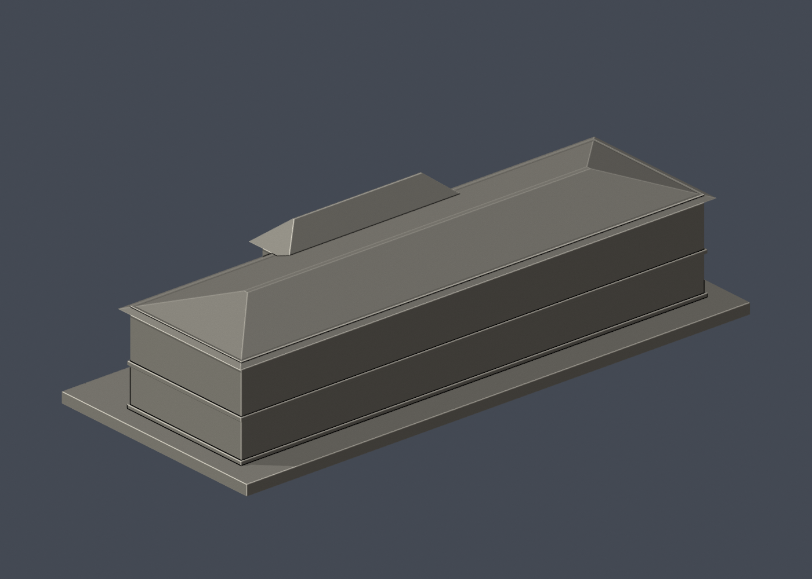
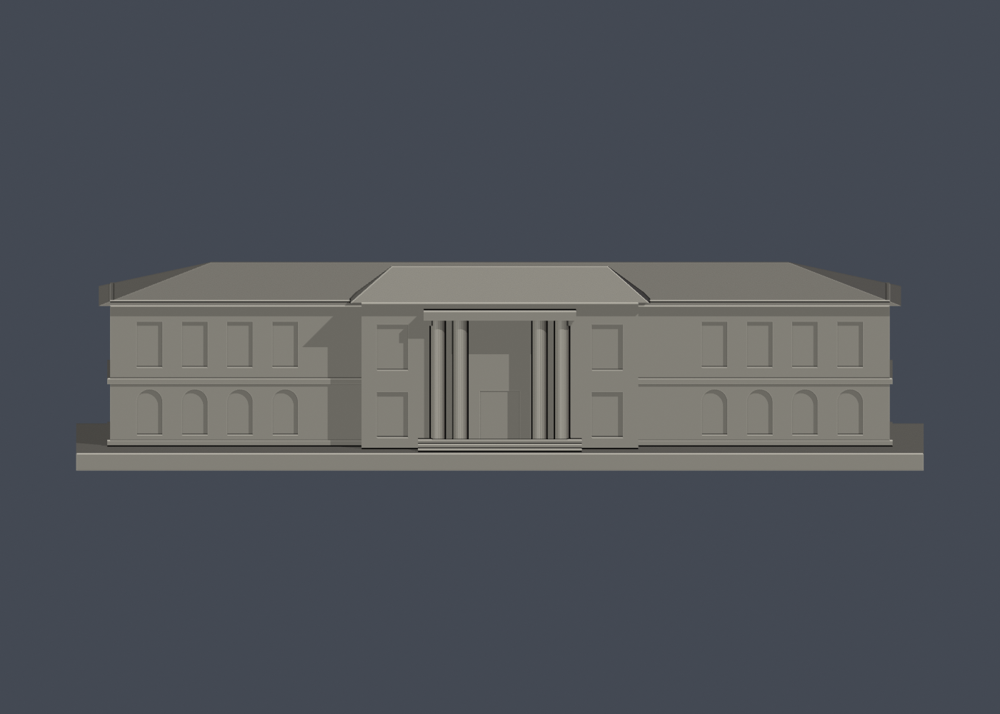

# 國立臺灣大學 第一行政大樓（歷史前棟）

公開外觀照片衍生的簡化列印模型，非測繪模型。官方索引代碼：M50。

## 模型預覽

| 模型預覽 | 模型預覽 | 模型預覽 |
| :---: | :---: | :---: |
| 正面  | 背面  | 正立面  |

## 範圍與可靠程度
只涵蓋照片可辨識的歷史北側前棟。南側增建及附屬平房不在本模型範圍，不能視為完整行政複合建築。

保留辨識特徵：兩層長立面、左右翼、突出中央入口、四根古典柱及複合斜屋頂；柱頭雕飾改為厚實方形簡化。

所有尺寸均為照片目測比例，沒有取得實測長寬高。建物深度、背面、屋頂後部及樹木遮蔽部分證據不足，以無裝飾實體量體表示。窗數、柱距、屋頂坡度不是竣工測量值。沒有推估室內、地下室或設備配置。建物外觀可能已與拍攝時間不同。

最長邊 150 mm（含底座），每棟獨立縮放，不同模型不能按共同校園比例拼接。尺寸為 [150.0, 65.0, 35.0] mm。

## 列印建議與限制
- 底座朝下，單位 mm。建議先用 0.4 mm 噴嘴、0.16–0.2 mm 層高、3道外牆、15–20%填充作切片試算。
- 四柱門廊上緣、屋簷及入口上方建議局部支撐；柱徑約2.7 mm，不宜任意縮小。
- 最細新增浮雕約 0.9–1.1 mm。瓦片、字體、植物、排水管、細石雕及空調未加入，以免把未觀察細節捏造為精準模型。
- STL 是單一連通封閉表面；凹窗有背牆。實心幾何的實際填充密度由切片器設定。
- 已檢查原始 STL 法向與繞向、水密性、邊與頂點流形、正體積、單一表面、可重建雜湊、Blender/STL 三角幾何一致性。完整結果見 validation.json。
- 尚未實際列印或完成切片器支撐檢驗；不宣稱任意機器都可無支撐列印。沒有聲稱進行完整三角形自交掃描。

## 檔案及重建
- model.stl：列印檔。model.obj：交換格式。
- scene.blend：由交付 STL 匯入的單網格場景，可編修網格；參數化來源為 build_model.py。
- previews/front.png、rear.png、elevation.png：直接渲染交付 STL，非概念圖。
- Python 3.12；pip install -r requirements.txt；python build_model.py。
- Blender 4.3.2：blender -b -t 2 -P render_preview.py。
- python validate_model.py。此檢查會在暫存目錄獨立重建及重新開啟已儲存場景，並不修補交付 STL。
- 可直接改 build_model.py 的毫米參數；修改後需重新渲染與驗證，150 mm規格亦須重新檢查。

## 公開來源
查閱與像素檢視日期：2026-10-13。來源照片僅供研究，未隨模型重新散布。
- [臺大行政大樓官方頁](https://homepage.ntu.edu.tw/~ntuga/admin/)
- [實際檢視的官方斜角照片（2014攝影）](https://homepage.ntu.edu.tw/~ntuga/admin/images/photo-admin1.jpg)
- [實際檢視的訪客中心正面照片](https://visitorcenter.ntu.edu.tw/eng/001/Upload/1240/relpic/71274/82586/9ee1621d-6f1c-458a-92bb-68476b4aa694%40710x470.jpg)
- [臺大官方臺北校區建物索引，檢索標題日期2026-08-17](https://cpo.ntu.edu.tw/map/C_01_list.pdf)

來源頁的照片版權屬原權利人；本資料夾不含來源照片或校徽貼圖。腳本與幾何為依公開外觀重新製作；未授予第三方建築設計或照片的權利。
