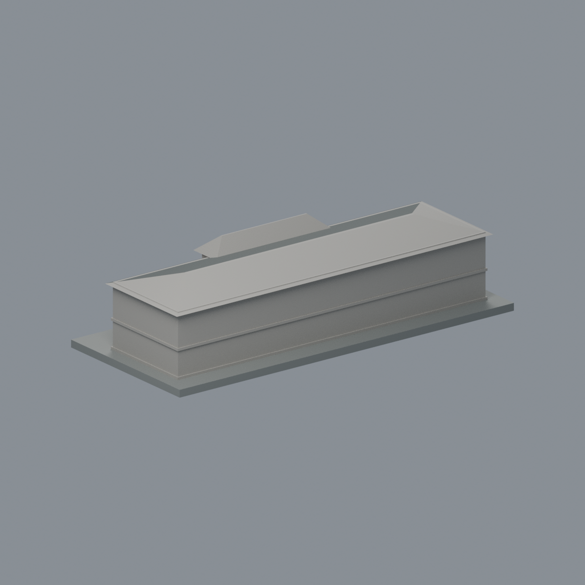
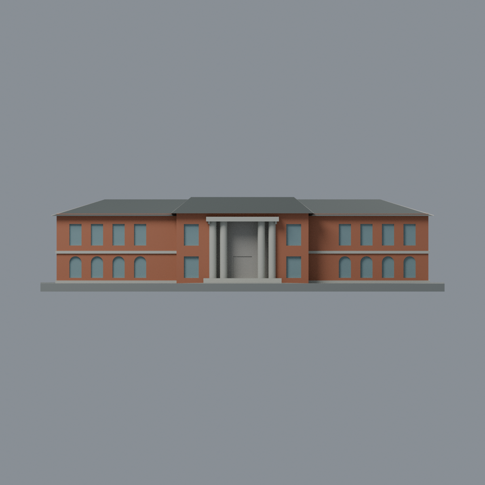
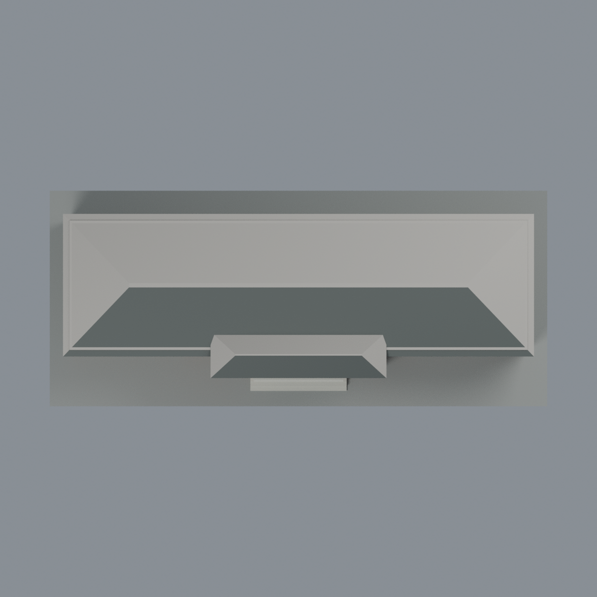

# 臺大行政大樓：六材質外觀版

沿用原 **1,886 三角面／937 頂點**，不改原 STL 位元、座標、面序或幾何；這是既有模型外觀改版，不增加模型包數。

| 模型預覽 | 模型預覽 | 模型預覽 |
| :---: | :---: | :---: |
| 正面  | 背面保持中性  |  |
|  |  |  |

[表面色 3MF](admin-appearance.3mf) · [可編輯 Blender](scene.blend) · [材質色表](palette.json) · [逐面指派與依據](face-materials.json) · [原 STL](../model.stl)

## 來源與配色邊界

親自查看臺大官方[行政大樓照片](https://homepage.ntu.edu.tw/~ntuga/admin/images/photo-admin1.jpg)，浮水印署名「陳兆倫攝／2014 年臺大攝影之美」。內嵌 EXIF DateTimeOriginal 為 **2014-07-28 16:15:13**；時區與拍攝日未獨立確認。日期是來源證據界線，不宣稱 2026 現況。照片不隨模型散布。

- 正面兩翼與中央突出塊的紅橘磚牆；色值未校正，不是標準建材色。樹遮處僅沿原簡化重複壁面作有界延伸。
- 原四根圓柱、階梯式簡化柱頭、柱腳及門廊頂橫梁為淡暖灰石色；沒有新增科林斯葉紋或照片窗下雕飾。
- 原凹窗內緣淡灰、背面淡灰藍；不另畫細窗格或加厚窗框。原連續水平帶是幾何簡化代理，不宣稱照片上每段窗下飾板連成整條。
- 只登錄可見正面屋頂坡為深灰。後屋面、深門廊、側面與背面中性；不把陰影塗成黑牆，不畫植栽、銘牌、字體、空調或排水設備。
- 仍是歷史前棟簡化量體，不包含後方增建；展示底板不是現地鋪面或草地。

[原幾何與來源界線](../README.md) · [來源與 EXIF 覆核](qa/source-review.json)

## 重建與核驗

安裝 [依賴](source/requirements.txt)，Blender 使用 4.3.2。由本資料夾上層提供原 model.stl：

1. `python appearance/source/build_appearance.py`
2. `python appearance/source/verify_exchange.py`
3. `blender -b -t 3 --python-exit-code 1 -P appearance/source/render_appearance.py`
4. `blender -b -t 3 --python-exit-code 1 -P appearance/source/verify_scene.py`

[獨立重建 ZIP](rebuild-source.zip)含原 STL、四支程式及依賴，不含第三方照片；不取代原建模腳本。[逐檔 SHA256](SHA256SUMS)

[交換／拓撲 QA](qa/exchange-validation.json)核對原座標與面序、全部面材質、單連通、有向水密邊、頂點 link 單環、正體積與零退化／重複面；lib3mf 嚴格讀取零警告，實際編輯單材質再存讀，其他材質及面指派不變。SDK 六位小數量化誤差另列。

[Blender 存讀與編輯](qa/scene-validation.json) · [渲染記錄](qa/render-manifest.json) · [獨立重建](qa/rebuild-validation.json)

## 製造限制照舊

尺寸仍為 150 × 65 × 35 mm；原 STL、建模程式、場景及歷史 QA 保留。原層檢與薄特徵檢查本次未重跑，不能由材質 QA 代替。

3MF 是同一網格的表面色，不是六個封閉分色實體、切片專案、噴頭映射或 G-code。切片 GUI、多材料路徑與實體列印未測；柱頭、屋簷、窗框及薄邊仍須評估材料、支撐及拆除風險，沒有保證可印或免支撐。
