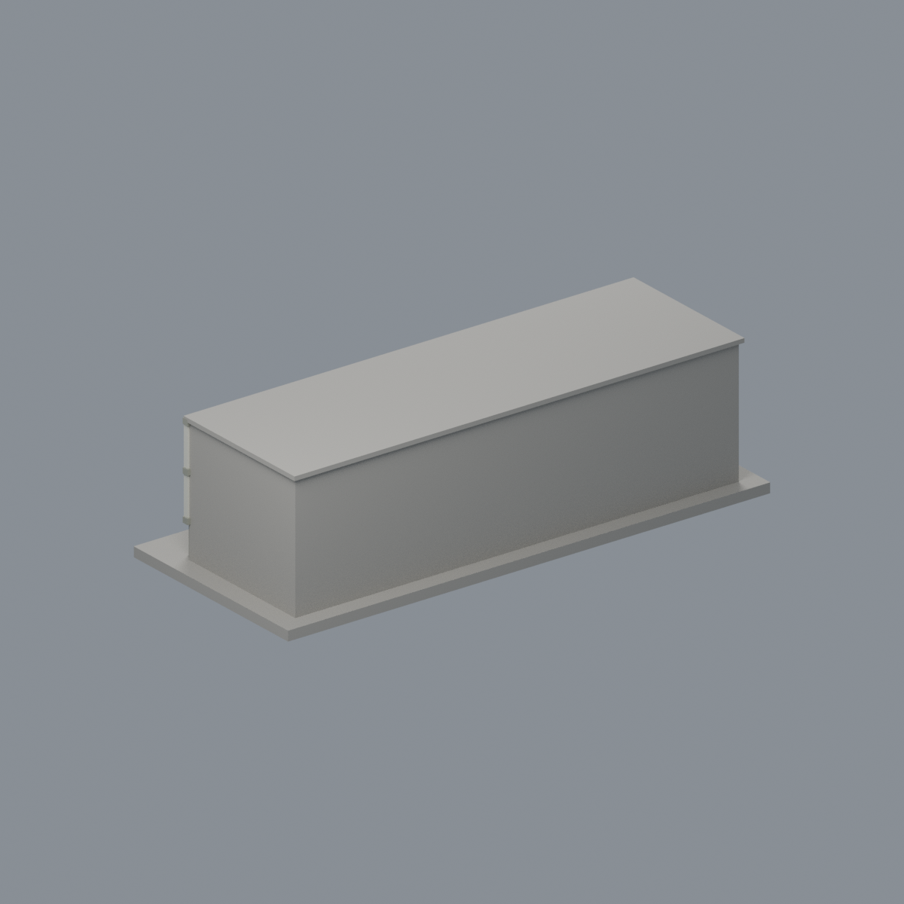
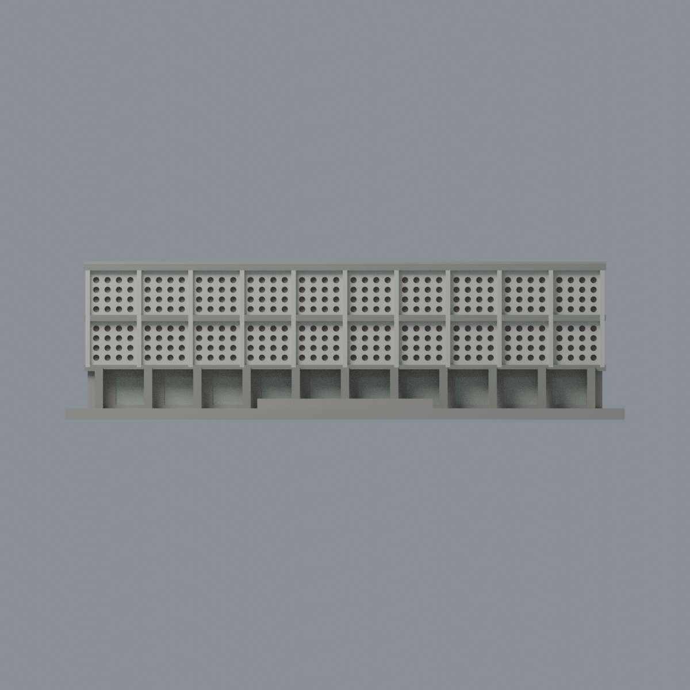
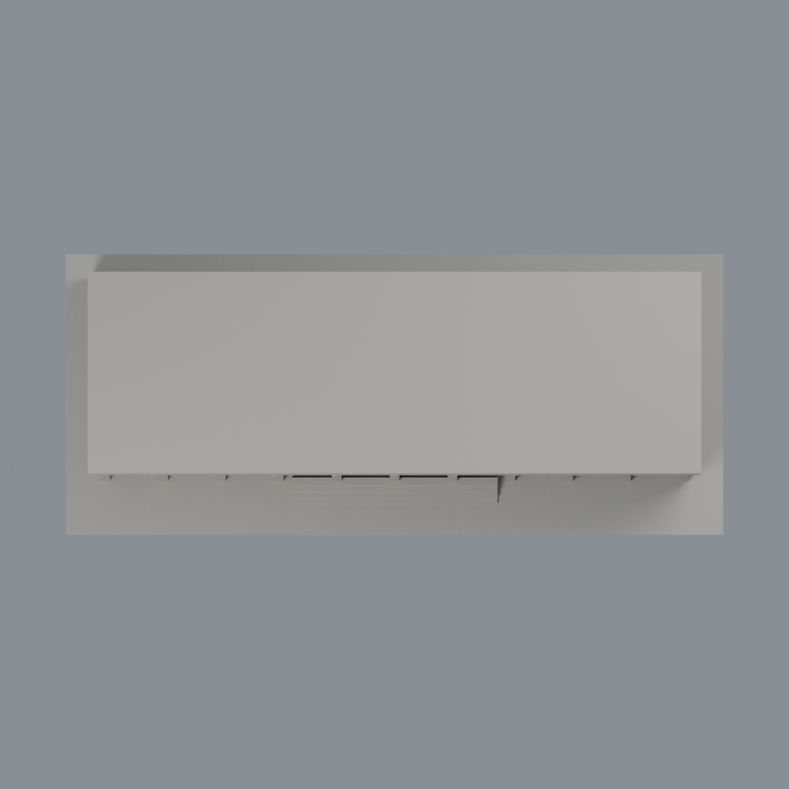

# 臺大農業陳列館：六材質外觀版

沿用原 **21,730 三角面／10,849 頂點**，不改原 STL 位元、座標、面序或幾何；這是既有模型外觀改版，不增加模型包數。

| 模型預覽 | 模型預覽 | 模型預覽 |
| :---: | :---: | :---: |
| 正面  | 背面保持中性  |  |
|  |  |  |

[表面色 3MF](ntuagexh-appearance.3mf) · [可編輯 Blender](scene.blend) · [材質色表](palette.json) · [逐面指派與依據](face-materials.json) · [原 STL](../model.stl)

## 來源與配色邊界

親自核對臺大訪客中心[農業陳列館官方外觀照片](https://visitorcenter.ntu.edu.tw/eng/001/Upload/1240/relpic/71274/83211/f727f242-a69c-48b8-a149-02c074fbb005.jpg)，1280×850 完整解碼，沒有 EXIF 拍攝日期；來源頁、檔名與上傳位置不當拍攝日期。[來源覆核與雜湊](qa/source-review.json)。僅以這個清楚斜前角度支持正面材料，不主張 2026 現況，不包含第三方原照。

- 原兩排粗化圓孔屏牆灰白、細直分隔白色；原灰混凝土橫帶與地面柱採暖灰，保留原 4×4 粗化孔排列與原窗格比例，不複製實景精確孔數、污漬或苔蘚。
- 孔內曲面用暖灰陶質代理，背襯淺孔底中性灰，**不是藍玻璃、不是完整穿孔、不烘焙照片黑影**。原幾何仍為淺凹孔。
- 底層離散長方凹背只給淡灰綠玻璃代理。**照片紅入口門框與褐細窗框在原網格未分離，不能整片凹背染紅冒充窗框；本版明列省略這些細紅褐框**，周圍混合牆中性，不補線或字牌。
- 兩側、背面、主屋頂與底座保留中性，不推定整棟外貌，不加植栽、空調、護欄或設備。
- 原 STL、場景、建模腳本與歷史 QA 不變；配色不增模型數，不宣稱實體列印成功。

[原幾何與歷史來源限制](../README.zh-TW.md)

## 重建與核驗

安裝 [依賴](source/requirements.txt)，Blender 使用 4.3.2。由本資料夾上層提供原 model.stl：

1. `python appearance/source/build_appearance.py`
2. `python appearance/source/verify_exchange.py`
3. `blender -b -t 3 --python-exit-code 1 -P appearance/source/render_appearance.py`
4. `blender -b -t 3 --python-exit-code 1 -P appearance/source/verify_scene.py`

[獨立重建 ZIP](rebuild-source.zip)含原 STL、四支程式及依賴，不含第三方照片；不取代原建模腳本。[逐檔 SHA256](SHA256SUMS)

[交換／拓撲 QA](qa/exchange-validation.json)核對原座標與面序、全部面材質、單連通、有向水密邊、頂點 link 單環、正體積與零退化／重複面；lib3mf 嚴格讀取零警告，實際編輯單材質再存讀，其他材質及面指派不變。SDK 六位小數量化誤差另列。

[Blender 存讀與編輯](qa/scene-validation.json) · [渲染記錄](qa/render-manifest.json) · [獨立重建](qa/rebuild-validation.json)

## 製造限制照舊

尺寸仍為 150 × 64 × 42.3 mm；原 STL、建模程式、場景及歷史 QA 保留。原層檢與薄特徵檢查本次未重跑，不能由材質 QA 代替。

3MF 是同一網格的表面色，不是各材質各自封閉的分色實體、切片專案、噴頭映射或 G-code。切片 GUI、多材料路徑與實體列印未測；柱頭、屋簷、窗框及薄邊仍須評估材料、支撐及拆除風險，沒有保證可印或免支撐。
