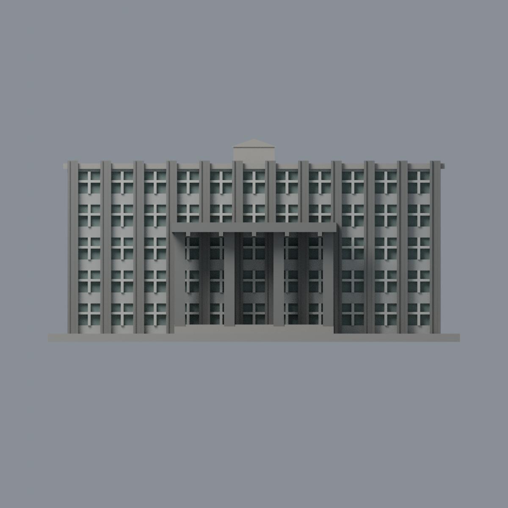
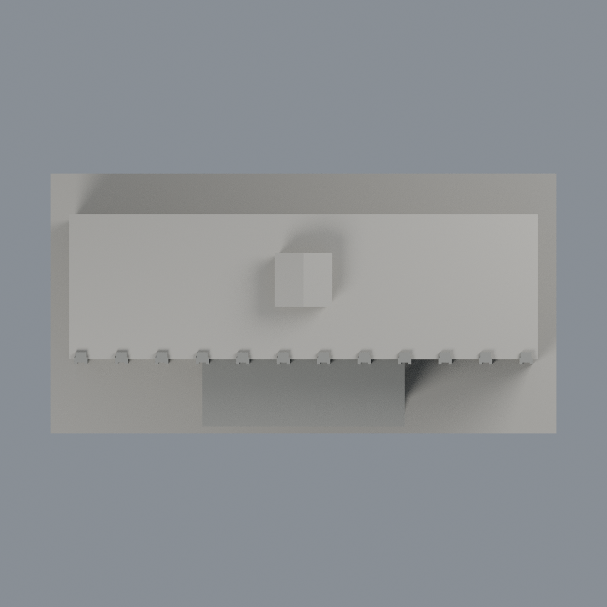

# 臺大農藝館：五材質外觀版

沿用原 **6,676 三角面／3,002 頂點**，不改原 STL 位元、座標、面序或幾何；這是既有模型外觀改版，不增加模型包數。

| 模型預覽 | 模型預覽 | 模型預覽 |
| :---: | :---: | :---: |
| 正面  | 背面保持中性  |  |
|  |  |  |

[表面色 3MF](ntuagron-appearance.3mf) · [可編輯 Blender](scene.blend) · [材質色表](palette.json) · [逐面指派與依據](face-materials.json) · [原 STL](../model.stl)

## 來源與配色邊界

親自核對臺大官方[正面照片](https://homepage.ntu.edu.tw/~cpo/2010photo/M/M13/IMG_5933.JPG)與[端面照片](https://homepage.ntu.edu.tw/~cpo/2010photo/M/M13/IMG_5935.JPG)。原圖 400×300／300×400 僅支持建築大材料區域，不宣稱細漆面或精確 RGB。EXIF DateTimeOriginal 分別為 2010-10-16 13:21:33／13:23:25；時區與時鐘未獨立核實，2011 修改時間不當拍攝日。[來源覆核與雜湊](qa/source-review.json)，歷史照片不代表 2026 現況，原照不入包。

- 正面原混凝土凸直肋、細雙肋及四柱大門廊採暖中灰；原窗間實牆淺灰，原十字窗框灰白，僅凹背採低飽和灰綠玻璃代理，不複製窗簾、冷氣或樹影。
- 門廊蓋板上表面依同一混凝土構件作有界材料延伸，並非俯視照片證實；其餘主屋頂與小屋突均中性。來源中小屋突偏粉色面積太小，不據此染色。
- 來源端面有窗，但原網格端面是簡化素牆；兩側、背面維持中性，不添窗，也不把素面染成玻璃。
- 保留原幾何窗距、五層節奏與粗化凸肋，非測繪實景複製；不加入銘牌文字、管線、植栽及設備。
- 原 STL、建模腳本、原場景及歷史 QA 不變；配色不新增模型數，不宣稱實體列印成功。

[原幾何與歷史來源限制](../README.zh-TW.md)

## 重建與核驗

安裝 [依賴](source/requirements.txt)，Blender 使用 4.3.2。由本資料夾上層提供原 model.stl：

1. `python appearance/source/build_appearance.py`
2. `python appearance/source/verify_exchange.py`
3. `blender -b -t 3 --python-exit-code 1 -P appearance/source/render_appearance.py`
4. `blender -b -t 3 --python-exit-code 1 -P appearance/source/verify_scene.py`

[獨立重建 ZIP](rebuild-source.zip)含原 STL、四支程式及依賴，不含第三方照片；不取代原建模腳本。[逐檔 SHA256](SHA256SUMS)

[交換／拓撲 QA](qa/exchange-validation.json)核對原座標與面序、全部面材質、單連通、有向水密邊、頂點 link 單環、正體積與零退化／重複面；lib3mf 嚴格讀取零警告，實際編輯單材質再存讀，其他材質及面指派不變。SDK 六位小數量化誤差另列。

[Blender 存讀與編輯](qa/scene-validation.json) · [渲染記錄](qa/render-manifest.json) · [獨立重建](qa/rebuild-validation.json)

## 製造限制照舊

尺寸仍為 150 × 77 × 74 mm；原 STL、建模程式、場景及歷史 QA 保留。原層檢與薄特徵檢查本次未重跑，不能由材質 QA 代替。

3MF 是同一網格的表面色，不是各材質各自封閉的分色實體、切片專案、噴頭映射或 G-code。切片 GUI、多材料路徑與實體列印未測；柱頭、屋簷、窗框及薄邊仍須評估材料、支撐及拆除風險，沒有保證可印或免支撐。
