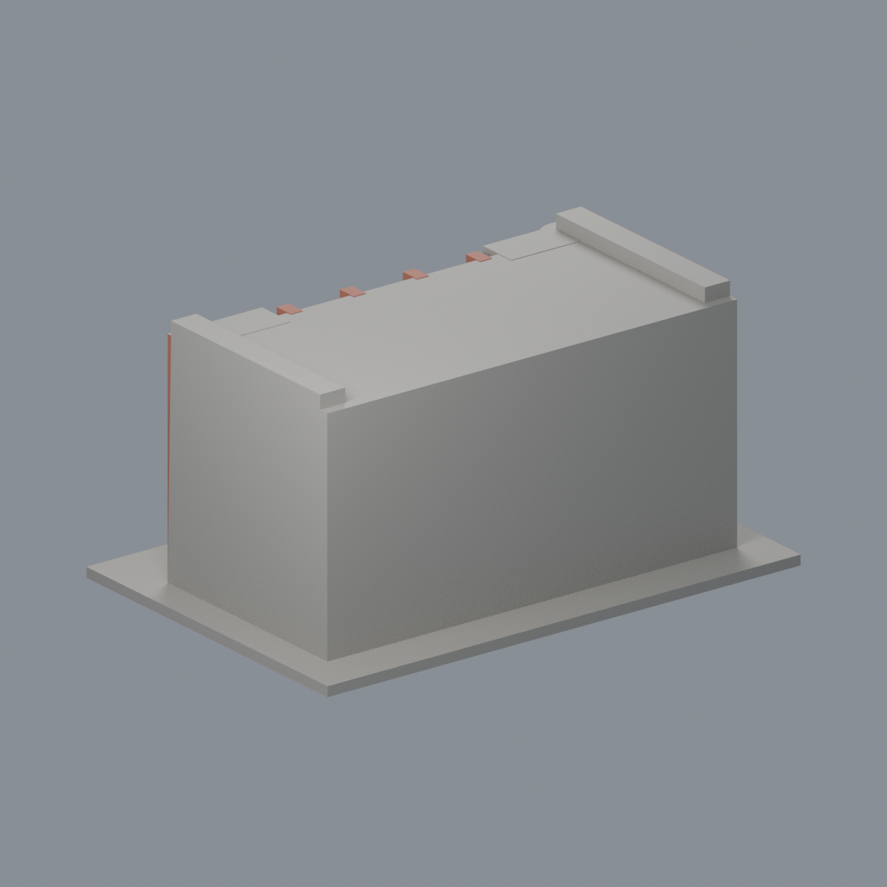

# 國立臺灣大學 生化科學研究所（歷史前棟）

## 模型預覽

| 模型預覽 | 模型預覽 | 模型預覽 |
| :---: | :---: | :---: |
| 正面與來源支持區域  | 未見外側背面中性  |  |

## 6 材質外觀版（2026-10-21）

[來源界線與四視角](appearance/README.md) · [表面色 3MF](appearance/ntubiochem-appearance.3mf) · [可編輯場景](appearance/scene.blend)

紅磁磚正面與前半圓角、銀灰原遮陽板及灰白雨棚；上層凹背中性不當玻璃，未知側後屋頂不推染，原面序不變。 原 STL 與歷史 QA 不變；這是外觀改善，不是新增幾何。原單色正面（歷史檔案留存，不作本頁預覽）／原單色背面（歷史檔案留存，不作本頁預覽）

官方索引代碼 N24。公開外觀近似模型，非測繪或BIM。

## 範圍與比例
僅王大閎設計的歷史前棟，未包括後期增建五層後棟。依2010官方照片辨識，進深、圓角半徑、屋頂與背面簡化；不宣稱全所建築複合體或2026現況。

保留辨識特徵：厚重兩側牆、圓弧前角、中央三組水平遮陽板及紅磚垂直帶、深入口雨棚。細百葉放大加厚；沒有重建內部實驗室。

尺寸 [150.0, 102.0, 75.0] mm，含底座最長150 mm。各館獨立比例，不是可拼接的共同尺度校園沙盤。尺寸、厚度、窗距均為照片目測和列印簡化，不是原建物實測。

## 列印
- 底座向下，毫米單位。參考起點：0.4 mm噴嘴、0.16–0.2 mm層高、3道外牆、15–20%填充。須依自己的切片器調整。
- 深雨棚與遮陽板下緣均為懸垂，需局部支撐；百葉有實體背牆，未宣稱免支撐。
- 新增細浮雕名義最小約0.9 mm；這不是全模型最小壁厚的測量結果。零碎設備、文字招牌、樹木、電線及細緻裝飾沒有加入。
- 門窗背牆與實心量體避免隱藏內殼；實際填充由切片器決定。
- 未實際列印；未用PrusaSlicer、Cura等生成工具路徑。不宣稱無支撐或無風險可印。

## 驗證與檔案
- model.stl、model.obj；scene.blend是由實際STL匯入的可編修網格。
- build_model.py為獨立參數來源；Python3.12，依requirements.txt裝依賴後執行python build_model.py。
- Blender4.3.2：blender -b -t 2 -P render_preview.py。previews/front.png、rear.png、elevation.png均直接渲染交付STL。
- python validate_model.py：原始法向、水密、流形邊／頂點、單一連通表面、無分離封閉內殼、正體積、150mm、獨立重建SHA256及已儲存Blender/STL三角幾何一致性。結果validation.json。
- python check_layers.py：每0.2mm水平截面幾何檢查，共 375 層，所抽樣截面全部閉合。首層採z=0.071mm避免重合平面退化，非實際列印首層設定。
- layer-check.json另記向下超45度面積指標與各層輪廓；它不是切片器、最小壁厚測試或實體試印。閉合截面不保證擠出連續、橋接、支撐可拆、床面附著或局部細節可印。
- SHA256SUMS可核對檔案；更改參數後需重建、重繪、重驗證。

## 公開來源
查閱及圖像像素檢視：2026-10-13。來源照片未隨檔重新散布。
- [臺大生化所簡史](https://ibs.ntu.edu.tw/web/about/about.jsp?lang=tw)
- [臺大官方2010照片索引](https://homepage.ntu.edu.tw/~cpo/about_campus_archeitectureimage.html)
- [官方實景 5890](https://homepage.ntu.edu.tw/~cpo/2010photo/N/N24/IMG_5890.JPG)
- [官方實景 5891](https://homepage.ntu.edu.tw/~cpo/2010photo/N/N24/IMG_5891.JPG)
- [官方實景 5894](https://homepage.ntu.edu.tw/~cpo/2010photo/N/N24/IMG_5894.JPG)
- [臺大校友雙月刊：王大閎設計与立面特徵](https://ntualumnibm.ntu.edu.tw/bm.bimonthly.article/detail/sn/4391)
- [臺大官方建物索引，檢索標題2026-08-17](https://cpo.ntu.edu.tw/map/C_01_list.pdf)

照片版權屬原權利人；沒有轉授原建築設計或照片權利。不同拍攝日期不等於已核實目前全部外觀。
