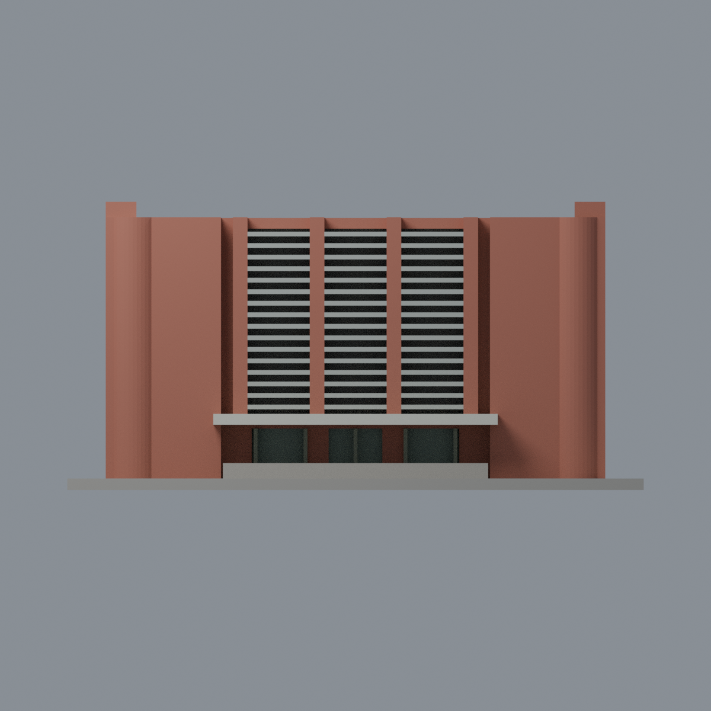
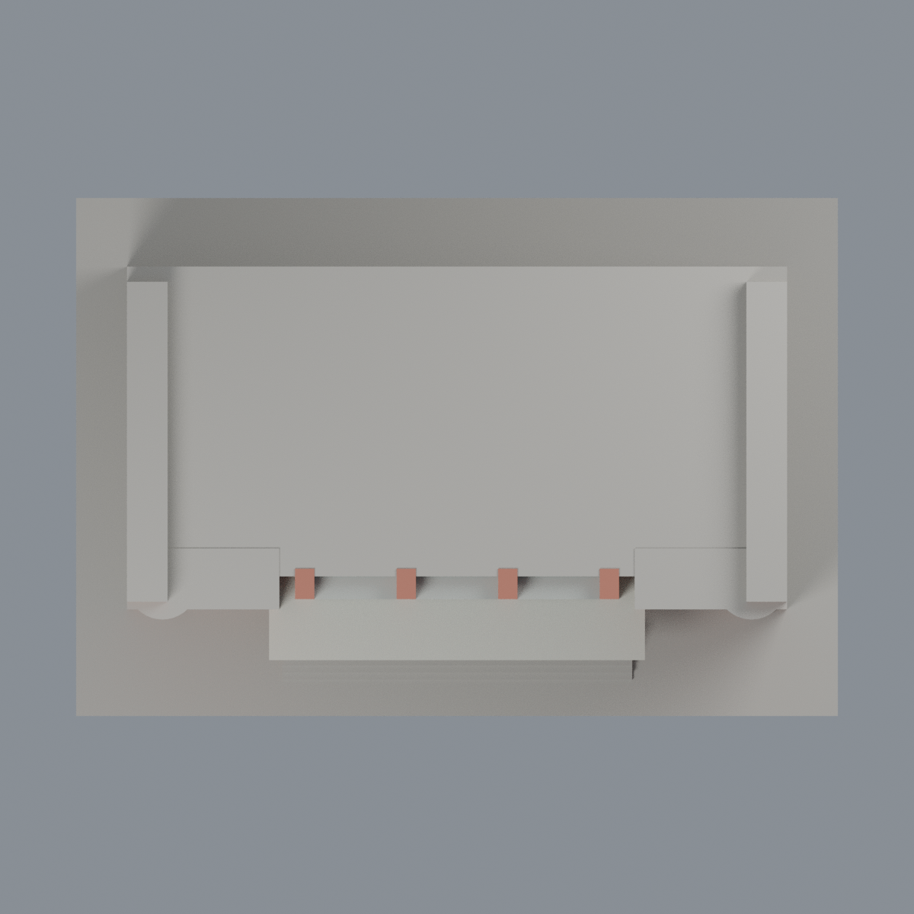

# 臺大生化所歷史前棟：六材質外觀版

沿用原 **2,618 三角面／1,109 頂點**，不改原 STL 位元、座標、面序或幾何；這是既有模型外觀改版，不增加模型包數。

| 正面 | 背面保持中性 |
|---|---|
|  |  |
|  |  |

[表面色 3MF](ntubiochem-appearance.3mf) · [可編輯 Blender](scene.blend) · [材質色表](palette.json) · [逐面指派與依據](face-materials.json) · [原 STL](../model.stl)

## 來源與配色邊界

親自核對臺大官方[正面 5890](https://homepage.ntu.edu.tw/~cpo/2010photo/N/N24/IMG_5890.JPG)、[遮陽立面 5891](https://homepage.ntu.edu.tw/~cpo/2010photo/N/N24/IMG_5891.JPG)與[入口近照 5894](https://homepage.ntu.edu.tw/~cpo/2010photo/N/N24/IMG_5894.JPG)。三照 EXIF DateTimeOriginal 分別為 2010-10-16 10:18:44／10:19:02／10:19:48，時鐘與時區未獨立核實；2011-01-11 為修改日期，非拍攝日。原圖 400×300 或 300×400，配色為低解析歷史來源支持的材料家族，非精確校準 RGB。[來源覆核與雜湊](qa/source-review.json)，不代表 2026 現況，原照不入包。

- 正面實牆、兩翼平面及前側圓弧紅磁磚；僅染圓角前半部，未知外側與背面中性，不按整棟對稱推染。既有四條凸直帶紅磁磚，保持原間距與粗化節奏。
- 原密集橫遮陽板採銀灰，**其後整片凹背維持中性，不當作連續玻璃**，也不複製空調、窗簾與照片陰影。
- 入口三組離散凹背採灰綠玻璃代理，原窄直框灰青銅色；只保留現有粗框，不新增細門窗格、把手、招牌文字或門上佈告。
- 大雨棚灰白，棚頂按同一材料構件作有界延伸，非俯視照片證實；原腳本未製作照片可見細棚底梁，本版不補幾何。
- 主屋頂、側牆頂面、未知兩端背側與底座中性。只作原歷史前棟，未見後擴建量體不加入。
- 原 STL、建模腳本、原場景與歷史 QA 不變，本版不是新增幾何，不宣稱實體列印成功。

[原幾何與歷史來源限制](../README.zh-TW.md)

## 重建與核驗

安裝 [依賴](source/requirements.txt)，Blender 使用 4.3.2。由本資料夾上層提供原 model.stl：

1. `python appearance/source/build_appearance.py`
2. `python appearance/source/verify_exchange.py`
3. `blender -b -t 3 --python-exit-code 1 -P appearance/source/render_appearance.py`
4. `blender -b -t 3 --python-exit-code 1 -P appearance/source/verify_scene.py`

[獨立重建 ZIP](rebuild-source.zip)含原 STL、四支程式及依賴，不含第三方照片；不取代原建模腳本。[逐檔 SHA256](SHA256SUMS)

[交換／拓撲 QA](qa/exchange-validation.json)核對原座標與面序、全部面材質、單連通、有向水密邊、頂點 link 單環、正體積與零退化／重複面；lib3mf 嚴格讀取零警告，實際編輯單材質再存讀，其他材質及面指派不變。SDK 六位小數量化誤差另列。

[Blender 存讀與編輯](qa/scene-validation.json) · [渲染記錄](qa/render-manifest.json) · [獨立重建](qa/rebuild-validation.json)

## 製造限制照舊

尺寸仍為 150 × 102 × 75 mm；原 STL、建模程式、場景及歷史 QA 保留。原層檢與薄特徵檢查本次未重跑，不能由材質 QA 代替。

3MF 是同一網格的表面色，不是各材質各自封閉的分色實體、切片專案、噴頭映射或 G-code。切片 GUI、多材料路徑與實體列印未測；柱頭、屋簷、窗框及薄邊仍須評估材料、支撐及拆除風險，沒有保證可印或免支撐。
