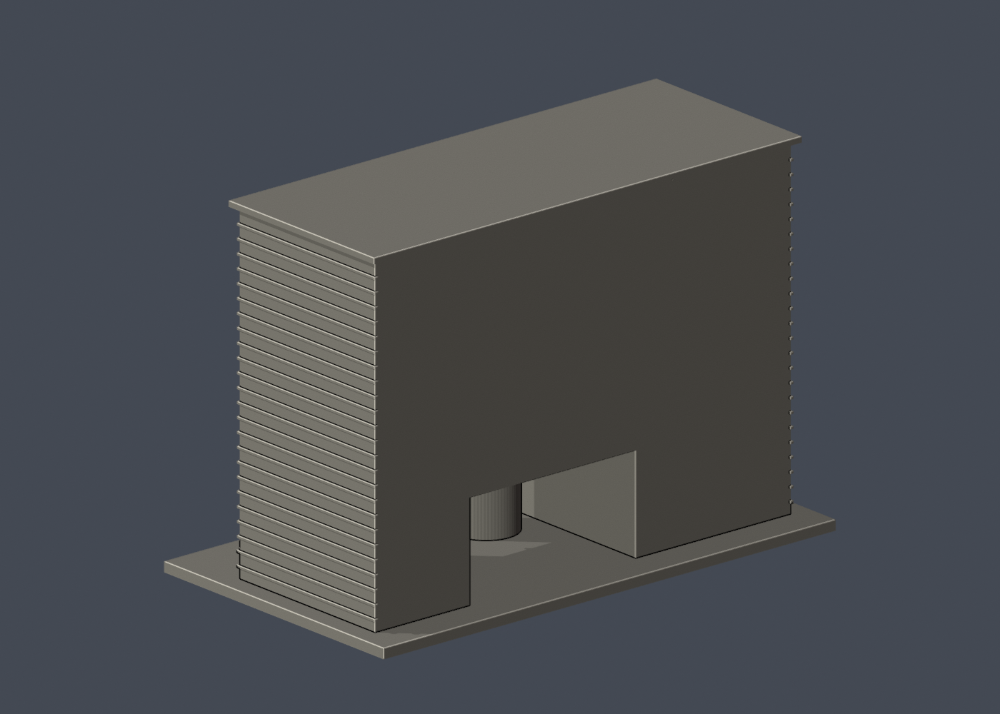

# 國立臺灣大學 博理館

## 模型預覽

| 模型預覽 | 模型預覽 | 模型預覽 |
| :---: | :---: | :---: |
| 正面與來源支持區域  | 未見外側背面中性  |  |

## 7 材質外觀版（2026-10-21）

[來源界線與四視角](appearance/README.md) · [表面色 3MF](appearance/ntubory-appearance.3mf) · [可編輯場景](appearance/scene.blend)

來源支持的灰褐牆板、奶油細帶、淺灰藍凹窗及銀灰窗梃；圓核心跨材質未分面與未知背側保留中性。 原 STL 與歷史 QA 不變；這是外觀改善，不是新增幾何。[原單色正面](previews/front.png)／[原單色背面](previews/rear.png)

| 模型預覽 | 模型預覽 | 模型預覽 |
| :---: | :---: | :---: |
| 原單色正面  | 原單色背面  |  |

範圍：七層主體外觀，依2004落成承包商與2010校方照片；已見前立面/左短端保留，未知背面及右短端簡化。

## 來源與模型
- 七層矩形主樓
- 上部兩排窄窗及中間三層玻璃面
- 底層兩層高偏右大開口
- 開口左側可見圓柱形外部核心
- 橫向細帶與左短端窄窗

承包商明列地上7層，2004完工；其所引廣藝條目誤寫1993未採用。主體尺寸只是照片估計，不把26.4m單一格子梁跨距當全棟寬度。

## 簡化與不確定性
- 窄窗節奏及分格數視覺概化，不是施工尺寸
- 中央三層玻璃區以較深整片凹區、連續水平窗帶表達，省略細密玻璃豎框以區別兩旁狹窗
- 背側/右短端無充分照片，維持素面與粗量體
- 天花格子梁細格省略，非內部模型
- 圓核心只表達公共外觀，不含室內設施

外觀照片推估，非測繪/工程模型。成品尺寸[150.0, 86.0, 104.69999694824219]mm，每件獨立最長150mm，不能作同尺度校園拼接。

## 列印與驗證
底層大開口寬55mm、高29mm，須充分可移除支撐；圓核心與屋頂實體相接，不能視為可免支撐橋接。附牆橫條高0.75mm、框1mm、階梯0.65mm；先在真正切片器檢查是否保留。 底座朝下，先以0.4mm噴嘴/0.2mm層高檢查工具路徑。未作真正切片器測試或實體試印。

原STL拓撲、原法向、單一連通封閉表面、正體積、重建雜湊及Blender幾何一致性全通過。0.2mm截面closed/valid報告見valid-sections.json；1mm抽樣0.8mm參考opening薄篩見thin-feature-check.json，這只是輔助幾何指標，不是完整壁厚分析。

## 公開證據
- [公開來源1](https://www.chunglin.com.tw/index.php?f=content&mn=1&module=product&tid=186512)
- [公開來源2](https://picture.smartweb.tw/4021/prod/title_186512.jpg)
- [公開來源3](https://homepage.ntu.edu.tw/~cpo/2010photo/E/E6/IMG_5996.JPG)
- [公開來源4](https://homepage.ntu.edu.tw/~cpo/2010photo/E/E6/IMG_5995.JPG)
- [公開來源5](https://homepage.ntu.edu.tw/~cpo/2010photo/E/E6/IMG_6016.JPG)
- [公開來源6](https://eecs.ntu.edu.tw/zh_tw/Introduction/History/History/intro1_2)
- [官方索引](https://cpo.ntu.edu.tw/map/C_01_list.pdf)，2026-08-17版，代碼E6。

來源照片只查閱不重新散布，previews全由實際STL生成。

## 重建
以requirements.txt列依賴執行python build_model.py；Blender 4.3.2+執行blender -b -P render_preview.py；python validate_model.py檢查原STL、獨立重建與場景。check_valid_sections.py及thin_canonical_v2.py均接受model.stl和輸出資料夾兩參數。
