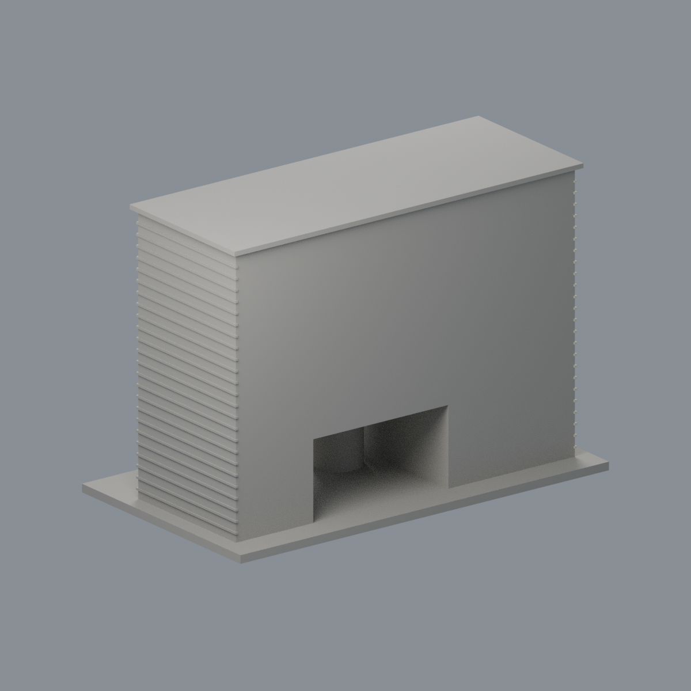
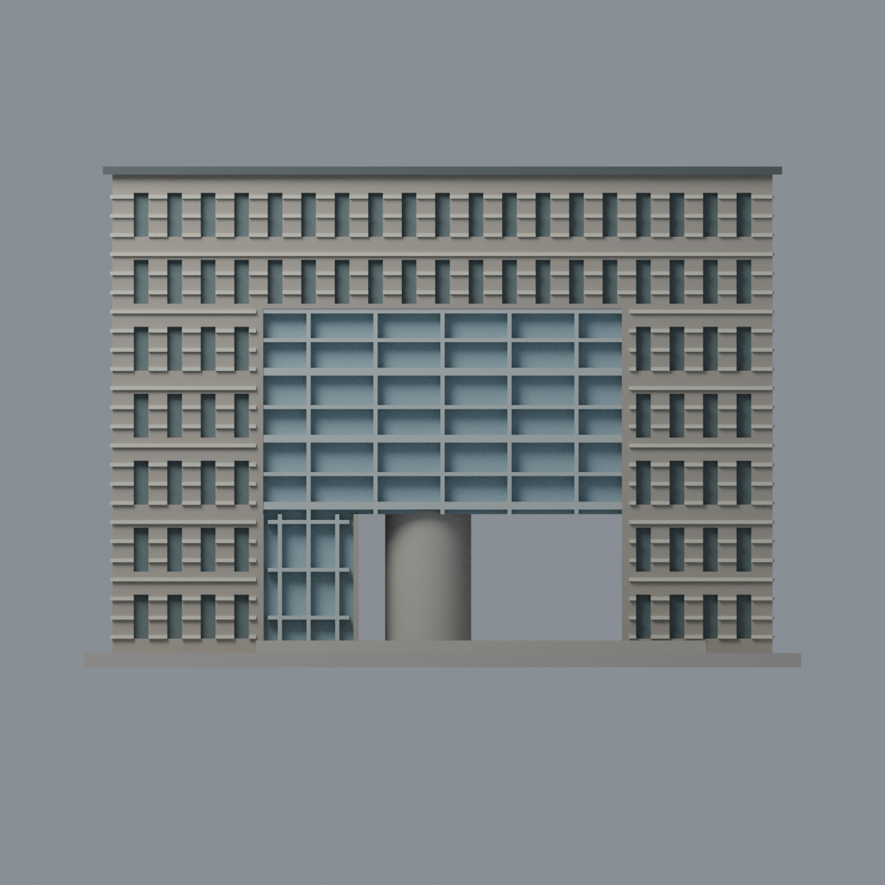
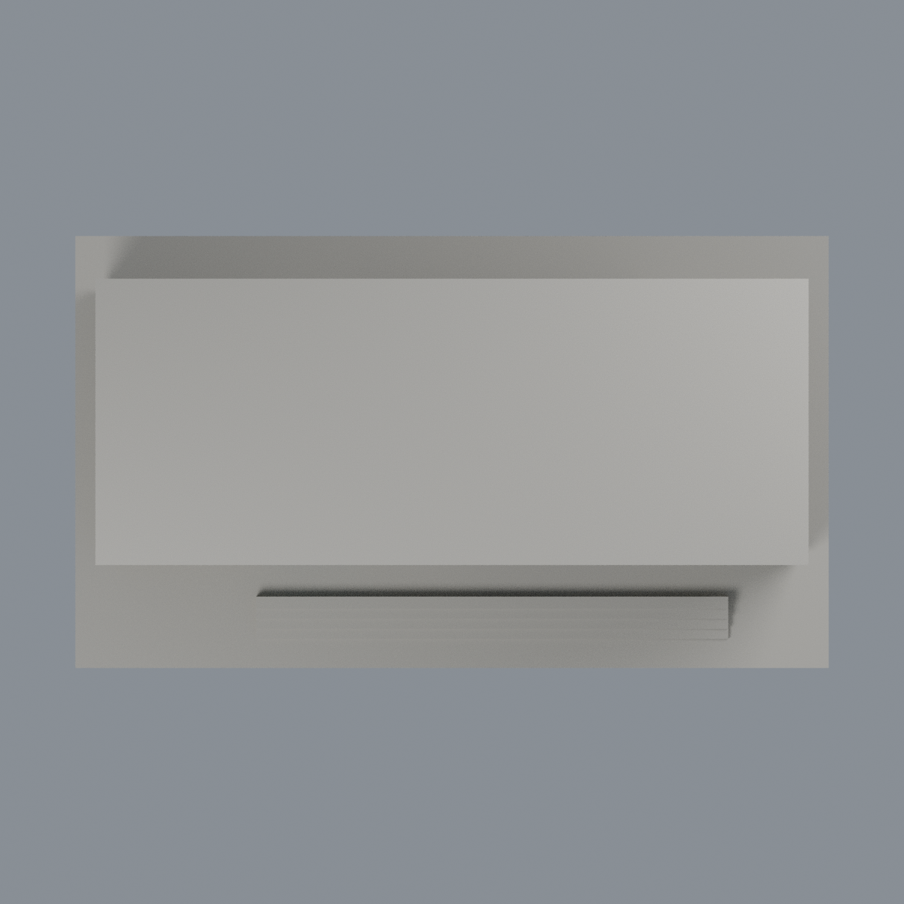

# 臺大博理館：七材質外觀版

沿用原 **9,160 三角面／4,578 頂點**，不改原 STL 位元、座標、面序或幾何；這是既有模型外觀改版，不增加模型包數。

| 正面 | 背面保持中性 |
|---|---|
|  |  |
|  |  |

[表面色 3MF](ntubory-appearance.3mf) · [可編輯 Blender](scene.blend) · [材質色表](palette.json) · [逐面指派與依據](face-materials.json) · [原 STL](../model.stl)

## 來源與配色邊界

親自核對中麟營造[博理館工程頁](https://www.chunglin.com.tw/index.php?f=content&mn=1&module=product&tid=186512)及[上部外觀照](https://picture.smartweb.tw/4021/prod/title_186512.jpg)，另核對臺大官方[左前照](https://homepage.ntu.edu.tw/~cpo/2010photo/E/E6/IMG_5996.JPG)、[挑空圓核心近照](https://homepage.ntu.edu.tw/~cpo/2010photo/E/E6/IMG_5995.JPG)與[長立面照](https://homepage.ntu.edu.tw/~cpo/2010photo/E/E6/IMG_6016.JPG)。承包商照片不是臺大官網照片，拍攝日不詳；校方三照 EXIF DateTimeOriginal 分別為 2010-10-16 14:21:21／14:20:12／14:35:54，時間與時區未獨立核實，2011 修改日期不當拍攝日。施工完成年代也不當照片日期。[來源覆核與雜湊](qa/source-review.json)，歷史證據不代表 2026 現況，原照不入包。

- 有來源正面／左端灰褐牆板、既有細奶油水平帶；不因承包商照片偏藍色調而畫成高飽和藍牆。
- 只對原中央大玻璃與左下延伸凹背採淺灰藍、窄窗凹背深灰玻璃色；原粗窗梃銀灰，保留原窗距／粗化節奏，不加細窗格或反射影像。
- 可見前／左頂邊深灰，屋頂上表面中性；未知右端、背面與挑空內部中性，不按對稱染色。
- **原圓核心側面三角形跨越實景下部白磚帶與上部銀灰金屬，無相應水平材質界線；整段圓核心保留中性。** 不用斜色界或整柱銀色掩蓋原網格限制。
- 原露天挑空仍保留原幾何，不填玻璃，也不製作內部房間、設備、天花格、銘牌或路燈。
- 原 STL、場景、建模腳本及歷史 QA 不變；配色不新增模型數，不宣稱實體列印成功。

[原幾何與歷史來源限制](../README.zh-TW.md)

## 重建與核驗

安裝 [依賴](source/requirements.txt)，Blender 使用 4.3.2。由本資料夾上層提供原 model.stl：

1. `python appearance/source/build_appearance.py`
2. `python appearance/source/verify_exchange.py`
3. `blender -b -t 3 --python-exit-code 1 -P appearance/source/render_appearance.py`
4. `blender -b -t 3 --python-exit-code 1 -P appearance/source/verify_scene.py`

[獨立重建 ZIP](rebuild-source.zip)含原 STL、四支程式及依賴，不含第三方照片；不取代原建模腳本。[逐檔 SHA256](SHA256SUMS)

[交換／拓撲 QA](qa/exchange-validation.json)核對原座標與面序、全部面材質、單連通、有向水密邊、頂點 link 單環、正體積與零退化／重複面；lib3mf 嚴格讀取零警告，實際編輯單材質再存讀，其他材質及面指派不變。SDK 六位小數量化誤差另列。

[Blender 存讀與編輯](qa/scene-validation.json) · [渲染記錄](qa/render-manifest.json) · [獨立重建](qa/rebuild-validation.json)

## 製造限制照舊

尺寸仍為 150 × 86 × 104.7 mm；原 STL、建模程式、場景及歷史 QA 保留。原層檢與薄特徵檢查本次未重跑，不能由材質 QA 代替。

3MF 是同一網格的表面色，不是各材質各自封閉的分色實體、切片專案、噴頭映射或 G-code。切片 GUI、多材料路徑與實體列印未測；柱頭、屋簷、窗框及薄邊仍須評估材料、支撐及拆除風險，沒有保證可印或免支撐。
