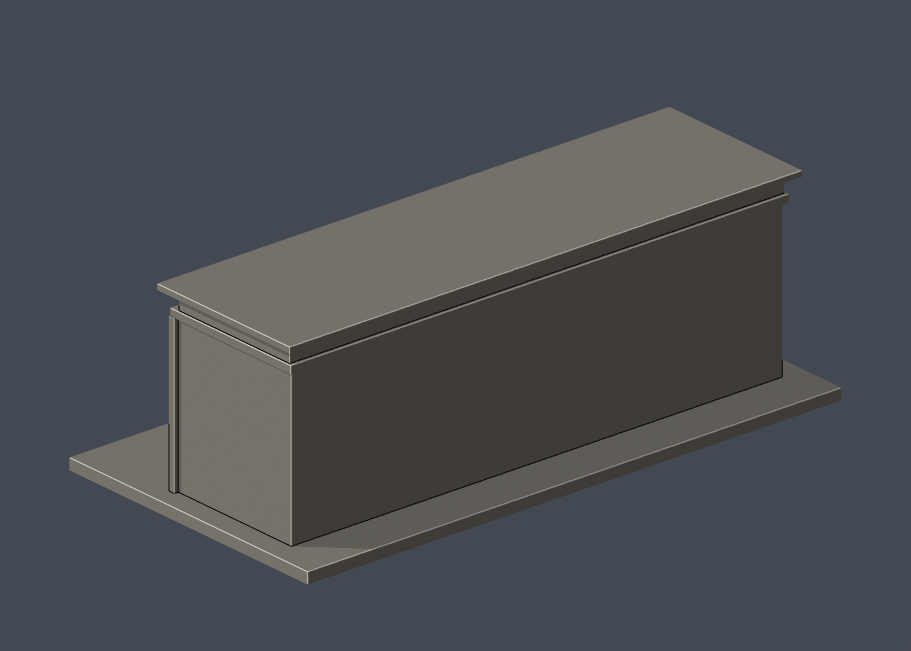

# 國立臺灣大學 化學工程館正門入口段

## 模型預覽

| 模型預覽 | 模型預覽 | 模型預覽 |
| :---: | :---: | :---: |
| 正面  | 背面  |  |

[返回校區圖鑑](../../README.md) · [返回臺大總圖鑑](../../../README.md)

## 實際 STL 正面與背面

[下載 STL](model.stl) · [Blender 場景](scene.blend) · [參數化來源](build_model.py) · [驗證結果](validation.json)

本件新增closed/valid與薄篩結果見本資料夾valid-sections.json、thin-feature-check.json。

範圍：正門中央三拱門廊及鄰接可見立面段，不含東西增建翼樓、南側連接實驗室與機器間；外觀依2026-09-29官方頁所刊照片。

## 來源與模型
- 兩層長窗及淺弧雨庇
- 三跨淺拱門廊、實心前階梯
- 右側較寬無窗牆面
- 上方通風帶與突出平屋緣

官方記錄1963落成、1976增建東西翼、2024登錄歷史建築，2026修復再利用計畫核准，尚不得聲稱修復已完成。系史館舊照只交叉核對門廊和窗格；其舊平屋頂欄杆未混用為2026屋頂通風帶。

## 簡化與不確定性
- 照片裁切以外的西端長度不推造，兩端為截段研究邊界
- 未知背側為素面；模型不是完整化工館
- 窗格/立柱加粗，立面比例估計
- 省略右側長坡道與細欄杆，完整東西翼/機器間另待建模

外觀照片推估，非測繪/工程模型。成品尺寸[150.0, 79.0, 51.599998474121094]mm，每件獨立最長150mm，不能作同尺度校園拼接。

## 列印與驗證
門廊跨距約12.3mm；屋頂、雨庇與拱梁須切片支撐/橋接評估，前階梯高0.65mm、窄直框1.2mm、拱罩實心加厚。 底座朝下，先以0.4mm噴嘴/0.2mm層高檢查工具路徑。未作真正切片器測試或實體試印。

原STL拓撲、原法向、單一連通封閉表面、正體積、重建雜湊及Blender幾何一致性全通過。0.2mm截面closed/valid報告見valid-sections.json；1mm抽樣0.8mm參考opening薄篩見thin-feature-check.json，這只是輔助幾何指標，不是完整壁厚分析。

## 公開證據
- [公開來源1](https://ga.ntu.edu.tw/main_ch/docDetail/2623/2583/44553/260929)
- [公開來源2](https://ga.ntu.edu.tw/upload/cont_att/373ca0d6-ce59-4d24-ad7a-720fa0d60043.jpg)
- [公開來源3](https://ga.ntu.edu.tw/upload/cont_att/0c646e4e-acdb-490d-b624-8ef19419a8b1.jpg)
- [公開來源4](https://www.ntuchehistory.com/products_detail/59)
- [公開來源5](https://www.ntuchehistory.com/upload/images/4.%E5%8C%96%E5%B7%A5%E9%A4%A8.jpg)
- [官方索引](https://cpo.ntu.edu.tw/map/C_01_list.pdf)，2026-08-17版，代碼M8。

來源照片只查閱不重新散布，previews全由實際STL生成。

## 重建
以requirements.txt列依賴執行python build_model.py；Blender 4.3.2+執行blender -b -P render_preview.py；python validate_model.py檢查原STL、獨立重建與場景。check_valid_sections.py及thin_canonical_v2.py均接受model.stl和輸出資料夾兩參數。
