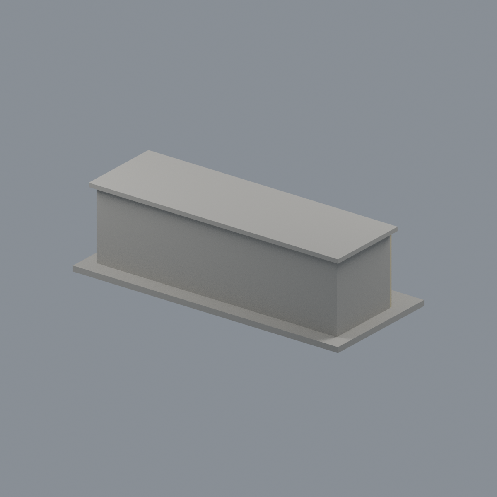
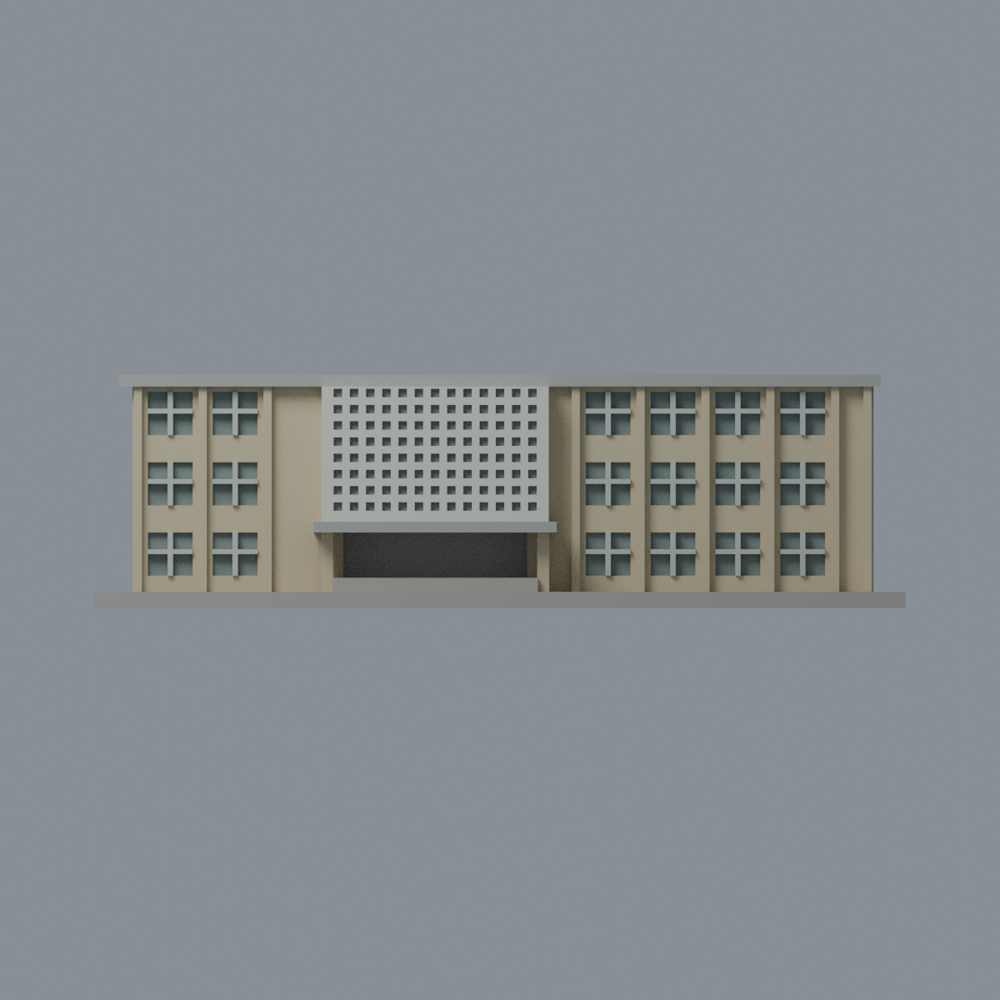
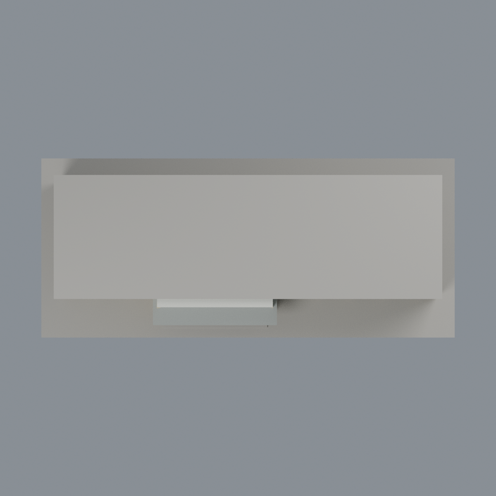

# 臺大電機一館：七材質外觀版

沿用原 **3,740 三角面／1,760 頂點**，不改原 STL 位元、座標、面序或幾何；這是既有模型外觀改版，不增加模型包數。

| 模型預覽 | 模型預覽 | 模型預覽 |
| :---: | :---: | :---: |
| 正面  | 背面保持中性  |  |
|  |  |  |

[表面色 3MF](ntuee1-appearance.3mf) · [可編輯 Blender](scene.blend) · [材質色表](palette.json) · [逐面指派與依據](face-materials.json) · [原 STL](../model.stl)

## 來源與配色邊界

親自核對臺大官方[斜前外觀 5756](https://homepage.ntu.edu.tw/~cpo/2010photo/N/N22/IMG_5756.JPG)、[入口近照 5757](https://homepage.ntu.edu.tw/~cpo/2010photo/N/N22/IMG_5757.JPG)與[屏牆近照 5758](https://homepage.ntu.edu.tw/~cpo/2010photo/N/N22/IMG_5758.JPG)。三照 EXIF DateTimeOriginal 分別為 2010-10-09 14:05:04／14:05:46／14:05:52；時區與時鐘未獨立核實，2011 修改時間不當拍攝日。原圖僅 400×300 或 300×400，支持材料家族而非細漆面與校準 RGB。[來源覆核與雜湊](qa/source-review.json)，不代表 2026 現況，第三方原照不入包。

- 正面淡奶黃磁磚牆與既有窄凸柱，粗化屏牆灰白；原照片屏牆細密曲折圖案與窄黃磚分隔條，原網格均未重現，**本版保留整體粗方孔白屏代理並明列省略黃磚細分隔，不捏造細紋或文字**。
- 原屏牆是背襯淺孔，孔底中性灰代表幾何限制，**不是玻璃、不是穿透孔，也不烘焙照片陰影**。真正三層窗的離散凹背才灰綠，原十字窗框銀灰。
- 雨棚側面、棚底與可見前／右屋簷側面灰混凝土；雨棚頂按同一構件作有界材料延伸，不宣稱頂面照片證實。主屋頂中性。
- 右端照片可見但原素面缺少實際窗列，兩端、背面及混合入口後牆中性，不添新窗、不把入口凹背全當玻璃。
- 原 STL、場景、建模腳本、粗化孔樣及歷史 QA 不變，不增模型數、不宣稱實體列印成功。

[原幾何與歷史來源限制](../README.zh-TW.md)

## 重建與核驗

安裝 [依賴](source/requirements.txt)，Blender 使用 4.3.2。由本資料夾上層提供原 model.stl：

1. `python appearance/source/build_appearance.py`
2. `python appearance/source/verify_exchange.py`
3. `blender -b -t 3 --python-exit-code 1 -P appearance/source/render_appearance.py`
4. `blender -b -t 3 --python-exit-code 1 -P appearance/source/verify_scene.py`

[獨立重建 ZIP](rebuild-source.zip)含原 STL、四支程式及依賴，不含第三方照片；不取代原建模腳本。[逐檔 SHA256](SHA256SUMS)

[交換／拓撲 QA](qa/exchange-validation.json)核對原座標與面序、全部面材質、單連通、有向水密邊、頂點 link 單環、正體積與零退化／重複面；lib3mf 嚴格讀取零警告，實際編輯單材質再存讀，其他材質及面指派不變。SDK 六位小數量化誤差另列。

[Blender 存讀與編輯](qa/scene-validation.json) · [渲染記錄](qa/render-manifest.json) · [獨立重建](qa/rebuild-validation.json)

## 製造限制照舊

尺寸仍為 150 × 65 × 43.2 mm；原 STL、建模程式、場景及歷史 QA 保留。原層檢與薄特徵檢查本次未重跑，不能由材質 QA 代替。

3MF 是同一網格的表面色，不是各材質各自封閉的分色實體、切片專案、噴頭映射或 G-code。切片 GUI、多材料路徑與實體列印未測；柱頭、屋簷、窗框及薄邊仍須評估材料、支撐及拆除風險，沒有保證可印或免支撐。
