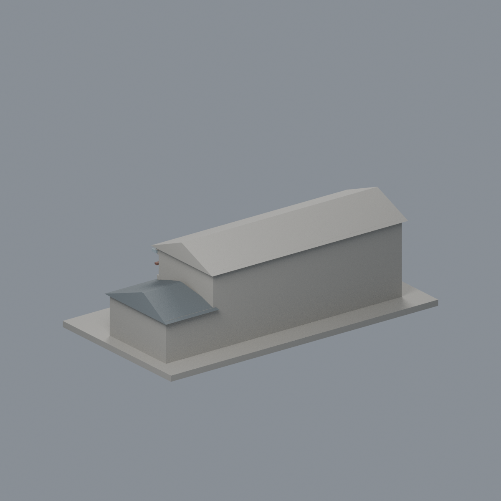

# 國立臺灣大學 工學博物館（修復保留館體）

## 6 材質外觀版（2026-10-21）

| 正面與來源支持區域 | 背牆中性／低翼屋面同系統延伸 |
|---|---|
|  |  |

[來源界線與四視角](appearance/README.md) · [表面色 3MF](appearance/ntuemuseum-appearance.3mf) · [可編輯場景](appearance/scene.blend)

來源支持的上層藍灰牆、赭棕木框、混凝土階梯與低翼炭灰屋面；底層混合灰腳牆、主屋頂及未知面中性，低翼後斜面僅同屋頂材料延伸。 原 STL 與歷史 QA 不變；這是外觀改善，不是新增幾何。[原單色正面](previews/front.png)／[原單色背面](previews/rear.png)

官方索引代碼 N51。公開外觀近似模型，非測繪或BIM。

## 範圍與比例
依2023、2024、2025官方外觀照片建模修復保留的右側主要館體與低側翼。沒有把2010舊機械館完整長條量體當成今日現況；不包括已移除中段、獨立舊立面牆及周邊新機械系館。背面及精確進深仍簡化。

保留辨識特徵：灰色兩層主體、長坡屋頂與端部山牆、小通風窗及高長窗、沿正立面的外梯、低側翼。外梯改實心踏步與厚欄牆，不複製纖細欄杆或室內展示。

尺寸 [150.0, 81.0, 49.0] mm，含底座最長150 mm。各館獨立比例，不是可拼接的共同尺度校園沙盤。尺寸、厚度、窗距均為照片目測和列印簡化，不是原建物實測。

## 列印
- 底座向下，毫米單位。參考起點：0.4 mm噴嘴、0.16–0.2 mm層高、3道外牆、15–20%填充。須依自己的切片器調整。
- 屋簷、外梯上平台、窗框上緣可能需支撐。實心外梯便於列印，但外觀比真實樓梯厚重。
- 新增細浮雕名義最小約0.9 mm；這不是全模型最小壁厚的測量結果。零碎設備、文字招牌、樹木、電線及細緻裝飾沒有加入。
- 門窗背牆與實心量體避免隱藏內殼；實際填充由切片器決定。
- 未實際列印；未用PrusaSlicer、Cura等生成工具路徑。不宣稱無支撐或無風險可印。

## 驗證與檔案
- model.stl、model.obj；scene.blend是由實際STL匯入的可編修網格。
- build_model.py為獨立參數來源；Python3.12，依requirements.txt裝依賴後執行python build_model.py。
- Blender4.3.2：blender -b -t 2 -P render_preview.py。previews/front.png、rear.png、elevation.png均直接渲染交付STL。
- python validate_model.py：原始法向、水密、流形邊／頂點、單一連通表面、無分離封閉內殼、正體積、150mm、獨立重建SHA256及已儲存Blender/STL三角幾何一致性。結果validation.json。
- python check_layers.py：每0.2mm水平截面幾何檢查，共 245 層，所抽樣截面全部閉合。首層採z=0.071mm避免重合平面退化，非實際列印首層設定。
- layer-check.json另記向下超45度面積指標與各層輪廓；它不是切片器、最小壁厚測試或實體試印。閉合截面不保證擠出連續、橋接、支撐可拆、床面附著或局部細節可印。
- SHA256SUMS可核對檔案；更改參數後需重建、重繪、重驗證。

## 公開來源
查閱及圖像像素檢視：2026-10-13。來源照片未隨檔重新散布。
- [臺大機械系：2024舊館轉型工學博物館](https://www.me.ntu.edu.tw/web/machine/museum.jsp)
- [官方2023修復外觀](https://www.me.ntu.edu.tw/epaper/20230930/News_Photo_Content_n_44372_s_218840.html)
- [實際檢視2023斜角照片](https://www.me.ntu.edu.tw/epaper/20230930/001/Upload/820/ckfile/e3aefaeb-5814-40c3-b867-3d9dbc694ba8.jpg)
- [官方2024整體外觀圖組（只使用左上外觀）](https://www.me.ntu.edu.tw/epaper/20241231/001/Upload/820/ckfile/710a0303-0216-4151-aa1a-491ec3586105.png)
- [官方2025建築實踐報導](https://www.me.ntu.edu.tw/epaper/20250630/News_Content_n_192897_sms_122490_s_256051.html)
- [實際檢視2025入口斜角](https://www.me.ntu.edu.tw/epaper/20250630/001/Upload/820/ckfile/38d04c75-8933-4703-ada4-bb921414c50e.jpg)
- [臺大官方建物索引，檢索標題2026-08-17](https://cpo.ntu.edu.tw/map/C_01_list.pdf)

照片版權屬原權利人；沒有轉授原建築設計或照片權利。不同拍攝日期不等於已核實目前全部外觀。
