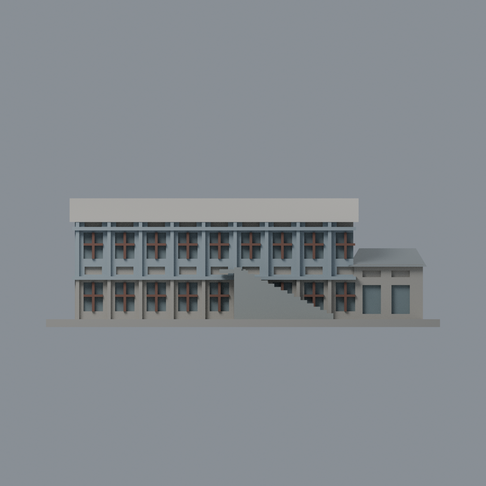
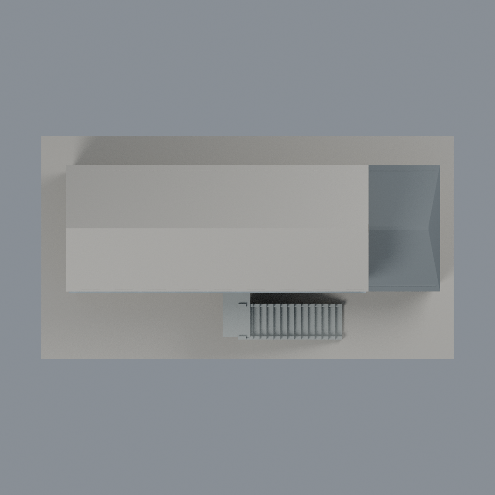

# 臺大工學博物館保留館體：六材質外觀版

沿用原 **3,690 三角面／1,721 頂點**，不改原 STL 位元、座標、面序或幾何；這是既有模型外觀改版，不增加模型包數。

| 正面 | 背面保持中性 |
|---|---|
|  |  |
|  |  |

[表面色 3MF](ntuemuseum-appearance.3mf) · [可編輯 Blender](scene.blend) · [材質色表](palette.json) · [逐面指派與依據](face-materials.json) · [原 STL](../model.stl)

## 來源與配色邊界

親自核對臺大機械系官方電子報 [2023 外觀](https://www.me.ntu.edu.tw/epaper/20230930/001/Upload/820/ckfile/e3aefaeb-5814-40c3-b867-3d9dbc694ba8.jpg)、[2024 組圖](https://www.me.ntu.edu.tw/epaper/20241231/001/Upload/820/ckfile/710a0303-0216-4151-aa1a-491ec3586105.png)及 [2025 外觀](https://www.me.ntu.edu.tw/epaper/20250630/001/Upload/820/ckfile/38d04c75-8933-4703-ada4-bb921414c50e.jpg)。組圖僅採左上室外照，不用內部展覽照片推立面色。前兩張無拍攝 EXIF，不將電子報年月當拍攝日；第三張 EXIF DateTimeOriginal 為 2025-06-19 14:42:31，時區／時鐘未獨立核實。[來源與雜湊](qa/source-review.json)，原照不入公開包，不稱 2026 現況。

- 僅修復保留館體與低翼，不補已拆除區段，也不把後方新紅磚樓算入。可分出的上層牆、水平帶與柱採藍灰粉刷代理。
- **底層連續牆面與部分通高柱混合藍灰牆／灰石腳，原網格沒有完整材料界線，因此保留中性**。不是把實景全部還原成中性色，也不以三角面重心假裁灰腳。
- 原高窗十字框赭棕木色，離散窗背灰玻璃；低翼原本缺木框，僅給窗背灰玻璃，不能把整扇凹背當棕木。細通風凹口保持中性，不宣稱藍色玻璃。
- 實體階梯、階梯狀護牆及平台灰混凝土，不是新增金屬欄杆。低翼斜屋面由 2024 左上外觀支持炭灰瓦代理，背向斜面為同一屋頂系統的有界材料延伸、不是背面實拍證實；未見主屋頂及未知側後中性，沒有瓦紋或額外設備。
- 全部以完整原三角面賦材質，不切面、不改原 STL、腳本、場景及歷史 QA；不是新增幾何，不宣稱實體列印成功。

[原幾何與歷史來源限制](../README.zh-TW.md)

## 重建與核驗

安裝 [依賴](source/requirements.txt)，Blender 使用 4.3.2。由本資料夾上層提供原 model.stl：

1. `python appearance/source/build_appearance.py`
2. `python appearance/source/verify_exchange.py`
3. `blender -b -t 3 --python-exit-code 1 -P appearance/source/render_appearance.py`
4. `blender -b -t 3 --python-exit-code 1 -P appearance/source/verify_scene.py`

[獨立重建 ZIP](rebuild-source.zip)含原 STL、四支程式及依賴，不含第三方照片；不取代原建模腳本。[逐檔 SHA256](SHA256SUMS)

[交換／拓撲 QA](qa/exchange-validation.json)核對原座標與面序、全部面材質、單連通、有向水密邊、頂點 link 單環、正體積與零退化／重複面；lib3mf 嚴格讀取零警告，實際編輯單材質再存讀，其他材質及面指派不變。SDK 六位小數量化誤差另列。

[Blender 存讀與編輯](qa/scene-validation.json) · [渲染記錄](qa/render-manifest.json) · [獨立重建](qa/rebuild-validation.json)

## 製造限制照舊

尺寸仍為 150 × 81 × 49 mm；原 STL、建模程式、場景及歷史 QA 保留。原層檢與薄特徵檢查本次未重跑，不能由材質 QA 代替。

3MF 是同一網格的表面色，不是各材質各自封閉的分色實體、切片專案、噴頭映射或 G-code。切片 GUI、多材料路徑與實體列印未測；柱頭、屋簷、窗框及薄邊仍須評估材料、支撐及拆除風險，沒有保證可印或免支撐。
