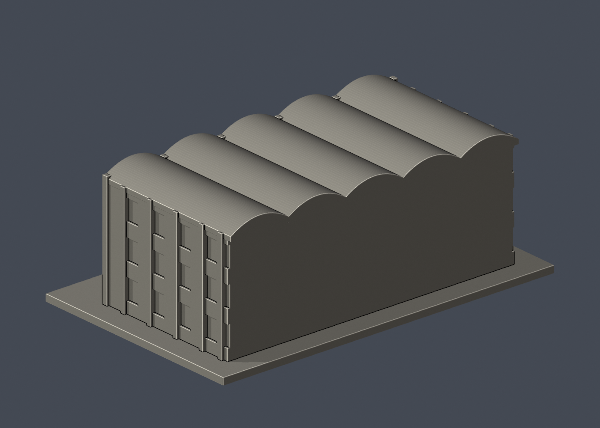

# 國立臺灣大學 工程科學及海洋工程學系館（五波浪入口段）

## 模型預覽

| 模型預覽 | 模型預覽 | 模型預覽 |
| :---: | :---: | :---: |
| 正面  | 背面  |  |

[返回校區圖鑑](../../README.md) · [返回臺大總圖鑑](../../../README.md)

## 實際 STL 正面與背面

[下載 STL](model.stl) · [Blender 場景](scene.blend) · [參數化來源](build_model.py) · [驗證結果](validation.json)

[新增34件列印幾何補查與細節警示](../../../qa/printability-20261013/README.zh-TW.md)

官方索引代碼 E61。公開外觀近似模型，非測繪或BIM。

## 範圍與比例
只取公開照片可確認的五跨波浪入口段，沒有把此短段當成官方所述全長178公尺系館，更不包含二館與三座其他實驗館。波浪屋面沿短段進深延續為近似，真實屋頂全長與背後連接未確認，模型後截面留白。

保留辨識特徵：五連淺弧波浪屋緣、每跨三小通風孔、雙列窗與寬實心直帶、外露肋柱、低入口雨棚與台階。三層可見窗帶並不等同官方地上樓層計數，含低層視覺效果。

尺寸 [150.0, 95.0, 55.5] mm，含底座最長150 mm。各館獨立比例，不是可拼接的共同尺度校園沙盤。尺寸、厚度、窗距均為照片目測和列印簡化，不是原建物實測。

## 列印
- 底座向下，毫米單位。參考起點：0.4 mm噴嘴、0.16–0.2 mm層高、3道外牆、15–20%填充。須依自己的切片器調整。
- 波浪屋簷與入口雨棚需評估局部支撐，凹窗橫框亦有懸垂；沒有薄殼空屋頂。
- 新增細浮雕名義最小約0.9 mm；這不是全模型最小壁厚的測量結果。零碎設備、文字招牌、樹木、電線及細緻裝飾沒有加入。
- 門窗背牆與實心量體避免隱藏內殼；實際填充由切片器決定。
- 未實際列印；未用PrusaSlicer、Cura等生成工具路徑。不宣稱無支撐或無風險可印。

## 驗證與檔案
- model.stl、model.obj；scene.blend是由實際STL匯入的可編修網格。
- build_model.py為獨立參數來源；Python3.12，依requirements.txt裝依賴後執行python build_model.py。
- Blender4.3.2：blender -b -t 2 -P render_preview.py。previews/front.png、rear.png、elevation.png均直接渲染交付STL。
- python validate_model.py：原始法向、水密、流形邊／頂點、單一連通表面、無分離封閉內殼、正體積、150mm、獨立重建SHA256及已儲存Blender/STL三角幾何一致性。結果validation.json。
- python check_layers.py：每0.2mm水平截面幾何檢查，共 278 層，所抽樣截面全部閉合。首層採z=0.071mm避免重合平面退化，非實際列印首層設定。
- layer-check.json另記向下超45度面積指標與各層輪廓；它不是切片器、最小壁厚測試或實體試印。閉合截面不保證擠出連續、橋接、支撐可拆、床面附著或局部細節可印。
- SHA256SUMS可核對檔案；更改參數後需重建、重繪、重驗證。

## 公開來源
查閱及圖像像素檢視：2026-10-13。來源照片未隨檔重新散布。
- [工科海洋官方館舍介紹：五棟及178公尺主館身份](https://jsc.cc.ntu.edu.tw/~ntuesoe/tw/location.html)
- [實際檢視官方目前系網五波浪立面](https://jsc.cc.ntu.edu.tw/~ntuesoe/tw/001/Upload/1040/ckfile/0d8ee55a-8ab4-4e02-9bca-3a4498ba983c.jpg)
- [2010官方外觀 5957](https://homepage.ntu.edu.tw/~cpo/2010photo/E/E61/IMG_5957.JPG)
- [2010官方外觀 5959](https://homepage.ntu.edu.tw/~cpo/2010photo/E/E61/IMG_5959.JPG)
- [2010官方外觀 5960](https://homepage.ntu.edu.tw/~cpo/2010photo/E/E61/IMG_5960.JPG)
- [臺大官方建物索引，檢索標題2026-08-17](https://cpo.ntu.edu.tw/map/C_01_list.pdf)

照片版權屬原權利人；沒有轉授原建築設計或照片權利。不同拍攝日期不等於已核實目前全部外觀。

## 2026-10-13 列印幾何修訂 v2
舊版雖通過邊／頂點流形與閉合截面檢查，但新增截面有效性檢查發現窗橫框末端與寬實心直帶相切，造成零寬往返輪廓（例如 z=12.071 mm、x=-31.5 mm、y=-26.5 mm）。這不是 1e-6 取整造成；不推薦使用舊版 STL。

本版只把窗橫框長度由 6.2 改成 5.8 mm，每端縮短 0.2 mm，消除該相切。入口段外形、150 mm 尺度與公開來源不變。
- python check_valid_sections.py：278 個 0.2 mm 間距截面，每個輪廓及其組合多邊形均須 closed/valid，不使用 polygon repair；結果 valid-sections.json。
- python thin_canonical_v2.py：56 個 1 mm 間距截面作 0.8 mm 參考寬度形態學 opening，最大面積損失 0.0396%，沒有超過 1% 指標層。這是新增輔助幾何篩檢，並非全面壁厚測量、工具路徑或試印。
- 舊版僅保留追溯，不作本版列印附件。支撐與切片器檢視仍不可省略。
