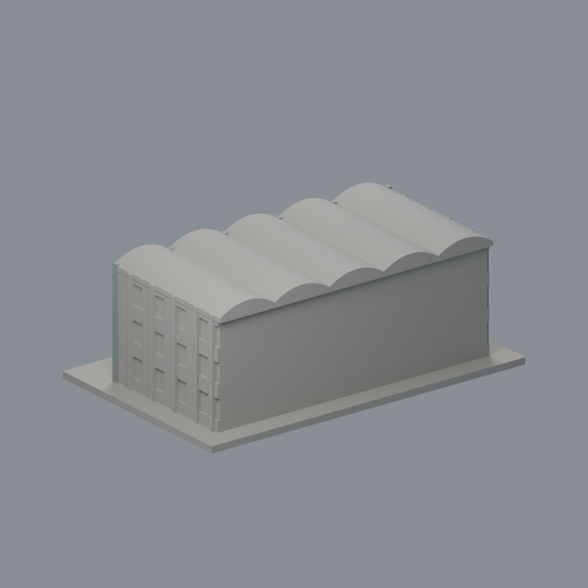
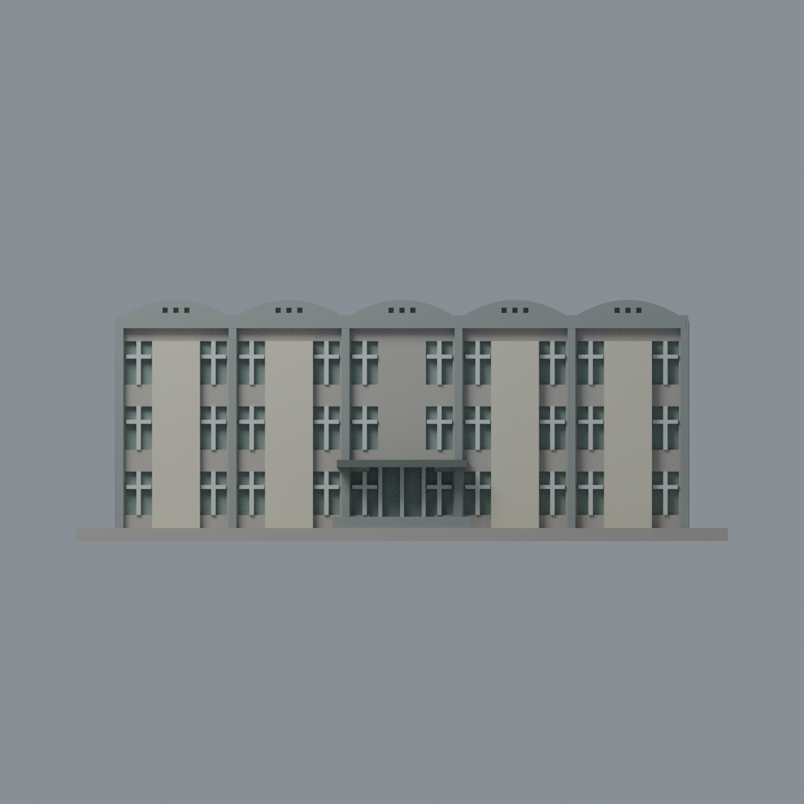
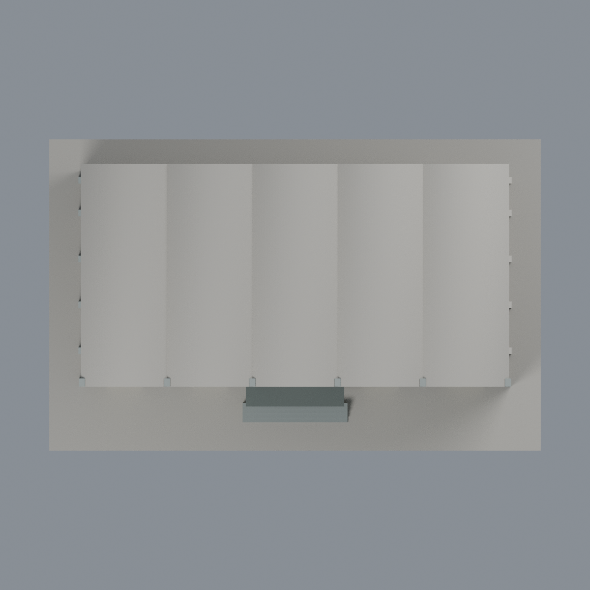

# 臺大工科海洋五波浪入口段：六材質外觀版

沿用原 **4,594 三角面／2,293 頂點**，不改原 STL 位元、座標、面序或幾何；這是既有模型外觀改版，不增加模型包數。

| 正面 | 背面保持中性 |
|---|---|
|  |  |
|  |  |

[表面色 3MF](ntuesoe-appearance.3mf) · [可編輯 Blender](scene.blend) · [材質色表](palette.json) · [逐面指派與依據](face-materials.json) · [原 STL](../model.stl)

## 來源與配色邊界

親自核對臺大工科海洋系[正面來源](https://jsc.cc.ntu.edu.tw/~ntuesoe/tw/001/Upload/1040/ckfile/0d8ee55a-8ab4-4e02-9bca-3a4498ba983c.jpg)，EXIF DateTimeOriginal 記為 2022-05-13 09:04:50；另臺大官方 [5957](https://homepage.ntu.edu.tw/~cpo/2010photo/E/E61/IMG_5957.JPG)、[5959](https://homepage.ntu.edu.tw/~cpo/2010photo/E/E61/IMG_5959.JPG)、[5960](https://homepage.ntu.edu.tw/~cpo/2010photo/E/E61/IMG_5960.JPG) 記為 2010-10-16。EXIF 時區與時鐘未獨立核實，不把修改日或不同年份照片當作 2026 現況。[來源覆核與雜湊](qa/source-review.json)，原照只供私有研究、不入公開包。

- 僅原有五波浪入口段，不是整棟 178 公尺長館體。寬實牆板奶油磚色，原窄柱與**波形正端面**灰混凝土；**未知曲面屋頂頂面仍中性**，不當太陽能或藍屋頂。
- 原離散窗凹背採克制灰綠玻璃，既有窗梃銀灰；小屋端通風凹孔保留中性，不是玻璃。未增加細磁磚縫、額外框線、植栽箱、冷氣或文字。
- 正面與可確定的左斜側離散窗／柱有來源，左側原網格未設細窗框者不假補。右側、後切面及未能精準區分的實牆仍中性，而非聲稱實景灰牆。
- 入口棚深灰，頂面僅同構件有界材料延伸，不聲稱有屋頂俯視證據；台階灰色。原無分面地坪中性，沒有塗成草地。
- 全部以完整原三角面賦材質，不切面、不改 STL 位元／面序、原腳本／場景／歷史 QA；不是新增幾何，不宣稱實體列印成功。

[原幾何與歷史來源限制](../README.zh-TW.md)

## 重建與核驗

安裝 [依賴](source/requirements.txt)，Blender 使用 4.3.2。由本資料夾上層提供原 model.stl：

1. `python appearance/source/build_appearance.py`
2. `python appearance/source/verify_exchange.py`
3. `blender -b -t 3 --python-exit-code 1 -P appearance/source/render_appearance.py`
4. `blender -b -t 3 --python-exit-code 1 -P appearance/source/verify_scene.py`

[獨立重建 ZIP](rebuild-source.zip)含原 STL、四支程式及依賴，不含第三方照片；不取代原建模腳本。[逐檔 SHA256](SHA256SUMS)

[交換／拓撲 QA](qa/exchange-validation.json)核對原座標與面序、全部面材質、單連通、有向水密邊、頂點 link 單環、正體積與零退化／重複面；lib3mf 嚴格讀取零警告，實際編輯單材質再存讀，其他材質及面指派不變。SDK 六位小數量化誤差另列。

[Blender 存讀與編輯](qa/scene-validation.json) · [渲染記錄](qa/render-manifest.json) · [獨立重建](qa/rebuild-validation.json)

## 製造限制照舊

尺寸仍為 150 × 95 × 55.5 mm；原 STL、建模程式、場景及歷史 QA 保留。原層檢與薄特徵檢查本次未重跑，不能由材質 QA 代替。

3MF 是同一網格的表面色，不是各材質各自封閉的分色實體、切片專案、噴頭映射或 G-code。切片 GUI、多材料路徑與實體列印未測；柱頭、屋簷、窗框及薄邊仍須評估材料、支撐及拆除風險，沒有保證可印或免支撐。
