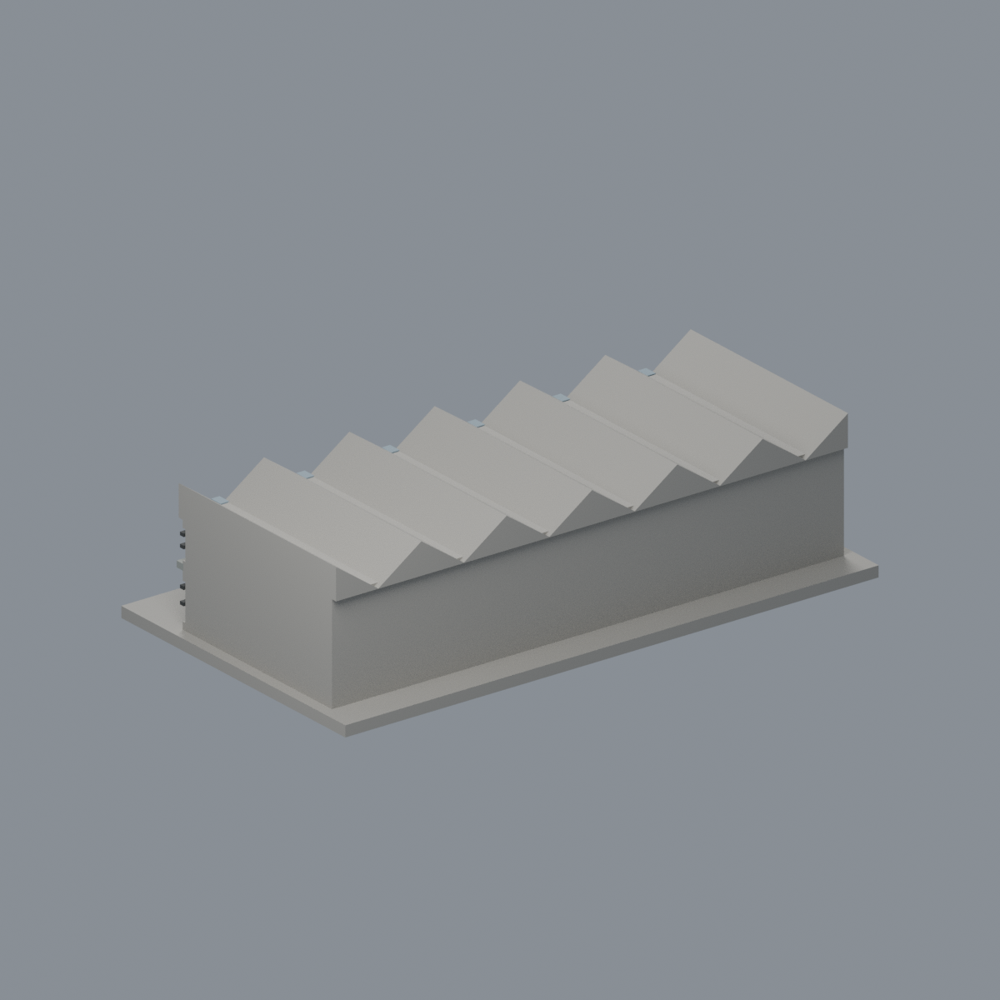

# 國立臺灣大學 第一學生活動中心（歷史前棟）

## 8 材質外觀版（2026-10-21）

| 正面與來源支持區域 | 未見外側背面中性 |
|---|---|
|  |  |

[來源界線與四視角](appearance/README.md) · [表面色 3MF](appearance/ntufirst-appearance.3mf) · [可編輯場景](appearance/scene.blend)

實照支持白色折板端面、灰藍柱、深窗格與中央紅門；下窗混合實裙、未分界白磚帶及未知屋頂保持中性，插畫只辨形不供配色。 原 STL 與歷史 QA 不變；這是外觀改善，不是新增幾何。[原單色正面](previews/front.png)／[原單色背面](previews/rear.png)

官方索引代碼 M11。公開外觀近似模型，非測繪或BIM。

## 範圍與比例
本件僅歷史前棟外觀研究；主證據集中於正面，進深和背面簡化，後棟、增建及屋頂設施均未納入。不能視為整個活動中心複合體。

保留辨識特徵：連續折板屋頂、兩端半折板、中央超尺度大門、格柵窗與抬高台基；格柵刻意加粗。

尺寸 [150.0, 84.0, 38.5] mm，含底座最長150 mm。各館獨立比例，不是可拼接的共同尺度校園沙盤。尺寸、厚度、窗距均為照片目測和列印簡化，不是原建物實測。

## 列印
- 底座向下，毫米單位。參考起點：0.4 mm噴嘴、0.16–0.2 mm層高、3道外牆、15–20%填充。須依自己的切片器調整。
- 折板屋簷、大門上方與格柵橫線局部懸垂可能需支撐。窗格為厚浮雕且有實體背牆；未複製細鐵件。
- 新增細浮雕名義最小約0.9 mm；這不是全模型最小壁厚的測量結果。零碎設備、文字招牌、樹木、電線及細緻裝飾沒有加入。
- 門窗背牆與實心量體避免隱藏內殼；實際填充由切片器決定。
- 未實際列印；未用PrusaSlicer、Cura等生成工具路徑。不宣稱無支撐或無風險可印。

## 驗證與檔案
- model.stl、model.obj；scene.blend是由實際STL匯入的可編修網格。
- build_model.py為獨立參數來源；Python3.12，依requirements.txt裝依賴後執行python build_model.py。
- Blender4.3.2：blender -b -t 2 -P render_preview.py。previews/front.png、rear.png、elevation.png均直接渲染交付STL。
- python validate_model.py：原始法向、水密、流形邊／頂點、單一連通表面、無分離封閉內殼、正體積、150mm、獨立重建SHA256及已儲存Blender/STL三角幾何一致性。結果validation.json。
- python check_layers.py：每0.2mm水平截面幾何檢查，共 193 層，所抽樣截面全部閉合。首層採z=0.071mm避免重合平面退化，非實際列印首層設定。
- layer-check.json另記向下超45度面積指標與各層輪廓；它不是切片器、最小壁厚測試或實體試印。閉合截面不保證擠出連續、橋接、支撐可拆、床面附著或局部細節可印。
- SHA256SUMS可核對檔案；更改參數後需重建、重繪、重驗證。

## 公開來源
查閱及圖像像素檢視：2026-10-13。來源照片未隨檔重新散布。
- [臺大學生活動中心管理組：歷史館舍與折板說明](https://www.active.ntu.edu.tw/about_us/Center)
- [臺大訪客中心：第一學生活動中心](https://visitorcenter.ntu.edu.tw/News_Content_n_74842_s_81634.html)
- [實際檢視官方正面照片](https://visitorcenter.ntu.edu.tw/001/Upload/photoedittemp/abb892c2-86f6-4aff-84b0-3d47544225c9.jpg)
- [官方完整正立面示意圖（輔助辨認兩端折板，不當測繪）](https://visitorcenter.ntu.edu.tw/001/Upload/142/ckfile/ec404990-10a1-4df8-bc2d-5c9b107df765.png)
- [自由時報：另一張公開正面照片](https://playing.ltn.com.tw/article/7603/2)
- [臺大官方建物索引，檢索標題2026-08-17](https://cpo.ntu.edu.tw/map/C_01_list.pdf)

照片版權屬原權利人；沒有轉授原建築設計或照片權利。不同拍攝日期不等於已核實目前全部外觀。
