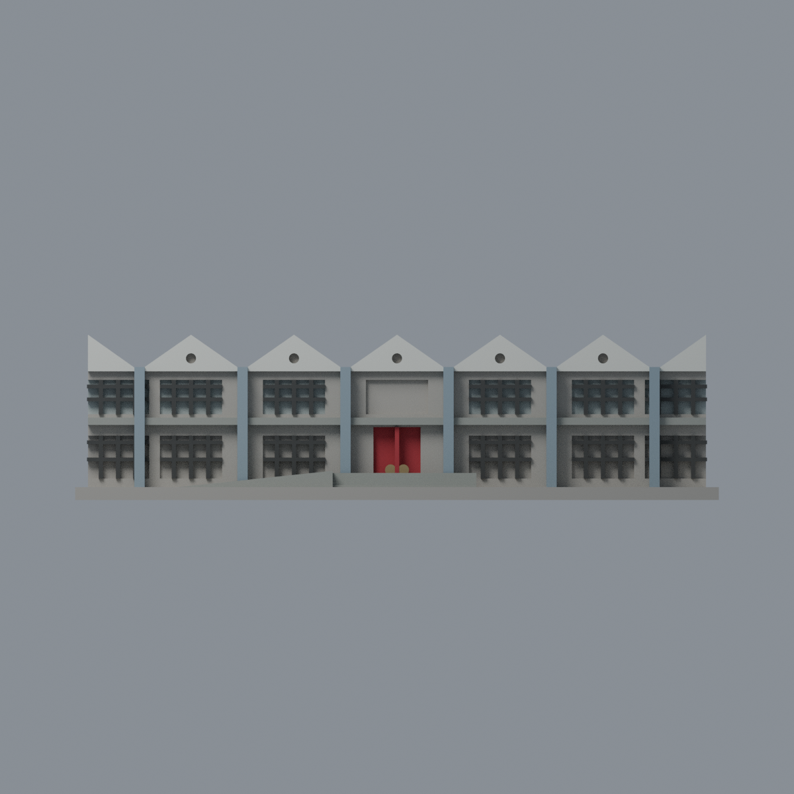
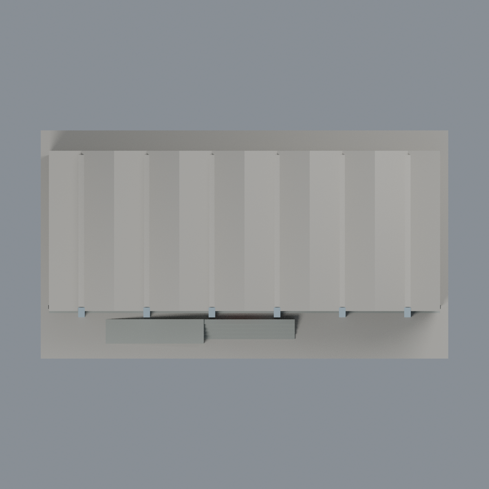

# 臺大第一學生活動中心歷史前棟：八材質外觀版

沿用原 **4,724 三角面／2,074 頂點**，不改原 STL 位元、座標、面序或幾何；這是既有模型外觀改版，不增加模型包數。

| 正面 | 背面保持中性 |
|---|---|
|  |  |
|  |  |

[表面色 3MF](ntufirst-appearance.3mf) · [可編輯 Blender](scene.blend) · [材質色表](palette.json) · [逐面指派與依據](face-materials.json) · [原 STL](../model.stl)

## 來源與配色邊界

親自核對臺大訪客中心完整[實景照片](https://visitorcenter.ntu.edu.tw/001/Upload/photoedittemp/abb892c2-86f6-4aff-84b0-3d47544225c9.jpg)及[外形插畫](https://visitorcenter.ntu.edu.tw/001/Upload/142/ckfile/ec404990-10a1-4df8-bc2d-5c9b107df765.png)。**插畫只核對完整折板外形，不作顏色依據**；照片 EXIF DateTimeOriginal 記 2011-10-28 00:08:05，時區／時鐘未獨立核實，不作 2026 現況還原。[來源覆核與雜湊](qa/source-review.json)，原圖不入公開包。

- 既有折板正端面白色，前柱灰藍，以實景而非插畫白柱為準。折板上方屋面未見，保留中性，不臆測整個屋頂都是白漆。
- 既有窗格深灰，離散上層窗背克制灰玻璃。**下層窗凹背混合透明／半透明玻璃與深色不透光下裙，原本未分面，整片中性而不染成純玻璃**。中央上層缺原照細窗格，保留中性，不新增格線。
- 中央雙門原背面及中縫紅色，既有圓把手低彩度黃銅；不是加招牌或金字。台階與原簡化坡道灰混凝土，不聲稱無障礙坡度比例。
- 窗間實牆混合白磚／灰石帶而未分界，保留中性；原凸水平帶僅灰混凝土代理，不宣稱完整白磚帶還原。未知側後與主屋頂中性，不加後棟或設備。
- 全部使用完整原面；原 STL、面序、腳本、場景與歷史 QA 不變。不是新增幾何，也沒有實體列印成功宣稱。

[原幾何與歷史來源限制](../README.zh-TW.md)

## 重建與核驗

安裝 [依賴](source/requirements.txt)，Blender 使用 4.3.2。由本資料夾上層提供原 model.stl：

1. `python appearance/source/build_appearance.py`
2. `python appearance/source/verify_exchange.py`
3. `blender -b -t 3 --python-exit-code 1 -P appearance/source/render_appearance.py`
4. `blender -b -t 3 --python-exit-code 1 -P appearance/source/verify_scene.py`

[獨立重建 ZIP](rebuild-source.zip)含原 STL、四支程式及依賴，不含第三方照片；不取代原建模腳本。[逐檔 SHA256](SHA256SUMS)

[交換／拓撲 QA](qa/exchange-validation.json)核對原座標與面序、全部面材質、單連通、有向水密邊、頂點 link 單環、正體積與零退化／重複面；lib3mf 嚴格讀取零警告，實際編輯單材質再存讀，其他材質及面指派不變。SDK 六位小數量化誤差另列。

[Blender 存讀與編輯](qa/scene-validation.json) · [渲染記錄](qa/render-manifest.json) · [獨立重建](qa/rebuild-validation.json)

## 製造限制照舊

尺寸仍為 150 × 84 × 38.5 mm；原 STL、建模程式、場景及歷史 QA 保留。原層檢與薄特徵檢查本次未重跑，不能由材質 QA 代替。

3MF 是同一網格的表面色，不是各材質各自封閉的分色實體、切片專案、噴頭映射或 G-code。切片 GUI、多材料路徑與實體列印未測；柱頭、屋簷、窗框及薄邊仍須評估材料、支撐及拆除風險，沒有保證可印或免支撐。
