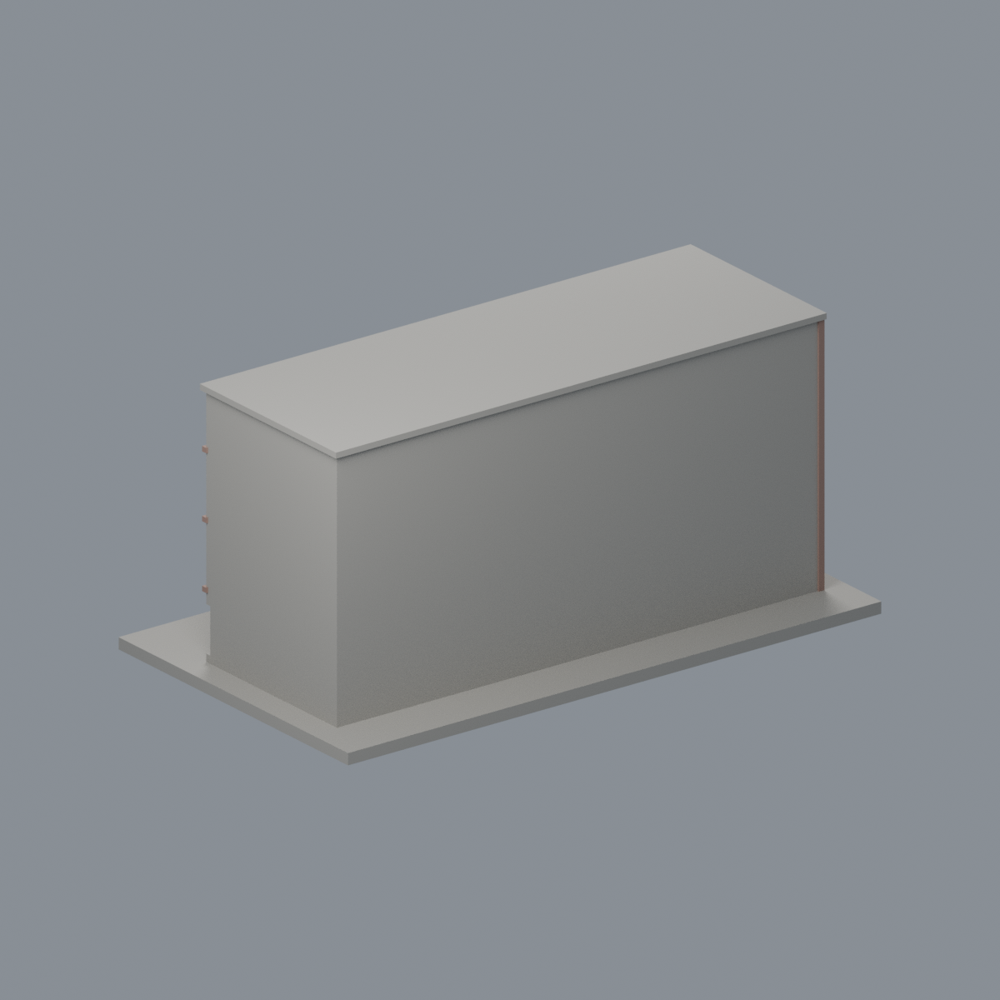
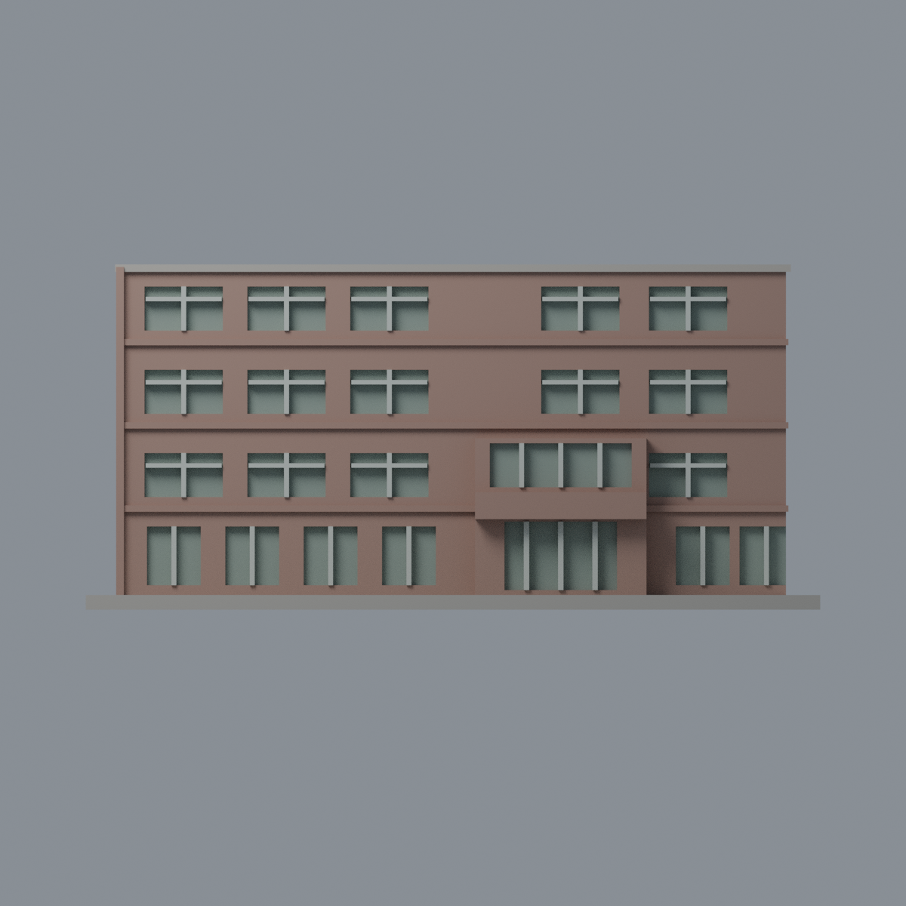

# 國立臺灣大學 食品科技館（原館前部）

## 模型預覽

| 新版模型預覽 | 新版模型預覽 | 新版模型預覽 |
| :---: | :---: | :---: |
|  |  |  |
|  |  |  |

[返回校區圖鑑](../../README.md) · [返回臺大總圖鑑](../../../README.md)

## 實際 STL 正面與背面

[下載 STL](model.stl) · [Blender 場景](scene.blend) · [參數化來源](build_model.py) · [驗證結果](validation.json)

本件新增closed/valid與薄篩結果見本資料夾valid-sections.json、thin-feature-check.json。

官方索引代碼 S48。公開外觀近似模型，非測繪或BIM。

## 範圍與比例
只作原四層館前部與可見左側，不包含鄰接S49食品研發大樓，也不把側後遮蔽部分補成推測翼樓。依2010官方三角度外觀；官方沿革與2026公告核對館名仍在使用，並未核實2026每處窗戶/設備現況。右部入口、成組窗、進深與窗距目測近似，後面留白。

保留辨識特徵：四層水平寬牆帶、成組矩形窗、偏右的凸出入口門廳與厚招牌牆、左側低長狹窗與直立牆柱。文字、空調與樹木省略。

尺寸 [150.0, 86.0, 70.5] mm，含底座最長150 mm。各館獨立比例，不是可拼接的共同尺度校園沙盤。尺寸、厚度、窗距均為照片目測和列印簡化，不是原建物實測。

## 列印
- 底座向下，毫米單位。參考起點：0.4 mm噴嘴、0.16–0.2 mm層高、3道外牆、15–20%填充。須依自己的切片器調整。
- 窗橫框、入口牆帶與屋簷可能懸垂，需切片檢查局部支撐。實心主體不是可進入建築空殼。
- 新增細浮雕名義最小約0.9 mm；這不是全模型最小壁厚的測量結果。零碎設備、文字招牌、樹木、電線及細緻裝飾沒有加入。
- 門窗背牆與實心量體避免隱藏內殼；實際填充由切片器決定。
- 未實際列印；未用PrusaSlicer、Cura等生成工具路徑。不宣稱無支撐或無風險可印。

## 驗證與檔案
- model.stl、model.obj；scene.blend是由實際STL匯入的可編修網格。
- build_model.py為獨立參數來源；Python3.12，依requirements.txt裝依賴後執行python build_model.py。
- Blender4.3.2：blender -b -t 2 -P render_preview.py。previews/front.png、rear.png、elevation.png均直接渲染交付STL。
- python validate_model.py：原始法向、水密、流形邊／頂點、單一連通表面、無分離封閉內殼、正體積、150mm、獨立重建SHA256及已儲存Blender/STL三角幾何一致性。結果validation.json。
- python check_layers.py：每0.2mm水平截面幾何檢查，共 353 層，所抽樣截面全部閉合。首層採z=0.071mm避免重合平面退化，非實際列印首層設定。
- layer-check.json另記向下超45度面積指標與各層輪廓；它不是切片器、最小壁厚測試或實體試印。閉合截面不保證擠出連續、橋接、支撐可拆、床面附著或局部細節可印。
- SHA256SUMS可核對檔案；更改參數後需重建、重繪、重驗證。

## 公開來源
查閱及圖像像素檢視：2026-10-13。來源照片未隨檔重新散布。
- [官方食科所沿革：食品科技館與食品研發大樓分開](https://www.fst.ntu.edu.tw/zh_tw/about/about2)
- [官方早期館舍說明：原館四層、另側實習工廠改建](https://sec.ntu.edu.tw/epaper/article.asp?num=750&sn=4842)
- [官方2026館名與使用身份](https://www.fst.ntu.edu.tw/zh_tw/Announcement/Announcement3/115學年度逕行修讀博士班-55302409)
- [實際檢視2010官方外觀 S48-0.jpg](https://homepage.ntu.edu.tw/~cpo/2010photo/S/S48/IMG_5837.JPG)
- [實際檢視2010官方外觀 S48-1.jpg](https://homepage.ntu.edu.tw/~cpo/2010photo/S/S48/IMG_5838.JPG)
- [實際檢視2010官方外觀 S48-2.jpg](https://homepage.ntu.edu.tw/~cpo/2010photo/S/S48/IMG_5839.JPG)
- [臺大官方建物索引，檢索標題2026-08-17](https://cpo.ntu.edu.tw/map/C_01_list.pdf)

照片版權屬原權利人；沒有轉授原建築設計或照片權利。不同拍攝日期不等於已核實目前全部外觀。

## 新增截面有效性與細節指標
- python check_valid_sections.py：0.2mm間距、z=0.071mm起，全部個別輪廓及組合Polygon必須closed/valid，不以修復吞掉自交；valid-sections.json。
- python thin_canonical_v2.py：每1mm的閉合有效截面作0.8mm參考opening，結果thin-feature-check.json。不是最小壁厚量測、真正切片或試印；尖端和曲線邊緣也會有損失。
- 本件71個薄篩截面，最大面積損失0.0356%，超過1%指標層0個。不能由此保證所有細節可印。

