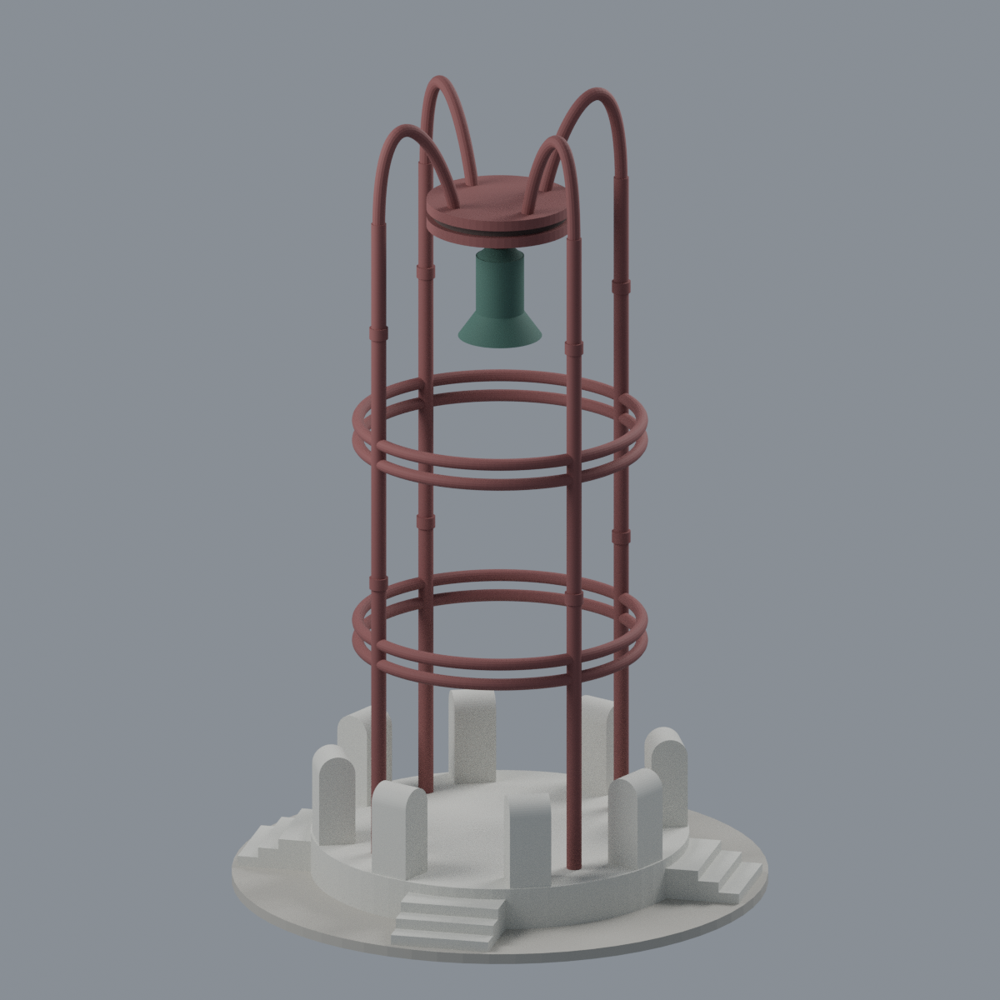
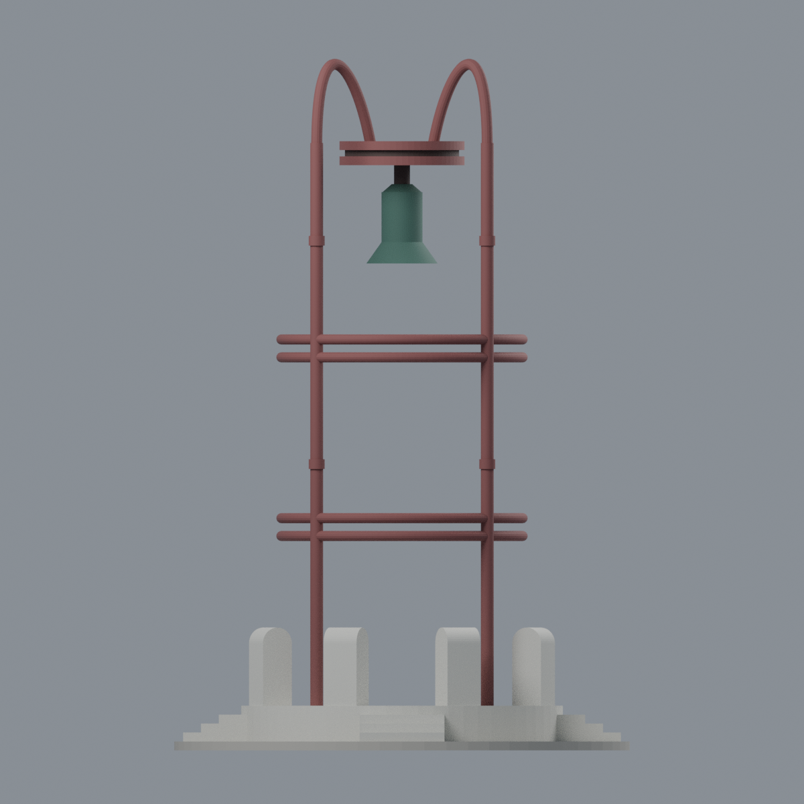
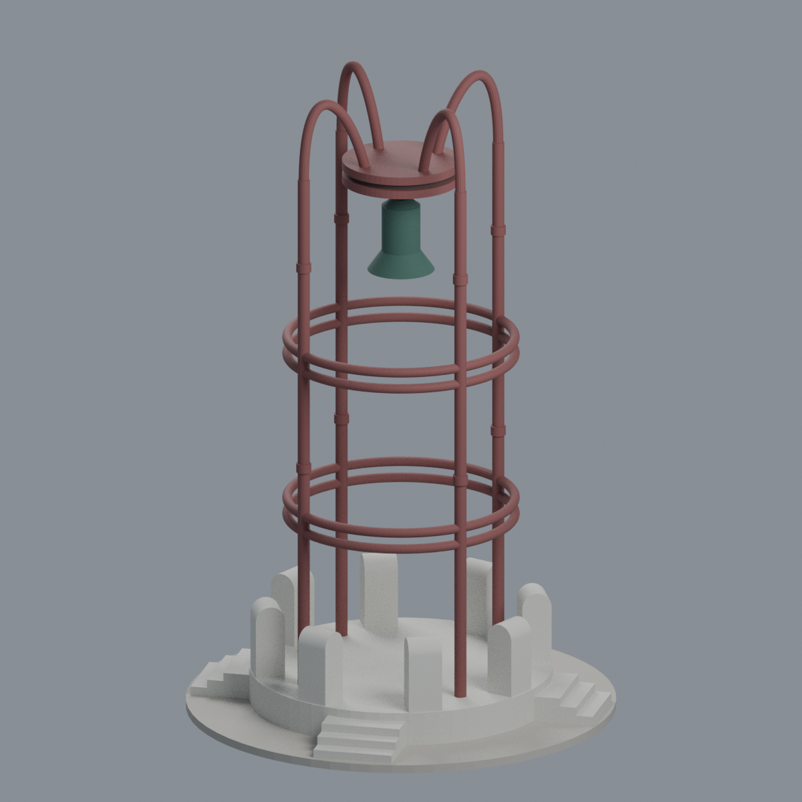
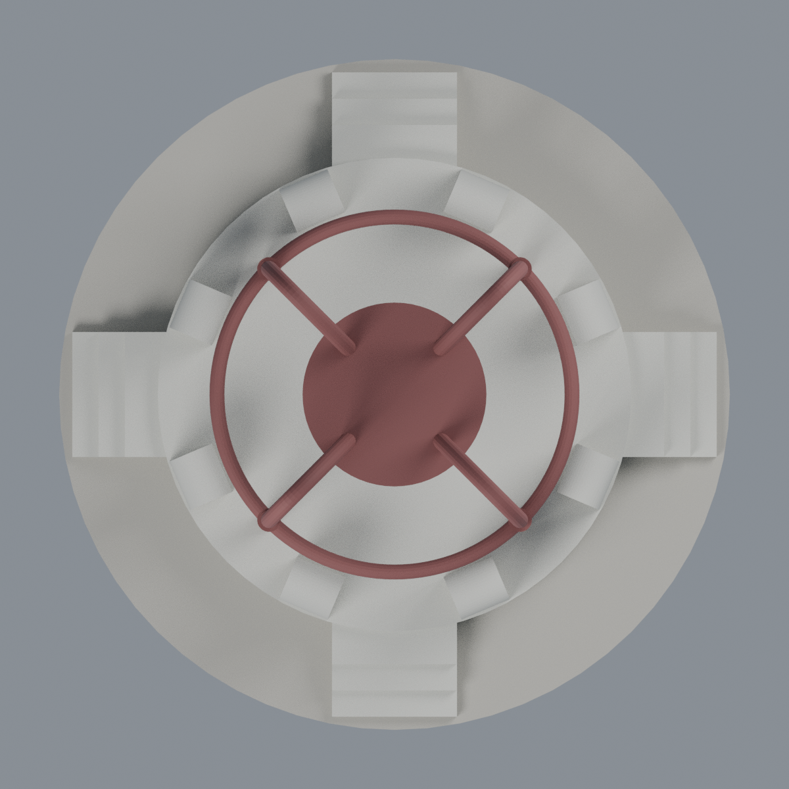

# 國立臺灣大學｜傅鐘鐘亭

**2005–2021 歷史外觀近似・完整有限範圍鐘亭・彩色可編輯模型**。不是現況測繪，也尚未實體列印。

| 檔案 | 用途 |
|---|---|
| [scene.blend](scene.blend) | 五材質可編輯 Blender 場景 |
| [model.3mf](model.3mf) | 毫米單位、逐三角形顯示材質；不是多擠出頭配置 |
| [model.stl](model.stl) | 單一連通封閉幾何，STL 本身無色 |
| [build_model.py](build_model.py) | 可重建參數化原始碼 |
| [SOURCES.md](SOURCES.md) / [QA.md](QA.md) | 來源、近似、製造警告及數位檢查 |

尺寸約 **102 × 102 × 154.86 mm**。保留四放射內彎柱、兩組雙環、圓形吊盤與銅鐘、圓台、八支短石柱及四向階梯。三外露踏面＋平台頂面為第四級的模型解讀，不是實測。

**列印注意：需要自行檢查支撐與方向。** 懸鐘、圓盤底、環桿與上彎柱具有大幅懸空；高細柱仍可能脆弱。原始切片在曲柱最高端最後兩個檢查平面出現 0.8 mm 侵蝕警告，完整保留，不宣稱薄壁全面合格或免支撐。最底 2 mm 中性圓底為人為展示支承。

| 正面斜視 | 背面斜視 | 正立面 |
|---|---|---|
|  |  |  |
| 左斜視 | 俯視 | |
|  |  | |

## 重建
Python 套件見 requirements.txt；執行 `python build_model.py`、`python qa_model.py`、`python check_features.py`。以 `blender -b --python-exit-code 1 --python render_model.py` 產生場景與全部五張實際網格圖，再執行 `verify_scene.py`、`verify_render.py`。`verify_exchange.py` 需 lib3mf SDK；檢查報告不等於實體製造認證。
