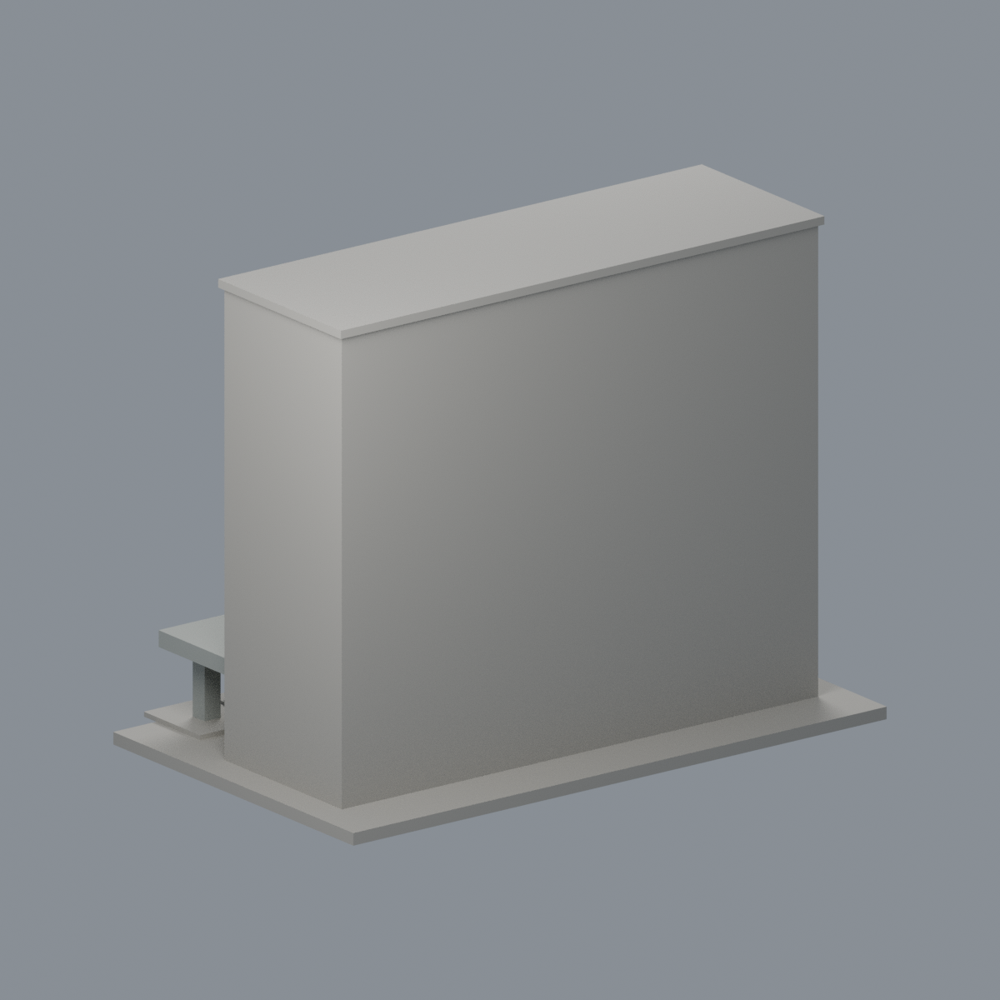

# 國立臺灣大學 地理館（前部）

## 5 材質外觀版（2026-10-21）

| 正面與來源支持區域 | 未見外側背面中性 |
|---|---|
|  |  |

[來源界線與四視角](appearance/README.md) · [表面色 3MF](appearance/ntugeog-appearance.3mf) · [可編輯場景](appearance/scene.blend)

淡奶油實牆、五條灰藍窗帶與灰窗梃、灰混凝土門廊；底層混合凹口及未知兩端背側屋頂中性，原窗帶節奏不改。 原 STL 與歷史 QA 不變；這是外觀改善，不是新增幾何。[原單色正面](previews/front.png)／[原單色背面](previews/rear.png)

官方索引代碼 S42。公開外觀近似模型，非測繪或BIM。

## 範圍與比例
只作照片可核對的六層前部水平窗帶量體及入口雨棚，不含旁邊遮蔽翼樓或聲稱整棟基地完整。2010官方正面與左斜角交叉比對；現系網館址作身份核對。深度、窗柱間距為目測；旁樓遮蔽之端部與背面留白，不推測開窗。

保留辨識特徵：五條上層長窗帶及寬橫向牆帶、首層入口、偏右的低平寬雨棚、兩根外露支柱及台階。牆面細磁磚與植物省略。

尺寸 [150.0, 94.5, 117.0] mm，含底座最長150 mm。各館獨立比例，不是可拼接的共同尺度校園沙盤。尺寸、厚度、窗距均為照片目測和列印簡化，不是原建物實測。

## 列印
- 底座向下，毫米單位。參考起點：0.4 mm噴嘴、0.16–0.2 mm層高、3道外牆、15–20%填充。須依自己的切片器調整。
- 入口寬雨棚具有真實外部下方開口，必須在列印切片器檢視跨距與支撐可拆性；柱名義4.5mm。長窗框附牆加厚，並非獨立薄柱。
- 新增細浮雕名義最小約0.9 mm；這不是全模型最小壁厚的測量結果。零碎設備、文字招牌、樹木、電線及細緻裝飾沒有加入。
- 門窗背牆與實心量體避免隱藏內殼；實際填充由切片器決定。
- 未實際列印；未用PrusaSlicer、Cura等生成工具路徑。不宣稱無支撐或無風險可印。

## 驗證與檔案
- model.stl、model.obj；scene.blend是由實際STL匯入的可編修網格。
- build_model.py為獨立參數來源；Python3.12，依requirements.txt裝依賴後執行python build_model.py。
- Blender4.3.2：blender -b -t 2 -P render_preview.py。previews/front.png、rear.png、elevation.png均直接渲染交付STL。
- python validate_model.py：原始法向、水密、流形邊／頂點、單一連通表面、無分離封閉內殼、正體積、150mm、獨立重建SHA256及已儲存Blender/STL三角幾何一致性。結果validation.json。
- python check_layers.py：每0.2mm水平截面幾何檢查，共 585 層，所抽樣截面全部閉合。首層採z=0.071mm避免重合平面退化，非實際列印首層設定。
- layer-check.json另記向下超45度面積指標與各層輪廓；它不是切片器、最小壁厚測試或實體試印。閉合截面不保證擠出連續、橋接、支撐可拆、床面附著或局部細節可印。
- SHA256SUMS可核對檔案；更改參數後需重建、重繪、重驗證。

## 公開來源
查閱及圖像像素檢視：2026-10-13。來源照片未隨檔重新散布。
- [官方系所館址資訊](https://www.geog.ntu.edu.tw/index.php/tw/16-introduction?limit=5&start=5)
- [實際檢視2010官方外觀 S42-0.jpg](https://homepage.ntu.edu.tw/~cpo/2010photo/S/S42/IMG_5824.JPG)
- [實際檢視2010官方外觀 S42-1.jpg](https://homepage.ntu.edu.tw/~cpo/2010photo/S/S42/IMG_5825.JPG)
- [實際檢視2010官方外觀 S42-2.jpg](https://homepage.ntu.edu.tw/~cpo/2010photo/S/S42/IMG_5826.JPG)
- [臺大官方建物索引，檢索標題2026-08-17](https://cpo.ntu.edu.tw/map/C_01_list.pdf)

照片版權屬原權利人；沒有轉授原建築設計或照片權利。不同拍攝日期不等於已核實目前全部外觀。

## 新增截面有效性與細節指標
- python check_valid_sections.py：0.2mm間距、z=0.071mm起，全部個別輪廓及組合Polygon必須closed/valid，不以修復吞掉自交；valid-sections.json。
- python thin_canonical_v2.py：每1mm的閉合有效截面作0.8mm參考opening，結果thin-feature-check.json。不是最小壁厚量測、真正切片或試印；尖端和曲線邊緣也會有損失。
- 本件117個薄篩截面，最大面積損失0.0421%，超過1%指標層0個。不能由此保證所有細節可印。
