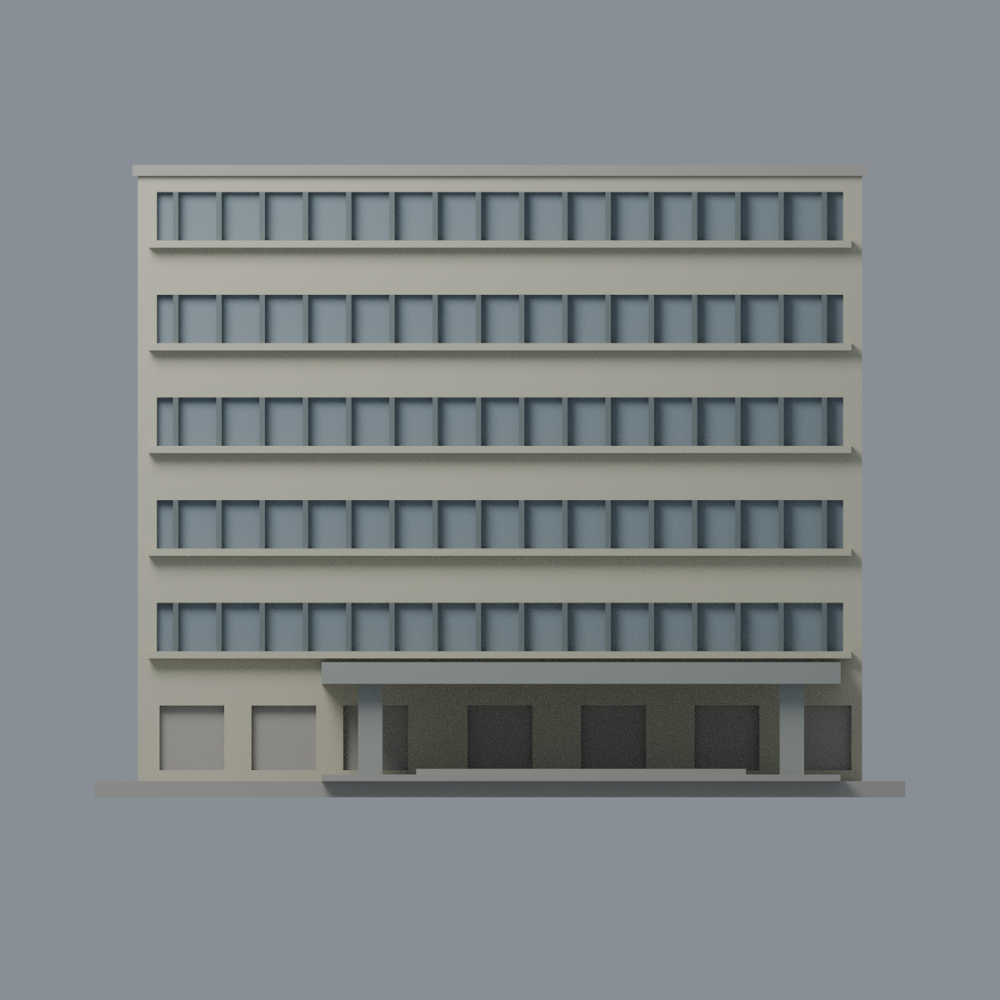

# 臺大地理館前部：五材質外觀版

沿用原 **2,702 三角面／1,189 頂點**，不改原 STL 位元、座標、面序或幾何；這是既有模型外觀改版，不增加模型包數。

| 正面 | 背面保持中性 |
|---|---|
|  |  |
|  |  |

[表面色 3MF](ntugeog-appearance.3mf) · [可編輯 Blender](scene.blend) · [材質色表](palette.json) · [逐面指派與依據](face-materials.json) · [原 STL](../model.stl)

## 來源與配色邊界

親自核對臺大官方[斜照 5824](https://homepage.ntu.edu.tw/~cpo/2010photo/S/S42/IMG_5824.JPG)、[正面 5825](https://homepage.ntu.edu.tw/~cpo/2010photo/S/S42/IMG_5825.JPG)與[正面近照 5826](https://homepage.ntu.edu.tw/~cpo/2010photo/S/S42/IMG_5826.JPG)。三照 EXIF DateTimeOriginal 分別為 2010-10-09 15:16:42／15:17:17／15:17:39；時鐘與時區未獨立核實，2010-12-31 是修改日期，不當拍攝日。原圖 336×448，支持大材料分區，不支持精確 RGB 與細部磚縫。[來源覆核與雜湊](qa/source-review.json)，歷史照片不代表 2026 現況，原照不入包。

- 正面實牆及原凸窗檯帶淡奶油；僅五條上部凹背採低飽和灰藍玻璃，原粗窗梃深銀灰。保留原五條窗帶節奏，不依照片補層數、細分窗或窗簾。
- 門廊與兩柱灰混凝土，門廊蓋板頂按同一構件作有界材料延伸，不宣稱俯視證實；不烘焙污漬，不加棚頂植栽。
- 底層凹口混合入口、實牆與受遮擋窗，整組保持中性，不能全部當玻璃。原地面、階梯保留中性色代理，不畫草地或花臺。
- 兩端、背面及主屋頂中性，原鄰棟省略與目測進深不改。不增空調、字牌、欄杆或庭院設施。
- 原 STL、建模腳本、原場景及歷史 QA 不變；本版不是新增幾何，不宣稱實體列印成功。

[原幾何與歷史來源限制](../README.zh-TW.md)

## 重建與核驗

安裝 [依賴](source/requirements.txt)，Blender 使用 4.3.2。由本資料夾上層提供原 model.stl：

1. `python appearance/source/build_appearance.py`
2. `python appearance/source/verify_exchange.py`
3. `blender -b -t 3 --python-exit-code 1 -P appearance/source/render_appearance.py`
4. `blender -b -t 3 --python-exit-code 1 -P appearance/source/verify_scene.py`

[獨立重建 ZIP](rebuild-source.zip)含原 STL、四支程式及依賴，不含第三方照片；不取代原建模腳本。[逐檔 SHA256](SHA256SUMS)

[交換／拓撲 QA](qa/exchange-validation.json)核對原座標與面序、全部面材質、單連通、有向水密邊、頂點 link 單環、正體積與零退化／重複面；lib3mf 嚴格讀取零警告，實際編輯單材質再存讀，其他材質及面指派不變。SDK 六位小數量化誤差另列。

[Blender 存讀與編輯](qa/scene-validation.json) · [渲染記錄](qa/render-manifest.json) · [獨立重建](qa/rebuild-validation.json)

## 製造限制照舊

尺寸仍為 150 × 94.5 × 117 mm；原 STL、建模程式、場景及歷史 QA 保留。原層檢與薄特徵檢查本次未重跑，不能由材質 QA 代替。

3MF 是同一網格的表面色，不是各材質各自封閉的分色實體、切片專案、噴頭映射或 G-code。切片 GUI、多材料路徑與實體列印未測；柱頭、屋簷、窗框及薄邊仍須評估材料、支撐及拆除風險，沒有保證可印或免支撐。
