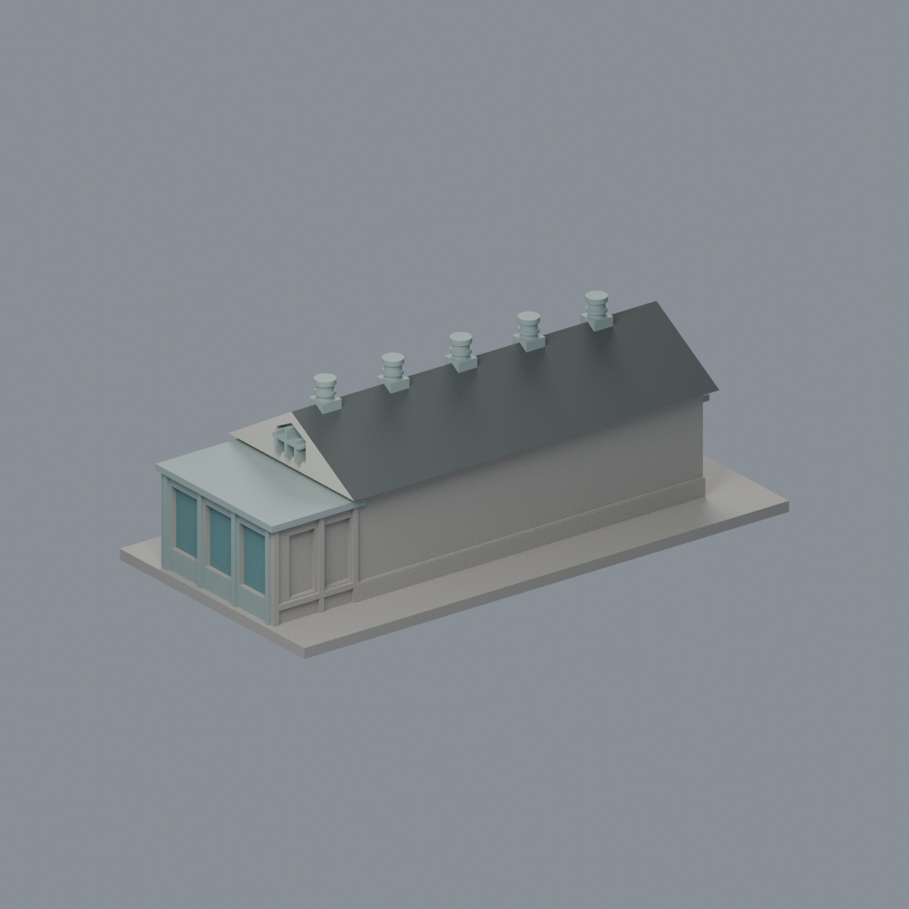

# 國立臺灣大學 地質標本館小屋

## 模型預覽

| 模型預覽 | 模型預覽 | 模型預覽 |
| :---: | :---: | :---: |
| 正面與來源支持區域  | 入口端有來源／反側牆中性  |  |

## 7 材質外觀版（2026-10-21）

[來源界線與四視角](appearance/README.md) · [表面色 3MF](appearance/ntucottage-appearance.3mf) · [可編輯場景](appearance/scene.blend)

依臺大2010與2014歷史照片限定乳白實牆、黃褐石腳、灰石窗眉、灰綠門廊窗梃與離散玻璃；深灰瓦屋面同系統延伸另一坡，未知反側牆中性。 原 STL 與歷史 QA 不變；這是外觀改善，不是新增幾何。原單色正面（歷史檔案留存，不作本頁預覽）／原單色背面（歷史檔案留存，不作本頁預覽）

官方索引位置參照 S22周邊，獨立小屋（沒有單獨代碼）。公開外觀近似模型，非測繪或BIM。

## 範圍與比例
這是地質科學系館後方1937小屋，與第九批S22多層地質前棟為不同實體建物；官方索引未單列小屋代碼，因此不能把兩件當兩個索引項目。2014理學院官方對角照片與2026原攝影者入口/另一端照片交叉比對。長牆分格、深度、五座圓柱天窗及玻璃前廊均目測，玻璃廊做實心凹窗表現，不重建內部；未見長面留白。

保留辨識特徵：切妻黑瓦屋頂形狀、五座圓柱屋脊天窗、兩端五邊形高窗、石砌基座概略、長側牆直立分格、一端兩直窗及眉簷、另一端低平玻璃門廊。瓦片與石材紋理省略，天窗帽加粗且封實。

尺寸 [150.0, 76.0, 53.400001525878906] mm，含底座最長150 mm。各館獨立比例，不是可拼接的共同尺度校園沙盤。尺寸、厚度、窗距均為照片目測和列印簡化，不是原建物實測。

## 列印
- 底座向下，毫米單位。參考起點：0.4 mm噴嘴、0.16–0.2 mm層高、3道外牆、15–20%填充。須依自己的切片器調整。
- 屋簷、端窗眉簷、天窗帽與低廊屋頂需檢視支撐。天窗柱直徑4.5mm、頂帽厚1.4mm，沒有中空細管；五邊形窗是附牆凹浮雕，不貫通屋內。
- 新增細浮雕名義最小約0.9 mm；這不是全模型最小壁厚的測量結果。零碎設備、文字招牌、樹木、電線及細緻裝飾沒有加入。
- 門窗背牆與實心量體避免隱藏內殼；實際填充由切片器決定。
- 未實際列印；未用PrusaSlicer、Cura等生成工具路徑。不宣稱無支撐或無風險可印。

## 驗證與檔案
- model.stl、model.obj；scene.blend是由實際STL匯入的可編修網格。
- build_model.py為獨立參數來源；Python3.12，依requirements.txt裝依賴後執行python build_model.py。
- Blender4.3.2：blender -b -t 2 -P render_preview.py。previews/front.png、rear.png、elevation.png均直接渲染交付STL。
- python validate_model.py：原始法向、水密、流形邊／頂點、單一連通表面、無分離封閉內殼、正體積、150mm、獨立重建SHA256及已儲存Blender/STL三角幾何一致性。結果validation.json。
- python check_layers.py：每0.2mm水平截面幾何檢查，共 267 層，所抽樣截面全部閉合。首層採z=0.071mm避免重合平面退化，非實際列印首層設定。
- layer-check.json另記向下超45度面積指標與各層輪廓；它不是切片器、最小壁厚測試或實體試印。閉合截面不保證擠出連續、橋接、支撐可拆、床面附著或局部細節可印。
- SHA256SUMS可核對檔案；更改參數後需重建、重繪、重驗證。

## 公開來源
查閱及圖像像素檢視：2026-10-13。來源照片未隨檔重新散布。
- [臺大博物館群官方小屋身份與屋頂特色](https://booking-campus-museum.ntu.edu.tw/museum_information.aspx?museum_id=4&pid=10020&uid=10020)
- [2014理學院官方介紹與外部對角照片](https://www.science.ntu.edu.tw/fiveyears/newsletter20/sample.html)
- [實際檢視2014官方另一端雙直窗及長牆](https://www.science.ntu.edu.tw/fiveyears/newsletter20/sample1.JPG)
- [2026原攝影者公開館外角度，僅取外部影像](https://www.tjcreativeculture.com/entry/台湾大学地質標本館)
- [實際檢視2026入口及長牆](https://cdn-ak.f.st-hatena.com/images/fotolife/T/TJCreativity-Culture/20260321/20260321161308.jpg)
- [實際檢視2026入口另一斜角與玻璃廊](https://cdn-ak.f.st-hatena.com/images/fotolife/T/TJCreativity-Culture/20260321/20260321161313.jpg)
- [2010官方入口外觀核對](https://homepage.ntu.edu.tw/~cpo/2010photo/S/S22/IMG_5854.JPG)
- [臺大官方建物索引，檢索標題2026-08-17](https://cpo.ntu.edu.tw/map/C_01_list.pdf)

照片版權屬原權利人；沒有轉授原建築設計或照片權利。不同拍攝日期不等於已核實目前全部外觀。

## 新增截面有效性與細節指標
- python check_valid_sections.py：0.2mm間距、z=0.071mm起，全部個別輪廓及組合Polygon必須closed/valid，不以修復吞掉自交；valid-sections.json。
- python thin_canonical_v2.py：每1mm的閉合有效截面作0.8mm參考opening，結果thin-feature-check.json。不是最小壁厚量測、真正切片或試印；尖端和曲線邊緣也會有損失。
- 本件54個薄篩截面，最大面積損失0.4107%，超過1%指標層0個。不能由此保證所有細節可印。
