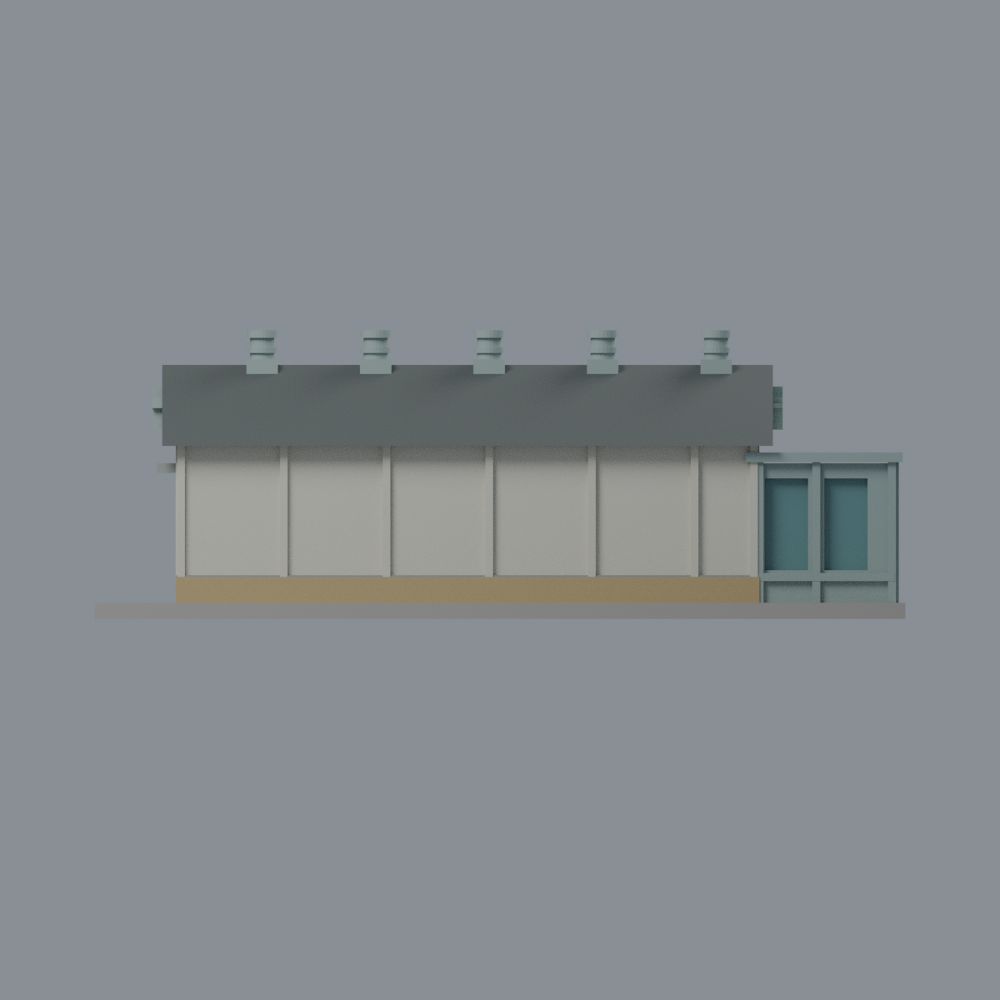
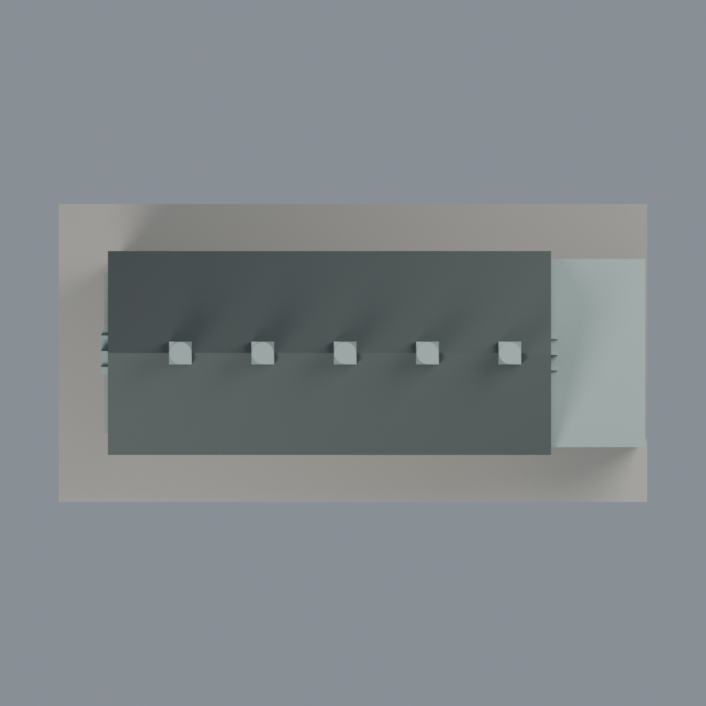

# 臺大地質標本館小屋：七材質外觀版

沿用原 **3,138 三角面／1,559 頂點**，不改原 STL 位元、座標、面序或幾何；這是既有模型外觀改版，不增加模型包數。

| 模型預覽 | 模型預覽 | 模型預覽 |
| :---: | :---: | :---: |
| 正面  | 入口端有來源／反側牆中性  |  |
|  |  |  |

[表面色 3MF](ntucottage-appearance.3mf) · [可編輯 Blender](scene.blend) · [材質色表](palette.json) · [逐面指派與依據](face-materials.json) · [原 STL](../model.stl)

## 來源與配色邊界

親自核對臺大理學院[第 20 期電子報](https://www.science.ntu.edu.tw/fiveyears/newsletter20/sample.html)（2014-07-02 出刊）[雙直窗端照片](https://www.science.ntu.edu.tw/fiveyears/newsletter20/sample1.JPG)，以及臺大官方[2010 入口端照片](https://homepage.ntu.edu.tw/~cpo/2010photo/S/S22/IMG_5854.JPG)。EXIF DateTime 分別為 2014-06-12 11:31:31、2010-10-09 15:49:25，**檔案時間不等於已獨立證實的拍攝日**。兩張是跨年歷史證據，不代表 2026 現況。[來源雜湊與覆核](qa/source-review.json)，原照不入包。

- 可見長側牆及兩端乳白灰抹面、基腳黃褐石色、腰帶與窗眉灰石；長牆大格全部是實牆，不當玻璃。
- 屋面深灰瓦色，不加瓦片、苔蘚或污漬；**同一瓦屋面材質有界延伸至未獨立拍清的另一坡**，不是每片屋面皆有直接影像。五個既有脊上通風構件採同系統淡灰綠金屬，不新增細構造。
- 端部五邊形窗與雙直窗只配原凹背玻璃，原凸窗梃灰綠；不新增標字或圖案。
- 入口端既有門廊前側與端面框灰綠、離散窗背灰青；原粗實體框與實景細構造不同，保留原輪廓。未見門廊反側與主屋反向長牆中性，不臆造細節。
- 原 STL、原建模腳本、場景及歷史 QA 不變，這是外觀改善，不新增模型數；沒有實體列印成功宣稱。

[原幾何與歷史來源限制](../README.zh-TW.md)

## 重建與核驗

安裝 [依賴](source/requirements.txt)，Blender 使用 4.3.2。由本資料夾上層提供原 model.stl：

1. `python appearance/source/build_appearance.py`
2. `python appearance/source/verify_exchange.py`
3. `blender -b -t 3 --python-exit-code 1 -P appearance/source/render_appearance.py`
4. `blender -b -t 3 --python-exit-code 1 -P appearance/source/verify_scene.py`

[獨立重建 ZIP](rebuild-source.zip)含原 STL、四支程式及依賴，不含第三方照片；不取代原建模腳本。[逐檔 SHA256](SHA256SUMS)

[交換／拓撲 QA](qa/exchange-validation.json)核對原座標與面序、全部面材質、單連通、有向水密邊、頂點 link 單環、正體積與零退化／重複面；lib3mf 嚴格讀取零警告，實際編輯單材質再存讀，其他材質及面指派不變。SDK 六位小數量化誤差另列。

[Blender 存讀與編輯](qa/scene-validation.json) · [渲染記錄](qa/render-manifest.json) · [獨立重建](qa/rebuild-validation.json)

## 製造限制照舊

尺寸仍為 150 × 76 × 53.4 mm；原 STL、建模程式、場景及歷史 QA 保留。原層檢與薄特徵檢查本次未重跑，不能由材質 QA 代替。

3MF 是同一網格的表面色，不是各材質各自封閉的分色實體、切片專案、噴頭映射或 G-code。切片 GUI、多材料路徑與實體列印未測；柱頭、屋簷、窗框及薄邊仍須評估材料、支撐及拆除風險，沒有保證可印或免支撐。
