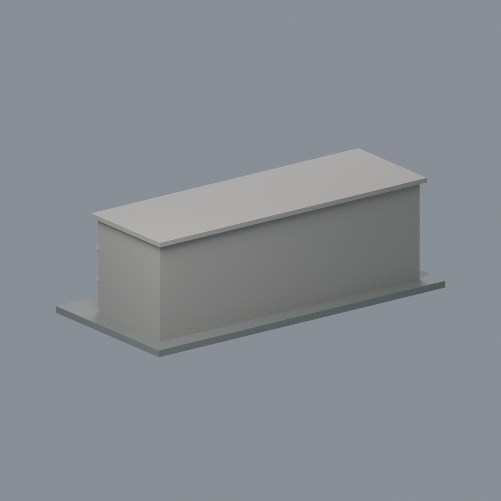
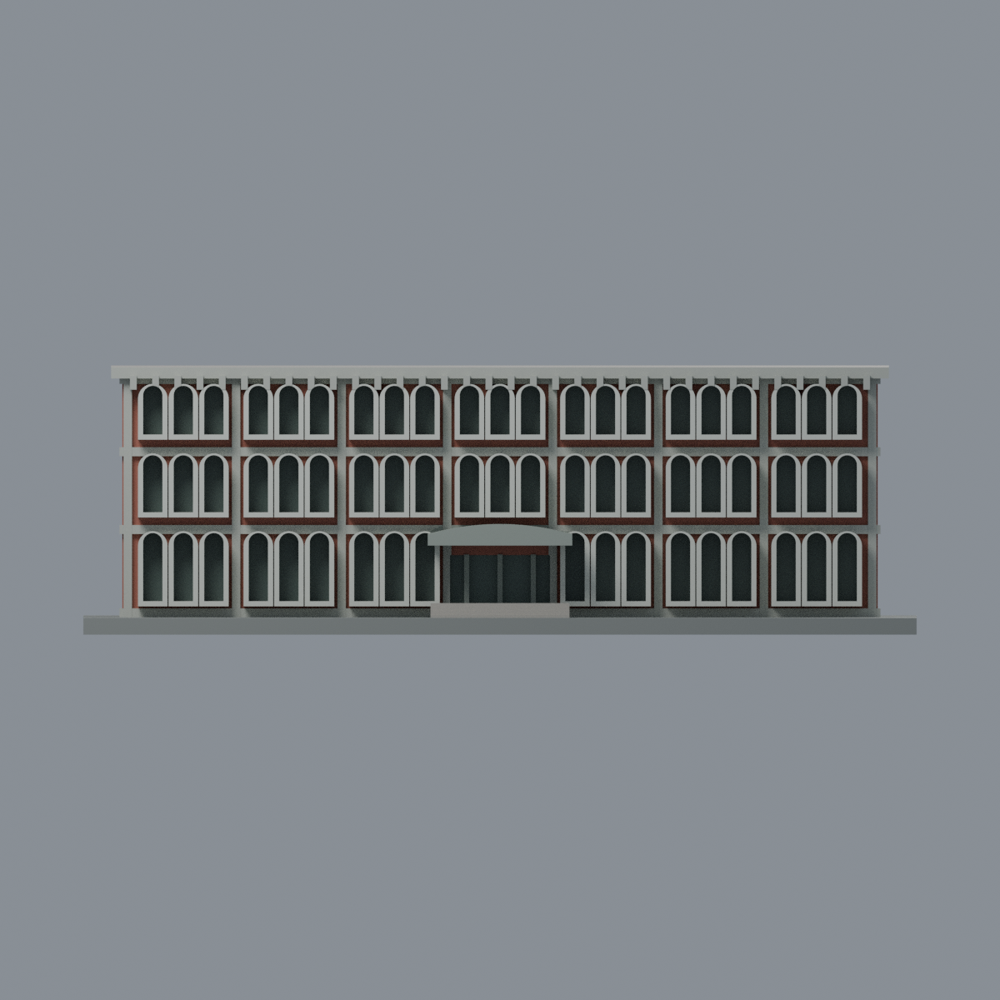
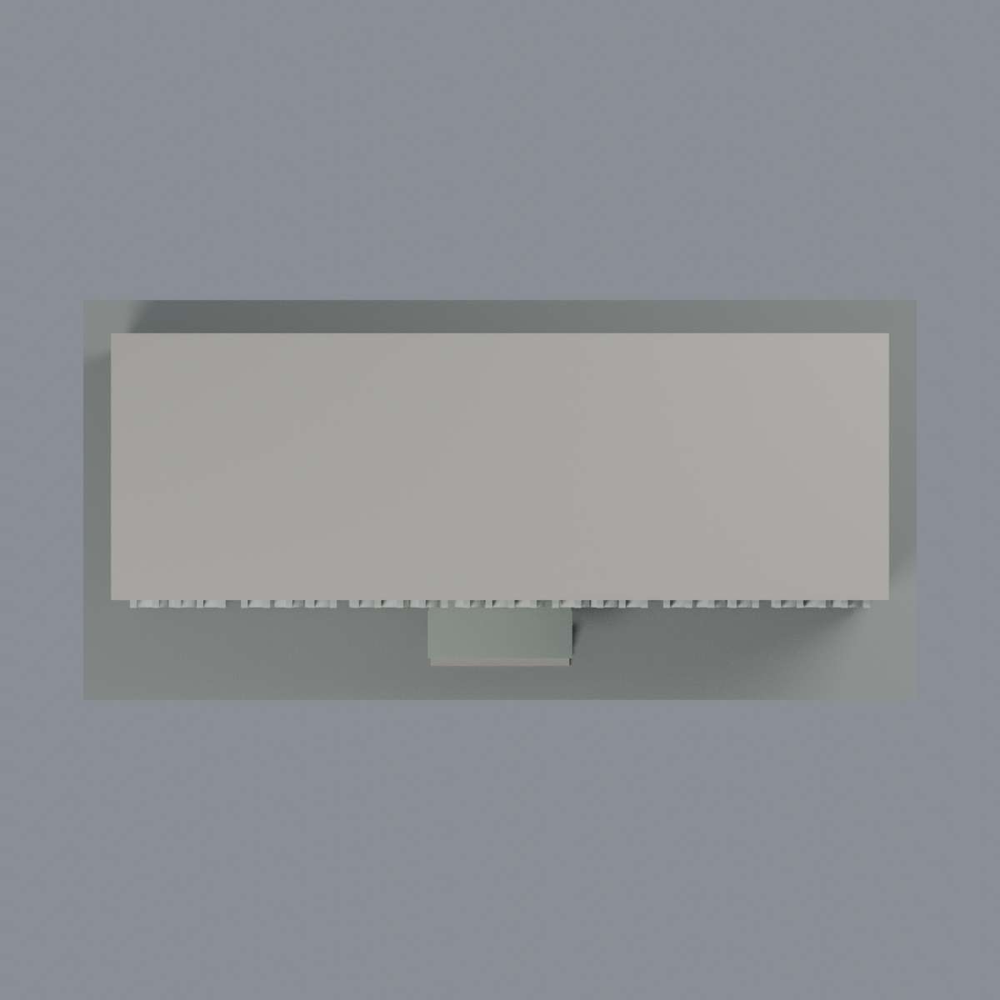

# 臺大地質科學館三層前棟：七材質外觀版

沿用原 **15,292 三角面／7,648 頂點**，不改原 STL 位元、座標、面序或幾何；這是既有模型外觀改版，不增加模型包數。

| 模型預覽 | 模型預覽 | 模型預覽 |
| :---: | :---: | :---: |
| 正面  | 背面保持中性  |  |
|  |  |  |

[表面色 3MF](geology-appearance.3mf) · [可編輯 Blender](scene.blend) · [材質色表](palette.json) · [逐面指派與依據](face-materials.json) · [原 STL](../model.stl)

## 來源與配色邊界

親自查看臺大 [校園建築影像索引](https://homepage.ntu.edu.tw/~cpo/about_campus_archeitectureimage_S.html) 的 [S22 正面](https://homepage.ntu.edu.tw/~cpo/2010photo/S/S22/IMG_5857.JPG) 與 [入口](https://homepage.ntu.edu.tw/~cpo/2010photo/S/S22/IMG_5858.JPG)。內嵌 EXIF DateTimeOriginal 為 **2010-10-09**，時間未獨立核實；這是歷史影像，不宣稱 2026 現況。照片不隨包散布。

- 只配色原三層前棟，並不含舊標本館、後方建築群或校園環境。正面磚填充牆為紅棕色，原垂直與水平結構帶為淡灰色。
- 原三排深拱罩外緣、側面與內緣為偏白預鑄構件代理；只把原凹格後壁設為低彩度玻璃，**不能把深拱罩內緣染成玻璃或黑洞**。窗罩形狀與厚化程度完全保留原近似。
- 原中央曲線雨遮灰色、原入口窗梃灰色，原門凹背低彩度玻璃；沒有增加門把、門牌或新的玻璃分格。原屋緣齒狀構件淡灰色。
- 背面、兩短端及未見屋頂平面保持中性；不以正面窗列推定背面，也不新增屋頂設備。原門階中性、底板只是展示底板。
- 灰白／磚／玻璃都是未校準視覺分類，並非材料化驗或逐塊實測；樹影、冷氣與污漬不烘焙進表面色。所有尺寸、窗數和幾何仍為原模型近似。

[原幾何與來源界線](../README.md) · [本次來源覆核](qa/source-review.json)

## 重建與核驗

安裝 [依賴](source/requirements.txt)，Blender 使用 4.3.2。由本資料夾上層提供原 model.stl：

1. `python appearance/source/build_appearance.py`
2. `python appearance/source/verify_exchange.py`
3. `blender -b -t 3 --python-exit-code 1 -P appearance/source/render_appearance.py`
4. `blender -b -t 3 --python-exit-code 1 -P appearance/source/verify_scene.py`

[獨立重建 ZIP](rebuild-source.zip)含原 STL、四支程式及依賴，不含第三方照片；不取代原建模腳本。[逐檔 SHA256](SHA256SUMS)

[交換／拓撲 QA](qa/exchange-validation.json)核對原座標與面序、全部面材質、單連通、有向水密邊、頂點 link 單環、正體積與零退化／重複面；lib3mf 嚴格讀取零警告，實際編輯單材質再存讀，其他材質及面指派不變。SDK 六位小數量化誤差另列。

[Blender 存讀與編輯](qa/scene-validation.json) · [渲染記錄](qa/render-manifest.json) · [獨立重建](qa/rebuild-validation.json)

## 製造限制照舊

尺寸仍為 150 × 72 × 48 mm；原 STL、建模程式、場景及歷史 QA 保留。原層檢與薄特徵檢查本次未重跑，不能由材質 QA 代替。

3MF 是同一網格的表面色，不是七個封閉分色實體、切片專案、噴頭映射或 G-code。切片 GUI、多材料路徑與實體列印未測；柱頭、屋簷、窗框及薄邊仍須評估材料、支撐及拆除風險，沒有保證可印或免支撐。
