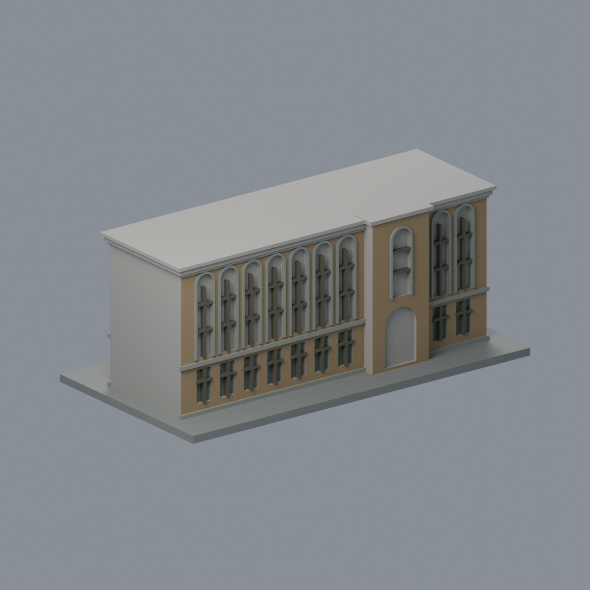
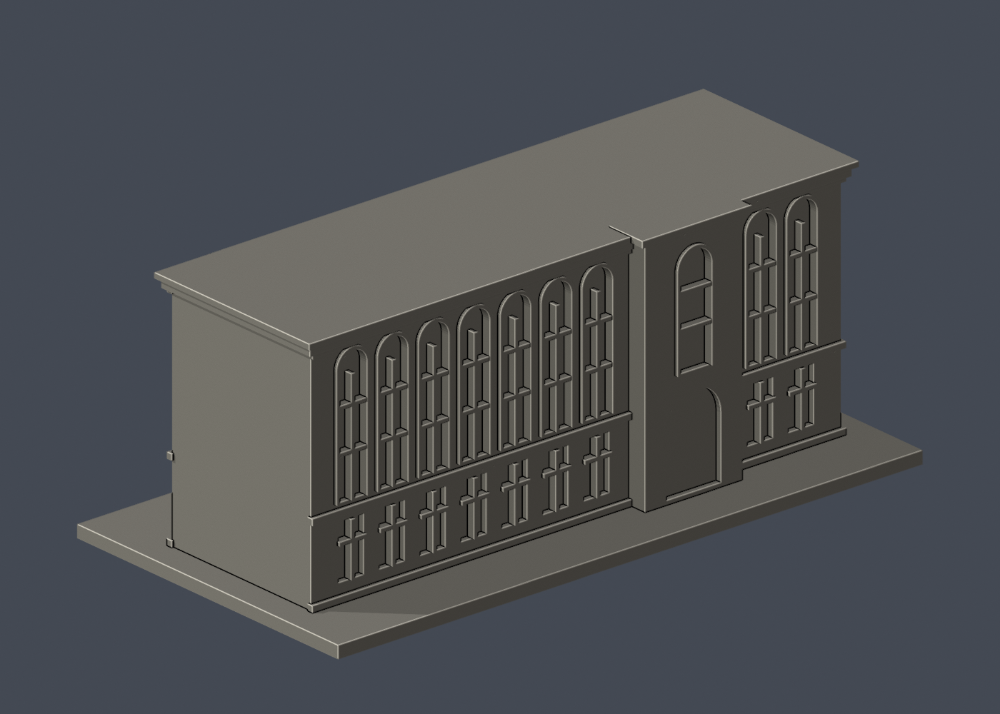

# 國立臺灣大學 植物標本館（主館）

[返回校區圖鑑](../../README.md) · [返回臺大總圖鑑](../../../README.md)

## 實際 STL 正面與背面

## 最新七材質外觀版（2026-10-20）

| 模型預覽 | 模型預覽 | 模型預覽 |
| :---: | :---: | :---: |
| 正面原幾何配色  | 庭園面已見區配色；高窗背與未知面中性  |  |

[來源界線與四視角](appearance/README.md) · [表面色 3MF](appearance/herbarium-appearance.3mf) · [可編輯場景](appearance/scene.blend)

依街側與庭園來源登錄赭棕磚、原灰石拱框／層帶、暗窗梃及木門。**高拱窗凹背因原三角面跨越實心石裙／玻璃分界，整片保持中性，並非實景材質還原**；不切面或畫假對角分界。僅下層小窗背配玻璃，屋頂與窄端中性。原STL與歷史QA不變，不是新增幾何。[原單色正面](previews/front.png)／[原單色背面](previews/rear.png)

| 模型預覽 | 模型預覽 | 模型預覽 |
| :---: | :---: | :---: |
| 原單色正面  | 原單色背面  |  |

[下載 STL](model.stl) · [Blender 場景](scene.blend) · [參數化來源](build_model.py) · [驗證結果](validation.json)

[新增34件列印幾何補查與細節警示](../../../qa/printability-20261013/README.zh-TW.md)

官方索引代碼 M22。公開外觀近似模型，非測繪或BIM。

## 範圍與比例
主館長矩形外部量體，以街側入口照片與庭園側照片交叉比對；不包含附屬溫室、獨立烤房與連接拱廊。長窗數量、窗距、進深及庭園側凸部位置為目測簡化，屋簷後實際屋面無充分證據，留作低平實心頂，不虛構斜瓦屋頂；狹側留白。

保留辨識特徵：跨較高牆面的連續細長圓拱窗框、清楚拱頂與簡化兩道橫窗格、下層矩形窗、粗窗台與細直線框、中央門口與薄雨棚、庭園側突出拱門量體及屋頂簷線。窗框加厚，鐵窗、冷氣與庭園植物不加入。

尺寸 [150.0, 79.0, 61.5] mm，含底座最長150 mm。各館獨立比例，不是可拼接的共同尺度校園沙盤。尺寸、厚度、窗距均為照片目測和列印簡化，不是原建物實測。

## 列印
- 底座向下，毫米單位。參考起點：0.4 mm噴嘴、0.16–0.2 mm層高、3道外牆、15–20%填充。須依自己的切片器調整。
- 窗橫框、入口雨棚與屋簷具有懸垂，應局部支撐；細長窗格約0.8mm起，切片時要檢視擠出線是否可成形。
- 新增細浮雕名義最小約0.8 mm；這不是全模型最小壁厚的測量結果。零碎設備、文字招牌、樹木、電線及細緻裝飾沒有加入。
- 門窗背牆與實心量體避免隱藏內殼；實際填充由切片器決定。
- 未實際列印；未用PrusaSlicer、Cura等生成工具路徑。不宣稱無支撐或無風險可印。

## 驗證與檔案
- model.stl、model.obj；scene.blend是由實際STL匯入的可編修網格。
- build_model.py為獨立參數來源；Python3.12，依requirements.txt裝依賴後執行python build_model.py。
- Blender4.3.2：blender -b -t 2 -P render_preview.py。previews/front.png、rear.png、elevation.png均直接渲染交付STL。
- python validate_model.py：原始法向、水密、流形邊／頂點、單一連通表面、無分離封閉內殼、正體積、150mm、獨立重建SHA256及已儲存Blender/STL三角幾何一致性。結果validation.json。
- python check_layers.py：每0.2mm水平截面幾何檢查，共 308 層，所抽樣截面全部閉合。首層採z=0.071mm避免重合平面退化，非實際列印首層設定。
- layer-check.json另記向下超45度面積指標與各層輪廓；它不是切片器、最小壁厚測試或實體試印。閉合截面不保證擠出連續、橋接、支撐可拆、床面附著或局部細節可印。
- SHA256SUMS可核對檔案；更改參數後需重建、重繪、重驗證。

## 公開來源
查閱及圖像像素檢視：2026-10-13。來源照片未隨檔重新散布。
- [臺大官方館舍身份](https://booking-campus-museum.ntu.edu.tw/museum_information.aspx?museum_id=8&pid=10020&uid=10020)
- [2024 Open House Taipei：臺大植物標本館](https://www.opentaipei.org/house/2024CNTUH)
- [實際檢視2024街側入口與上層拱窗](https://www.opentaipei.org/photodata/OP2024_014_001.webp)
- [臺北市政府公開街側外觀照片，實際檢視](https://www-ws.gov.taipei/001/Upload/851/relpic/64106/9440316/09881886-3aba-49e0-ae22-205833b14cc9.jpg)
- [中央社2018街側斜角照片，實際檢視](https://imgcdn.cna.com.tw/Jpn/WebJpnPhotos/800/2018/20180814/20180814184721.jpg)
- [原攝影者公開外觀系列，僅取館外影像](https://www.wilhelmchang.com/zh/ntu-herbarium/)
- [實際檢視庭園側長立面與凸出部分](https://photos.smugmug.com/photos/i-rCxTDbX/0/NSz7prZZH87WLLGnGm595zc6nvv8XsCtkCrCDPJzn/XL/i-rCxTDbX-XL.jpg)
- [實際檢視另一方向庭園側外觀](https://photos.smugmug.com/photos/i-DMnTXsV/0/MdsPFSGR7wTwvdfFv5whFMTz9P9bxBNBbtKfn5khT/XL/i-DMnTXsV-XL.jpg)
- [臺大官方建物索引，檢索標題2026-08-17](https://cpo.ntu.edu.tw/map/C_01_list.pdf)

照片版權屬原權利人；沒有轉授原建築設計或照片權利。不同拍攝日期不等於已核實目前全部外觀。
