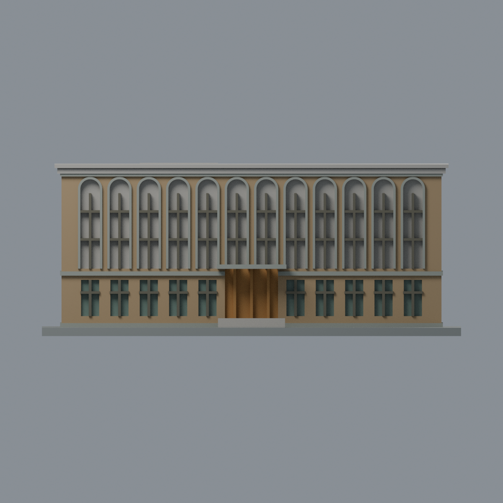
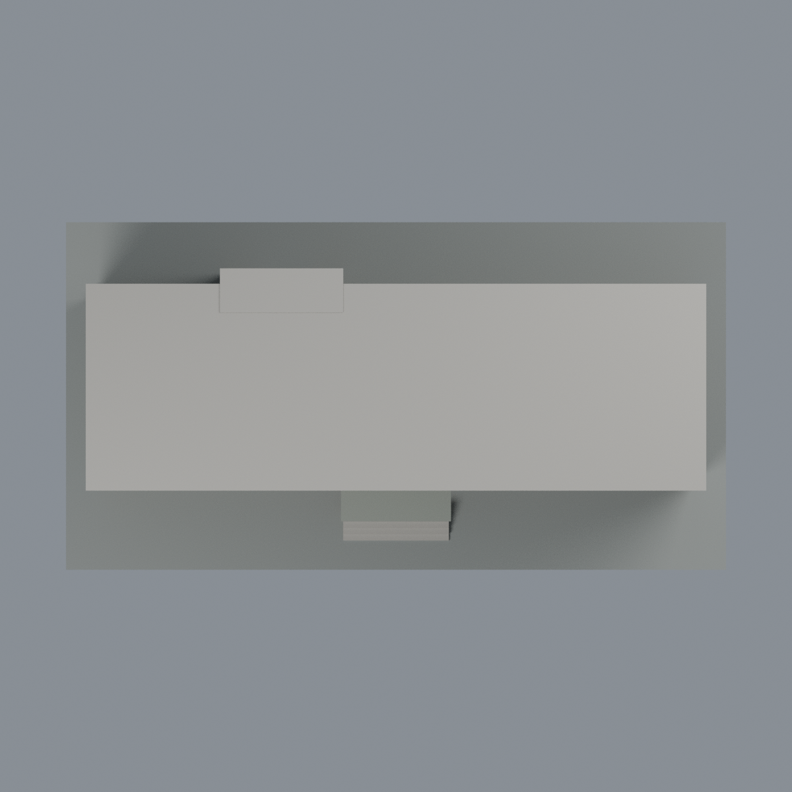

# 臺大植物標本館主館：七材質外觀版

沿用原 **13,176 三角面／6,300 頂點**，不改原 STL 位元、座標、面序或幾何；這是既有模型外觀改版，不增加模型包數。

| 正面 | 來源支持的庭園長牆／高窗凹背中性 |
|---|---|
|  |  |
|  |  |

[表面色 3MF](herbarium-appearance.3mf) · [可編輯 Blender](scene.blend) · [材質色表](palette.json) · [逐面指派與依據](face-materials.json) · [原 STL](../model.stl)

## 來源與配色邊界

親自查看 [Open House 2024 館舍頁](https://www.opentaipei.org/house/2024CNTUH) 的 [入口照片](https://www.opentaipei.org/photodata/OP2024_014_001.webp)、[臺北市官方街側照片](https://www-ws.gov.taipei/001/Upload/851/relpic/64106/9440316/09881886-3aba-49e0-ae22-205833b14cc9.jpg)，以及 [原攝影者 Wilhelm Chang 的庭園側照片](https://www.wilhelmchang.com/zh/ntu-herbarium/)。活動年份不等於拍攝日期，影像時間未獨立核實，不宣稱 2026 現況；原照片不隨包散布。

- 只登錄原主館，不含溫室、乾燥室及連廊。可見街側與庭園長牆為低彩度赭棕磚色；不把庭園照片夕陽映成亮橘牆色。原拱框、層帶及雨遮為灰色石／混凝土代理。
- **高拱窗整片凹背保留中性色，並非實景材質還原。** 實景下段為實心灰石裙板、上段才是玻璃；原凹背三角面由 z24 跨到約 z53，缺少可分離界線。不切分 STL、不畫假對角線，也不把石裙染成整片玻璃，因此本版不宣稱復原高窗玻璃／石裙分界。
- 可分離原高窗橫梃／直梃為暗棕灰色，原直梃下伸與實景石裙不同仍保留、不是新加實景窗格。下層小矩形窗的原凹背才使用低彩度玻璃。原簡化分格不新增鐵網、開窗角度或窗簾。
- 原街側主入口凹背與三支梃條為暖木色代理；照片門上半有玻璃，但原背面沒有可靠分區，因此不捏造玻璃分界或招牌文字。原門階中性。
- 庭園原突出入口前面磚色、上拱框灰色，門凹背中性而非藍玻璃；原突出量及高度仍屬歷史幾何近似，不藉顏色宣稱精確復原。
- 屋頂平面、兩窄端與未登錄突出側面中性；照片只露瓦緣，不足推定原簡化平頂的實際材料。低基座只配既有細帶，不新增整條石基高度。
- 色值未校準，樹影、日照斑、冷氣、告示、自行車、藤蔓及庭園不納入。展示底板不是現地地坪；所有原幾何與歷史 QA 保留。

[原幾何與來源界線](../README.md) · [本次來源覆核](qa/source-review.json)

## 重建與核驗

安裝 [依賴](source/requirements.txt)，Blender 使用 4.3.2。由本資料夾上層提供原 model.stl：

1. `python appearance/source/build_appearance.py`
2. `python appearance/source/verify_exchange.py`
3. `blender -b -t 3 --python-exit-code 1 -P appearance/source/render_appearance.py`
4. `blender -b -t 3 --python-exit-code 1 -P appearance/source/verify_scene.py`

[獨立重建 ZIP](rebuild-source.zip)含原 STL、四支程式及依賴，不含第三方照片；不取代原建模腳本。[逐檔 SHA256](SHA256SUMS)

[交換／拓撲 QA](qa/exchange-validation.json)核對原座標與面序、全部面材質、單連通、有向水密邊、頂點 link 單環、正體積與零退化／重複面；lib3mf 嚴格讀取零警告，實際編輯單材質再存讀，其他材質及面指派不變。SDK 六位小數量化誤差另列。

[Blender 存讀與編輯](qa/scene-validation.json) · [渲染記錄](qa/render-manifest.json) · [獨立重建](qa/rebuild-validation.json)

## 製造限制照舊

尺寸仍為 150 × 79 × 61.5 mm；原 STL、建模程式、場景及歷史 QA 保留。原層檢與薄特徵檢查本次未重跑，不能由材質 QA 代替。

3MF 是同一網格的表面色，不是七個封閉分色實體、切片專案、噴頭映射或 G-code。切片 GUI、多材料路徑與實體列印未測；柱頭、屋簷、窗框及薄邊仍須評估材料、支撐及拆除風險，沒有保證可印或免支撐。
