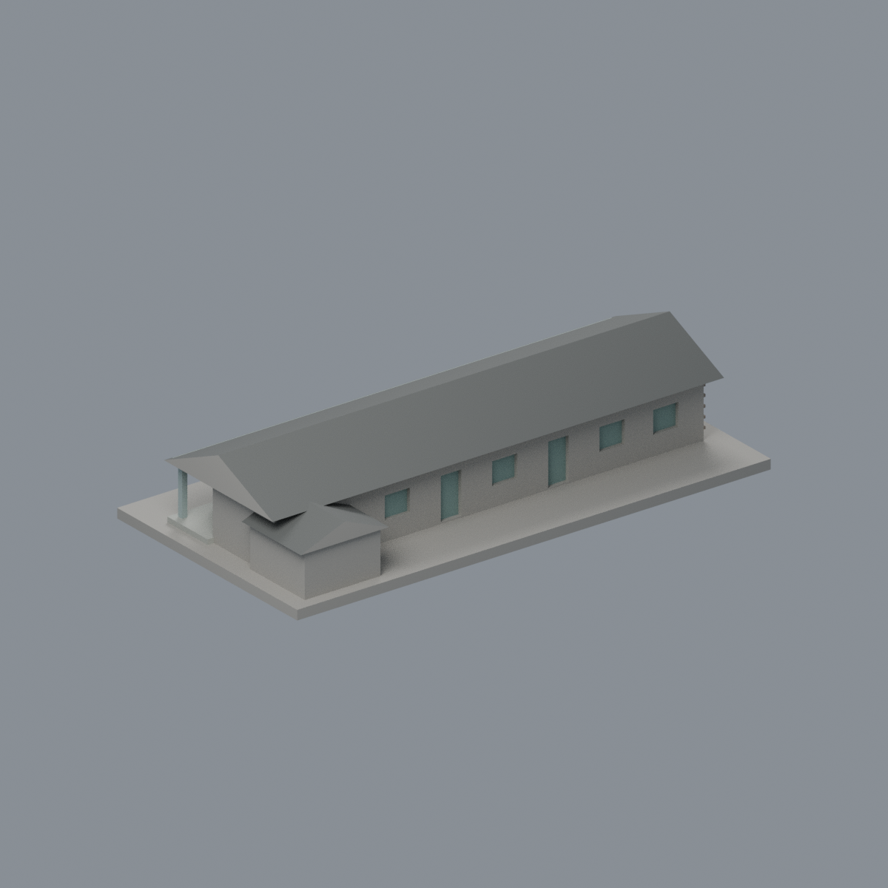
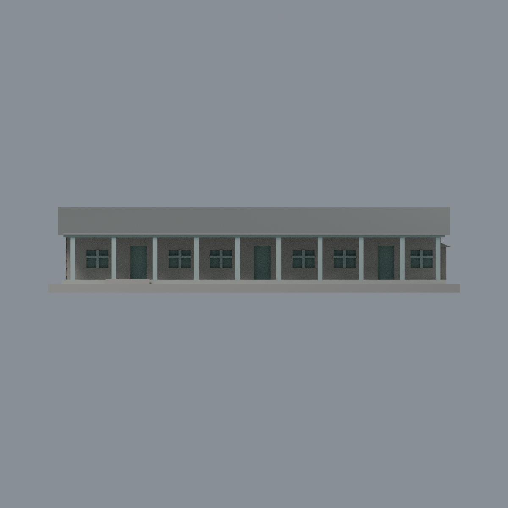
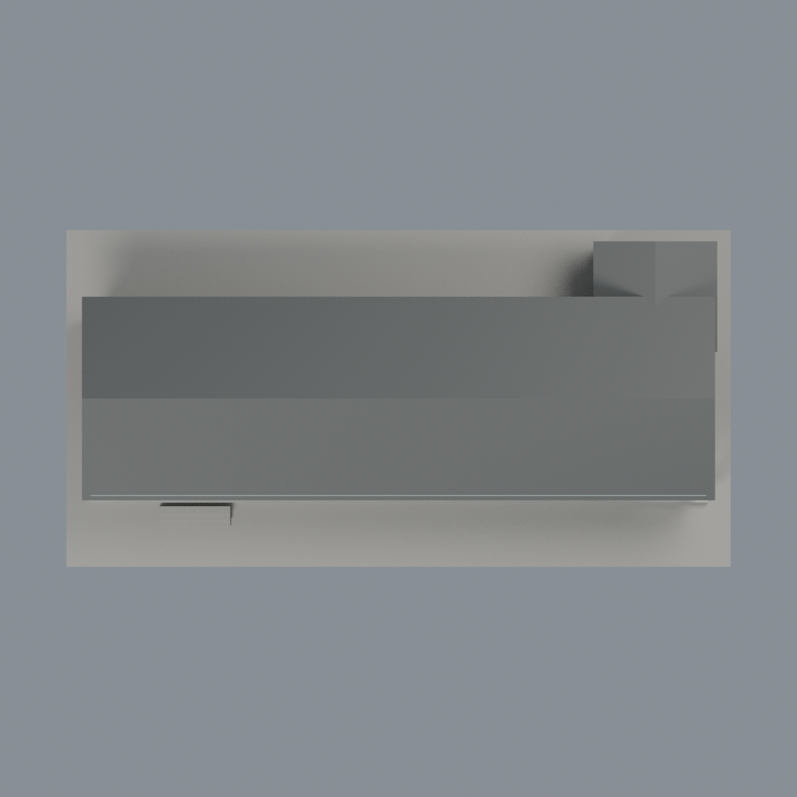

# 臺大磯永吉紀念室修繕前：六材質外觀版

沿用原 **1,730 三角面／811 頂點**，不改原 STL 位元、座標、面序或幾何；這是既有模型外觀改版，不增加模型包數。

| 模型預覽 | 模型預覽 | 模型預覽 |
| :---: | :---: | :---: |
| 正面  | 來源支持後窗／混合實牆中性  |  |
|  |  |  |

[表面色 3MF](ntuiso-appearance.3mf) · [可編輯 Blender](scene.blend) · [材質色表](palette.json) · [逐面指派與依據](face-materials.json) · [原 STL](../model.stl)

## 來源與配色邊界

親自核對臺大校園博物館[正面與左山牆照片](https://booking-campus-museum.ntu.edu.tw/upload/museum/ac709a52-851f-4f11-8fec-729b9c8e7b38.jpg)及臺大總務處[反側照片](https://ga.ntu.edu.tw/upload/cont_att/0961381d-37b5-42fe-9995-582275dfc664.jpg)，兩張完整解碼，拍攝日期不詳，發布／頁面日期不當拍攝日期。[來源覆核與雜湊](qa/source-review.json)。**沿用原包「修繕前」歷史範圍，不代表 2026 修繕完成或現況**，第三方原照不入包。

- 兩張照片支持主屋兩坡與小附屋瓦頂的炭灰材料，不新增瓦片紋理；山牆屋頂端三角包含原簡化出簷部分，維持中性，不把整片當木牆或斜瓦。
- 左端原粗格凸紋灰褐，代表風化木板，**不是磚牆**；原白灰藍廊柱、梁及前窗粗框採淡藍灰，原廊臺灰石色，不補照片斜撐或木紋。
- 前／後各自照片可辨的離散窗與門凹背採灰綠代理，不宣稱內部透明或精準門窗材質。後側門窗有來源，不因預設「後面未知」而忽略已核實證據。
- **前實牆混合深木與淺塗層、後實牆混合淡綠灰木板與紅褐直木條，但原面未按材料分開；兩片實牆保持中性**，不整牆染棕或新增棕線。附屋牆被植物遮擋，未知部分同樣中性。
- 原幾何、原 STL 面序／位元、原場景與歷史 QA 不變，配色不增模型數，也不宣稱實體列印成功。

[原幾何與歷史來源限制](../README.zh-TW.md)

## 重建與核驗

安裝 [依賴](source/requirements.txt)，Blender 使用 4.3.2。由本資料夾上層提供原 model.stl：

1. `python appearance/source/build_appearance.py`
2. `python appearance/source/verify_exchange.py`
3. `blender -b -t 3 --python-exit-code 1 -P appearance/source/render_appearance.py`
4. `blender -b -t 3 --python-exit-code 1 -P appearance/source/verify_scene.py`

[獨立重建 ZIP](rebuild-source.zip)含原 STL、四支程式及依賴，不含第三方照片；不取代原建模腳本。[逐檔 SHA256](SHA256SUMS)

[交換／拓撲 QA](qa/exchange-validation.json)核對原座標與面序、全部面材質、單連通、有向水密邊、頂點 link 單環、正體積與零退化／重複面；lib3mf 嚴格讀取零警告，實際編輯單材質再存讀，其他材質及面指派不變。SDK 六位小數量化誤差另列。

[Blender 存讀與編輯](qa/scene-validation.json) · [渲染記錄](qa/render-manifest.json) · [獨立重建](qa/rebuild-validation.json)

## 製造限制照舊

尺寸仍為 150 × 76 × 31 mm；原 STL、建模程式、場景及歷史 QA 保留。原層檢與薄特徵檢查本次未重跑，不能由材質 QA 代替。

3MF 是同一網格的表面色，不是各材質各自封閉的分色實體、切片專案、噴頭映射或 G-code。切片 GUI、多材料路徑與實體列印未測；柱頭、屋簷、窗框及薄邊仍須評估材料、支撐及拆除風險，沒有保證可印或免支撐。
